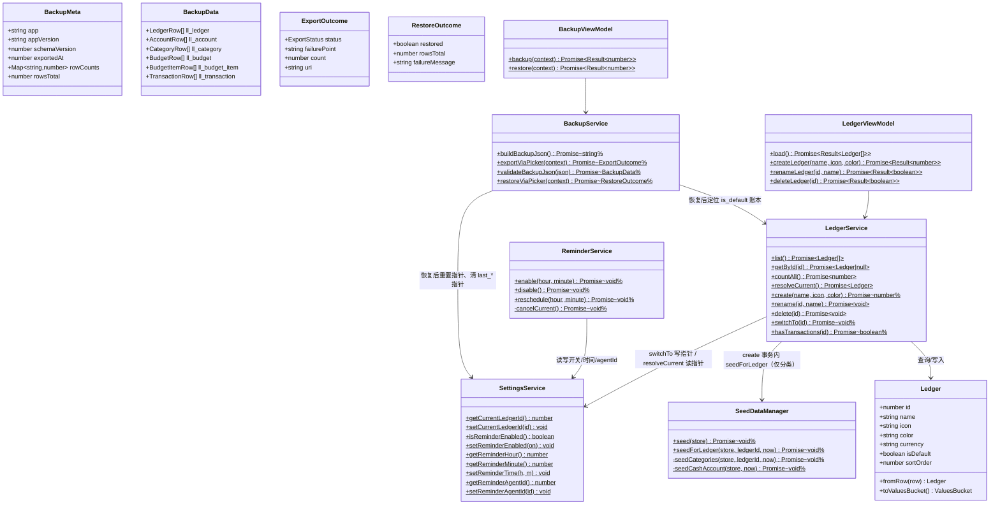
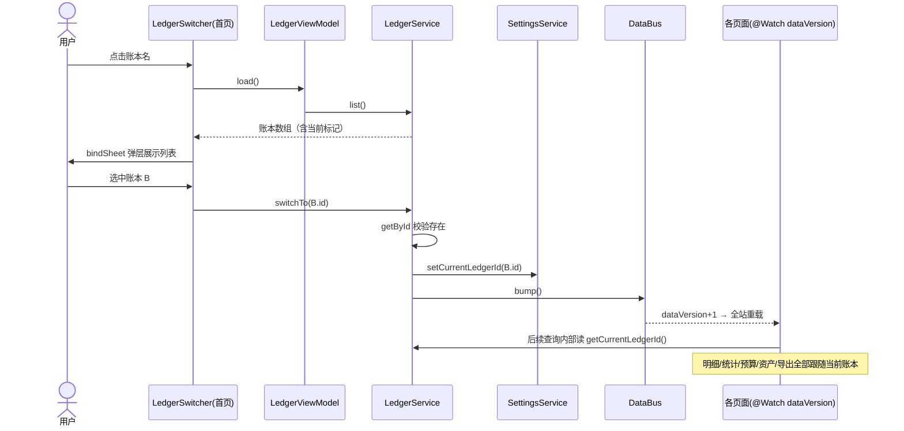
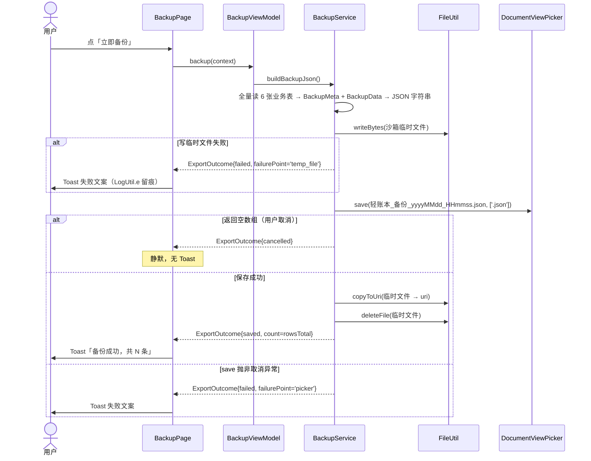
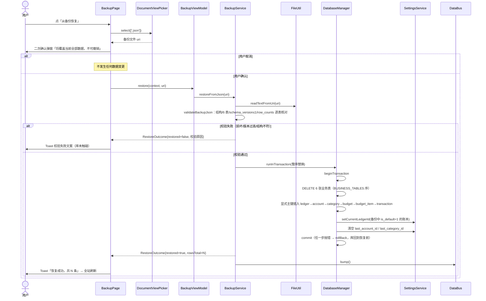
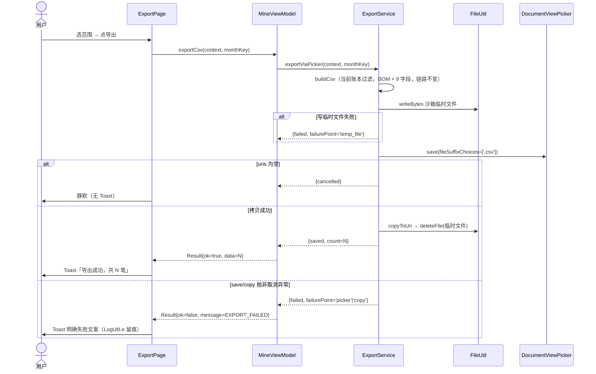
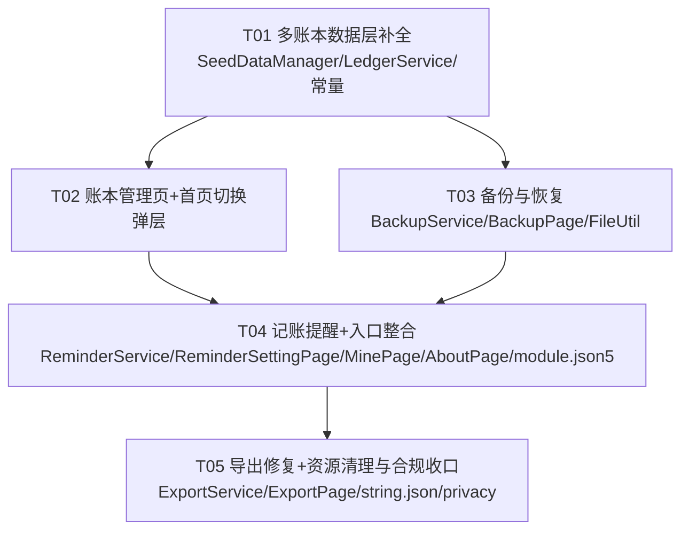

# 轻账本 · v1.1 增量架构设计

> 状态说明（2026-09-13）：本文是 v1.1 实施前的架构设计与任务拆分记录，并非当前代码状态说明。
> 第 1.0 节中关于功能“不存在”或“不可编译”的描述已经过期；应以 `entry/src/main/ets` 源码、构建结果和 PRD 验收记录为准。

| 项目 | 内容 |
|---|---|
| 文档版本 | v1.1 增量（基于 docs/ARCHITECTURE.md 架构脉络） |
| 需求输入 | docs/PRD-v1.1.md（F-10.1 ~ F-10.8，唯一需求来源） |
| 编写人 | 高见远（Architect） |
| 技术基线 | HarmonyOS NEXT / Stage / ArkTS，纯本地 RDB + Preferences，零第三方 SDK |

---

## 1. 实现方案与关键裁决

### 1.0 代码勘察结论（对齐现状，避免重复造轮子）

v1.1 的多账本**数据层底座已提前铺好**，本次设计在此基础上收口，而非从零搭建：

- `SettingsService` 已有 `getCurrentLedgerId()/setCurrentLedgerId()`（Preferences 键 `current_ledger_id`）；
- `AccountService / CategoryService / BudgetService / StatsService / TransactionService / ExportService` 的查询**已全部**改为 `SettingsService.getCurrentLedgerId()` 动态过滤——v1.0「全工程用 DEFAULT_LEDGER_ID 常量」的现状描述已过时，改造面比 PRD 预估小得多；
- `LedgerService`（list/getById/create/rename/delete/resolveCurrent/hasTransactions）已存在，但存在 **3 个缺口**：① 调用了不存在的 `SeedDataManager.seedForLedger`（当前不可编译）；② `create(name)` 缺 icon/color 参数、缺名称长度与重名校验（PRD F-10.3 规则 2）；③ 文件头注释宣称「播种分类+现金账户」，与 PRD 5.2 裁决「仅预置分类」冲突；
- `SeedDataManager.seed()` 内部调用 `seedCategories(store, now)` 与其三参签名 `(store, ledgerId, now)` 错位，同样不可编译；
- `BackupService / ReminderService / LedgerManagePage / BackupPage / ReminderSettingPage` 均不存在，为本版纯新增。

### 1.1 关键裁决表

| # | 裁决点 | 结论 | 理由 |
|---|---|---|---|
| R1 | 当前账本 id 持久化 | **SettingsService（Preferences）**，键 `current_ledger_id`（已有） | 冷启动必须恢复上次账本（F-10.4 规则 1），AppStorage 是内存态、进程结束即失；且 Preferences 读取为同步接口，service 层查询条件可直接同步取值，与既有 `LAST_ACCOUNT_ID` 等运行态同构 |
| R2 | 动态账本取值策略（方法加参数 vs service 内部读当前账本） | **service 内部读 `SettingsService.getCurrentLedgerId()`**（二选一之后者） | ① 全部既有 service 方法签名零改动，Viewmodel/Page 调用点零波及；② 「写库也归当前账本」是全局语义而非逐调用语义，收在 service 内层可杜绝漏传；③ 唯一例外是 `LedgerService` 自身（操作的是指定 id 的账本）与备份服务（跨账本全量），天然不受影响。**禁止**再给业务方法追加 `ledgerId` 参数 |
| R3 | 新账本预置 | 复用 `SeedDataManager`，新增公开方法 `seedForLedger(store, ledgerId, now)`，**仅播种 17 条系统分类（11 支出 + 6 收入），不预置账户**；在 `LedgerService.create` 的同一事务内调用 | PRD 5.2 默认裁决；复用 `EXPENSE/INCOME_CATEGORY_PRESETS` 单一真相源；同事务保证「建完即可记账」的原子性 |
| R4 | 首页切换器形态 | **首页 `LedgerSwitcher` 升级为半模态弹层选择器（bindSheet）**：账本列表 + 选中态 + 底部「管理账本」入口；创建/重命名/删除等管理动作收进独立页 `LedgerManagePage` | 切换是高频轻操作，弹层一步到位（F-10.4「一键切换」）；管理含表单与二次确认，放弹层过重且易误触；两形态各取所长，也同时满足 MinePage 的「账本管理」入口诉求 |
| R5 | 备份文件格式 | 明文 JSON、UTF-8，结构见 §1.3；经 `DocumentViewPicker.save`（`fileSuffixChoices: ['.json']`）落盘，文件名 `轻账本_备份_yyyyMMdd_HHmmss.json` | PRD 5.3 裁决；Picker 免权限链路与导出 CSV 同构 |
| R6 | 恢复流程 | 校验（沙箱内解析，不碰库）→ 通过后 `runInTransaction` 内：清空 6 张业务表 → 按依赖顺序显式主键插入 → 重置当前账本指针；任何一步抛错由 `runInTransaction` 统一回滚 | `DatabaseManager.runInTransaction` 已提供 begin/commit/rollBack 包装，直接复用；显式主键插入保证流水 `account_id/category_id` 等跨表引用不错位 |
| R7 | 恢复后的指针重置 | 当前账本 id 重置为备份中 `is_default=1` 的账本；**同时清空 `last_account_id` / `last_category_id`**（记账页默认账户/分类指针） | PRD 5.6；两枚旧指针若不清空，恢复后首次进记账页会引用已不存在的 id |
| R8 | 导出三态语义 | `ExportOutcome` 增加显式状态字段：`saved / cancelled / failed` + `failurePoint`（`'temp_file' | 'picker' | 'copy'`）；用户取消 = save 返回空数组，**不再**走 catch 混淆；`fileSuffixChoices` 修正为 `['.csv']` | 三态必须在数据结构上可区分，不能靠布尔值两态凑；`LogUtil.e` 按 failurePoint 留排查痕迹（F-10.2 验收 3） |
| R9 | `CURRENT_SCHEMA_VERSION` 是否 +1 | **不 +1，保持 1，零迁移** | `ll_ledger` 表、全部业务表的 `ledger_id` 列及 3 个账本相关索引均在 v1 DDL 中已建（已核实 `SchemaConstants.ets`）；本版无任何表结构变更。备份 meta 中的 `schema_version` 记 1，恢复校验规则为 `备份 schema_version ≤ CURRENT_SCHEMA_VERSION(1)` |
| R10 | 提醒实现 | `ReminderService` 封装 `reminderAgentManager`（`@kit.BackgroundTasksKit`）：开启/改时间 → 先 cancel 旧提醒再 `publishReminder`（`ReminderRequestAlarm`，`daysOfWeek` 填 1~7 每日循环，`wantAgent` 指向 `EntryAbility`）；**发布成功返回的 reminderId 持久化到 Preferences**，供跨进程取消 | 代理提醒是系统级行为，杀进程/重启仍生效（F-10.7 验收 4）；不持久化 id 则重启后无法 `cancelReminder` |
| R11 | 提醒持久化 | `SettingsService` 新增 4 个键：`reminder_enabled` / `reminder_hour` / `reminder_minute` / `reminder_agent_id`，读写走既有同步接口 | 与主题/应用锁同一套模式，无新存储引入 |
| R12 | 权限 | `module.json5` 仅新增 `ohos.permission.PUBLISH_AGENT_REMINDER`（system_grant，声明即用，无运行时弹窗） | PRD 5.5 红线；四处一致性（隐私政策/AGC/module.json5/代码）在 T05 收口 |

### 1.2 备份 JSON 结构（R5/R6 的落地定义）

```json
{
  "meta": {
    "app": "lightledger",
    "app_version": "1.1.0",
    "schema_version": 1,
    "exported_at": 1730000000000,
    "row_counts": {
      "ll_ledger": 2, "ll_account": 3, "ll_category": 17,
      "ll_budget": 1, "ll_budget_item": 4, "ll_transaction": 128
    },
    "rows_total": 155
  },
  "data": {
    "ll_ledger":      [ { "id": 1, "name": "个人账本", "...": "整行按列名序列化，INTEGER 分 / UTC 毫秒原样" } ],
    "ll_account":     [ ],
    "ll_category":    [ ],
    "ll_budget":      [ ],
    "ll_budget_item": [ ],
    "ll_transaction": [ ]
  }
}
```

- 行序列化 = 各表列名 → 值的键值对象（`Transaction.fromRow` 等既有列映射的逆向，不做任何格式换算）；
- 校验项（全不通过即拒绝，不进覆盖流程）：① JSON 可解析且含 `meta` / `data`；② `data` 恰好含 6 个表键且均为数组；③ `meta.schema_version ≤ 1`，否则提示版本不兼容；④ 逐表 `row_counts` 与数组实际长度一致（完整性初检）；⑤ 逐行必填字段存在且类型合法（id/name/created_at 等）；
- `ll_budget_item` 无 `ledger_id`（经 budget_id 归属账本），插入顺序必须晚于 `ll_budget`；整体插入顺序：**ledger → account → category → budget → budget_item → transaction**。

### 1.3 导出修复要点（R8 落地）

```text
exportViaPicker：
  buildCsv（当前账本，链路不变）
  → FileUtil.writeBytes 沙箱临时文件        失败 → status=failed, failurePoint='temp_file'，LogUtil.e
  → picker.save(fileSuffixChoices: ['.json' → 此处为 '.csv'])
      uris.length === 0                     → status=cancelled（静默，无 Toast）
      save 抛非取消异常                      → status=failed, failurePoint='picker'，LogUtil.e
  → FileUtil.copyToUri                      失败 → status=failed, failurePoint='copy'，LogUtil.e
  → 成功 → status=saved, count=流水行数
```

`MineViewModel.exportCsv` 返回语义同步改为 `Result<number>`：`data = 导出条数`（仅 saved 时有值），cancelled 返回 `ok=true 且 data===undefined`，failed 返回 `ok=false + ErrorMessages.EXPORT_FAILED`。`ExportPage` 据此三态提示：saved → `export_success_count`（含 %d 条数）、cancelled → 无任何 Toast、failed → 失败文案。备份动作（T03）直接复用同一套三态语义与 Toast 键。

---

## 2. 文件清单（v1.1 全量新增/修改）

> 相对路径均以仓库根 `E:\workset\harmony` 为准；★ = 新建文件，其余为修改。

| 文件 | 职责（一句话） |
|---|---|
| ★ `entry/src/main/ets/service/BackupService.ets` | 备份 JSON 构建 / 备份文件校验 / 单事务整库恢复 |
| ★ `entry/src/main/ets/service/ReminderService.ets` | reminderAgentManager 发布/取消每日记账提醒，id 持久化 |
| ★ `entry/src/main/ets/pages/LedgerManagePage.ets` | 账本管理页：列表（名称/图标/当前标记）+ 创建/重命名/删除 |
| ★ `entry/src/main/ets/pages/BackupPage.ets` | 备份与恢复页：备份/恢复动作 + 覆盖二次确认 + 三态提示 |
| ★ `entry/src/main/ets/pages/ReminderSettingPage.ets` | 记账提醒设置页：开关 + TimePicker（默认 21:30） |
| ★ `entry/src/main/ets/viewmodel/LedgerViewModel.ets` | 账本列表/创建/重命名/删除的 Result 包装（Service 只 throw，本层收口） |
| ★ `entry/src/main/ets/viewmodel/BackupViewModel.ets` | 备份/恢复的 Result 包装与计数汇总 |
| `entry/src/main/ets/service/SeedDataManager.ets` | 修复 seed() 签名错位；新增 `seedForLedger`（仅播种系统分类） |
| `entry/src/main/ets/service/LedgerService.ets` | create 增 icon/color 参数与名称校验；新增 switchTo(id)；修正注释 |
| `entry/src/main/ets/service/SettingsService.ets` | 新增提醒 4 键（开关/时/分/agentId）的读写接口 |
| `entry/src/main/ets/service/ExportService.ets` | ExportOutcome 三态化、fileSuffixChoices 修正、catch 分类、失败留痕 |
| `entry/src/main/ets/constants/AppConstants.ets` | 新增账本名上限/备份文件名前缀/schema 支持版本等常量 |
| `entry/src/main/ets/constants/ErrorMessages.ets` | 新增账本重名/超长、备份校验/版本不兼容/恢复失败、提醒失败文案 |
| `entry/src/main/ets/constants/IconConstants.ets` | 增补账本可选图标键集合（LEDGER_ICON_KEYS） |
| `entry/src/main/ets/constants/RouteConstants.ets` | 登记 LEDGER_MANAGE / BACKUP / REMINDER_SETTING 三条新路由 |
| `entry/src/main/ets/constants/AppStorageKeys.ets`（若需） | 无需改动；账本切换复用 DATA_VERSION 刷新，不新增 AppStorage 键 |
| `entry/src/main/ets/viewmodel/MineViewModel.ets` | exportCsv 返回语义改三态；loadSummary 增加账本数与提醒状态字段 |
| `entry/src/main/ets/viewmodel/HomeViewModel.ets` | 微调：暴露当前账本实体供切换器弹层展示（如已含 ledgerName 则仅核对） |
| `entry/src/main/ets/pages/MinePage.ets` | 账本/备份/提醒三入口转真 + 状态 valueText + 删除意见反馈项 |
| `entry/src/main/ets/pages/AboutPage.ets` | 删除「意见反馈」项 |
| `entry/src/main/ets/pages/ExportPage.ets` | 成功 Toast 含条数（export_success_count），失败/取消分支按三态分流 |
| `entry/src/main/ets/pages/HomePage.ets` | LedgerSwitcher 切换回调接入（switchTo + DataBus.bump 已由 service 触发） |
| `entry/src/main/ets/components/home/LedgerSwitcher.ets` | 重写为 bindSheet 弹层选择器，移除 ledger_soon Toast |
| `entry/src/main/ets/utils/FileUtil.ets` | 新增 `readTextFromUri(uri)`：按 Picker 授权 URI 读取备份文本 |
| `entry/src/main/module.json5` | requestPermissions 增加 `ohos.permission.PUBLISH_AGENT_REMINDER` |
| `entry/src/main/resources/base/profile/main_pages.json` | 登记 3 个新页面 |
| `entry/src/main/resources/base/element/string.json` | 新增 ledger_*/backup_*/remind_*/export_success_count；删除 6 个废弃键 |
| `entry/src/main/resources/zh_CN/element/string.json` | 同上（中文文案） |
| `entry/src/main/resources/en_US/element/string.json` | 同步删除现存的 `ledger_soon`（其余键 en_US 未建，缺失时回落 base） |
| `entry/src/main/resources/rawfile/privacy.md` | 权限章节增补 PUBLISH_AGENT_REMINDER；移除「应用内意见反馈」表述 |
| `entry/src/main/resources/rawfile/agreement.md` | 同步反馈口径调整 |

> 注意：`MinePage.ets` 与 `string.json` 会被多个任务触碰，工程师必须**按 T01→T05 顺序串行执行**，避免同文件并发改动。

---

## 3. 数据结构与接口（classDiagram）



---

## 4. 程序调用流程（sequenceDiagram）

### 4.1 账本切换（首页弹层）



### 4.2 本地备份



### 4.3 从备份恢复（覆盖式）



### 4.4 CSV 导出（修复后）



---

## 5. 任务列表（工程师按序执行）

### T01 多账本数据层补全（P0，依赖：无）

| 内容 | 说明 |
|---|---|
| 动文件 | `service/SeedDataManager.ets`：① 修复 `seed()` 内 `seedCategories(store, now)` 签名错位（补默认账本 id）；② 新增 `public static seedForLedger(store, ledgerId, now)`：复用 `EXPENSE/INCOME_CATEGORY_PRESETS` 幂等播种 17 条系统分类，**不播种账户**（PRD 5.2），原 `insertPresets` 直接复用 |
| | `service/LedgerService.ets`：① `create` 签名升级为 `create(name, icon, color)`；② 名称校验：去空格非空（已有）+ 长度 1~20（`LEDGER_NAME_MAX_LENGTH`）+ 与现有账本重名拒绝（忽略首尾空格）；③ 新增 `switchTo(id)`：getById 校验存在 → `SettingsService.setCurrentLedgerId` → `DataBus.bump()`；④ 修正文件头注释为「仅播种分类」 |
| | `constants/AppConstants.ets`：新增 `LEDGER_NAME_MAX_LENGTH=20`、`BACKUP_FILE_PREFIX='轻账本_备份_'`、`BACKUP_APP_NAME='lightledger'` |
| | `constants/ErrorMessages.ets`：新增 `LEDGER_NAME_TOO_LONG`、`LEDGER_NAME_DUPLICATED`、`BACKUP_INVALID='备份文件已损坏或格式不正确'`、`BACKUP_VERSION_INCOMPATIBLE`、`RESTORE_FAILED`、`REMINDER_FAILED` |
| | `constants/IconConstants.ets`：新增 `LEDGER_ICON_KEYS: string[]`（从现有 ic_common_book 等通用图标中圈定 ≥6 个可选键） |

### T02 账本管理页 + 首页切换弹层（P0，依赖 T01）

| 内容 | 说明 |
|---|---|
| 动文件 | ★ `viewmodel/LedgerViewModel.ets`：list/create/rename/delete 的 Result 包装（catch ErrorMessages 文案回传） |
| | ★ `pages/LedgerManagePage.ets`：NavTitleBar + 账本列表（图标/名称/当前标记）+ 创建入口（弹窗：名称 TextInput 上限 20 字符、图标网格、色点）+ 重命名 + 删除（ConfirmDialog 二次确认；默认账本不显示删除项；有流水时由 ErrorMessages.LEDGER_HAS_TX 拦截并 Toast）；三态与 palette(isDark) 遵循既有页面规范 |
| | `components/home/LedgerSwitcher.ets`：重写为点击弹 bindSheet 半模态：账本列表（选中态 ✓）+ 底部「管理账本」行跳 `RouteConstants.LEDGER_MANAGE`；移除 `ledger_soon` Toast 与 ToastUtil 导入 |
| | `pages/HomePage.ets`：传入切换回调（内部调 `LedgerService.switchTo`，bump 已由 service 触发，页面 @Watch 自动重载）；传入当前账本实体供弹层标记 |
| | `constants/RouteConstants.ets` + `resources/base/profile/main_pages.json`：登记 `pages/LedgerManagePage` |
| | `resources/base|zh_CN/element/string.json`：新增 `ledger_page_title`、`ledger_current_tag`、`ledger_create_action`、`ledger_rename_action`、`ledger_delete_action`、`ledger_name_hint`、`ledger_switch_sheet_title`、`ledger_manage_entry`、`ledger_delete_confirm` |

### T03 备份与恢复（P0，依赖 T01）

| 内容 | 说明 |
|---|---|
| 动文件 | ★ `service/BackupService.ets`：按 §1.2/§1.1-R5/R6/R7 实现 `buildBackupJson / exportViaPicker / validateBackupJson / restoreFromJson`（恢复在 `runInTransaction` 内清 6 表 → 显式主键按序插入 → 重置当前账本指针为备份 is_default 账本 → 清 last_account/last_category）；备份导出复用 ExportOutcome 三态 |
| | ★ `viewmodel/BackupViewModel.ets`：backup/restore 的 Result 包装 |
| | ★ `pages/BackupPage.ets`：备份与恢复两个动作卡 + 「备份文件包含全部账目数据，请妥善保管」提示 + 恢复前 ConfirmDialog 覆盖警告 + 三态 Toast（复用 export 同款键：backup_success_count / backup_restore_success_count / 失败键） |
| | `utils/FileUtil.ets`：新增 `readTextFromUri(uri): string`（fileIo.openSync(uri, READ_ONLY) → 全量读 → UTF-8 解码；失败返回空串并由调用方判空） |
| | `constants/RouteConstants.ets` + `main_pages.json`：登记 `pages/BackupPage` |
| | `string.json`（base/zh_CN）：新增 `backup_page_title`、`backup_action`、`restore_action`、`backup_hint`、`restore_confirm_title`、`restore_confirm_message`、`backup_success_count`、`backup_restore_success_count`、`backup_restore_failed`、`backup_version_mismatch` |

### T04 记账提醒 + 入口整合与假入口/反馈清理（P0，依赖 T01、T02、T03）

| 内容 | 说明 |
|---|---|
| 动文件 | ★ `service/ReminderService.ets`：`enable(h,m)` / `disable()` / `reschedule(h,m)`；ReminderRequestAlarm（REMINDER_TYPE_ALARM、daysOfWeek=[1..7]、title「该记账啦」、wantAgent→EntryAbility）；发布返回的 id 经 `SettingsService.setReminderAgentId` 持久化；disable/reschedule 先 `cancelReminder(旧id)`（幂等容错） |
| | `service/SettingsService.ets`：新增 `reminder_enabled / reminder_hour / reminder_minute / reminder_agent_id` 读写（默认 21:30、false、0） |
| | ★ `pages/ReminderSettingPage.ets`：Toggle 开关 + TimePicker（默认 21:30，秒级只取时/分）+ 尽力而为的「通知可能被系统关闭」引导提示（notificationManager.isNotificationEnabled）；开关与改时间均直接调 ReminderService，失败 Toast 回滚 UI 态 |
| | `module.json5`：requestPermissions 增加 `ohos.permission.PUBLISH_AGENT_REMINDER` |
| | `pages/MinePage.ets`：① 账本管理条目 → `go(RouteConstants.LEDGER_MANAGE)`，valueText「N 个账本」（复用 countValue 模式，MineSummary 新增 `ledgerCount`）；② 备份条目 → `go(RouteConstants.BACKUP)`；③ 提醒条目 → `go(RouteConstants.REMINDER_SETTING)`，valueText「21:30 已开启 / 未开启」（新键 `mine_remind_value_on` 含 %s）；④ 删除 mine_feedback 的 SettingItem（aboutGroup）；移除三个 Toast 分支与对应导入 |
| | `pages/AboutPage.ets`：删除 about_feedback 项 |
| | `viewmodel/MineViewModel.ets`：MineSummary 增加 `ledgerCount`（`LedgerService.countAll()`）与提醒状态字段 |
| | `constants/RouteConstants.ets` + `main_pages.json`：登记 `pages/ReminderSettingPage` |
| | `string.json`（base/zh_CN）：新增 `reminder_page_title`、`reminder_enable_label`、`reminder_time_label`、`mine_remind_value_on`、`mine_remind_value_off`、`reminder_notification_hint` |

### T05 导出链路修复 + 资源清理与合规收口（P0，依赖 T01~T04，收尾验收性质）

| 内容 | 说明 |
|---|---|
| 动文件 | `service/ExportService.ets`：ExportOutcome 增加 `status`（saved/cancelled/failed）与 `failurePoint`（temp_file/picker/copy）；`fileSuffixChoices` 改 `['.csv']`；catch 分支重写——空数组=cancelled，异常=failed + `LogUtil.e`（区分失败点），删除「异常按取消静默」逻辑 |
| | `viewmodel/MineViewModel.ets`：exportCsv 返回 `Result<number>`（data=条数；cancelled → ok=true 且 data undefined；failed → ok=false + EXPORT_FAILED） |
| | `pages/ExportPage.ets`：saved → `export_success_count`（%d 条数）；cancelled → 无 Toast；failed → 明确失败文案；保留防重复点击 |
| | `string.json`（base/zh_CN/en_US 三处）：新增 `export_success_count`；**删除 6 个废弃键**：`ledger_soon`、`mine_backup_soon`、`mine_remind_soon`、`mine_feedback`、`about_feedback`、`feedback_email`（en_US 仅现存 `ledger_soon` 一键需删） |
| | `resources/rawfile/privacy.md`、`rawfile/agreement.md`：① 权限章节增补 PUBLISH_AGENT_REMINDER（系统授予型、用途、关闭方式）；② 移除「应用内意见反馈入口」表述（邮箱按 PRD 5.1 保留在文本内）；③ 清理两文件中引用 feedback_email 的 TODO 注释 |
| | 全局验收自检（T05 完成标准）：`grep -r "ledger_soon|mine_backup_soon|mine_remind_soon|mine_feedback|about_feedback|feedback_email"` 于 entry/ 下零命中；`mine_feedback` 等 Toast 调用点零残留；构建通过 |

### 任务依赖图



---

## 6. 依赖与共享知识（工程师必读）

1. **ArkTS 语法红线**：禁 `any`/`unknown` 裸用；一切变量、参数、返回值显式类型注解；禁解构赋值与 `delete`；对象字面量必须可推断类型（接口/类）；`catch(e)` 后须 `e as BusinessError` 收窄再取 message；跨文件一律显式 import，禁止全局查找。
2. **字符串资源键命名约定**：页面标题 `page_*_title`；我的页条目/取值 `mine_*`；账本管理 `ledger_*`；备份 `backup_*`；提醒 `remind_*`/`reminder_*`；导出语义延续 `export_*`；带参数文案用 `%d`/`%s` 占位（如 `export_success_count`、`mine_remind_value_on`），页面经 `resourceManager.getStringSync($r('app.string.xxx', value))` 取纯文本。**base 与 zh_CN 必须成对增删**；en_US 缺键回落 base。
3. **路由登记铁律**：`constants/RouteConstants.ets` 与 `resources/base/profile/main_pages.json` 严格同步，新增 3 页各改两处；页面内跳转只引用 RouteConstants 常量。
4. **刷新协议**：任何写库/切账本/恢复操作后必须 `DataBus.bump()`（本设计中由 LedgerService/BackupService 在 service 层统一触发，页面组件不得自行调 service 之外的刷新手段）。
5. **错误处理分层**：Service 只 `throw new Error(ErrorMessages.XXX)`；ViewModel catch 后转 `Result`；Page 据此 Toast/渲染三态（LoadingState/ErrorState/Content）。新增文案一律进 `ErrorMessages`（业务错误）或 `string.json`（UI 提示），禁止字面量散落（SeedDataManager 账本名等数据库种子文案按既有架构例外保留在 constants）。
6. **金额与时间**：数据库金额恒为 INTEGER 分、时间为 UTC 毫秒；备份 JSON 原样序列化，不引入任何换算；展示层只经 MoneyUtil/DateUtil。
7. **零权限口径演进**：营销/文案口径由「零权限」改为「默认零权限，仅在你主动开启记账提醒时使用系统提醒能力」；`module.json5` 除 PUBLISH_AGENT_REMINDER 外**不得**新增任何权限；导出/备份全程走 DocumentViewPicker 免权限链路。
8. **事务纪律**：多表写必须走 `DatabaseManager.runInTransaction`；恢复、建账本（账本行+播种）两条链路已在设计中覆盖，不得在事务外做部分写。
9. **既有页面规范**：新页面遵循 SettingItem / NavTitleBar / ConfirmDialog 组件与 `palette(this.isDark)` 调色；@StorageLink(DATA_VERSION) @Watch + onPageShow 双重刷新。

---

## 7. 待明确事项

1. **提醒通知是否被系统关闭的检测**（F-10.7 规则 6）：`notificationManager.isNotificationEnabled()` 为尽力而为项，个别版本行为差异不阻断交付，检测失败时静默跳过引导提示即可。
2. **en_US 资源目录**：现仅含 `ledger_soon` 等少量键，本版不为其补全翻译（回落 base 中文），仅执行删除动作；若上架需英文界面为独立需求。
3. **备份文件大小上限**：万条流水级 JSON 约数 MB，`JSON.parse` 与单事务插入性能可接受；不做分片设计，若未来出现性能问题另立需求。
