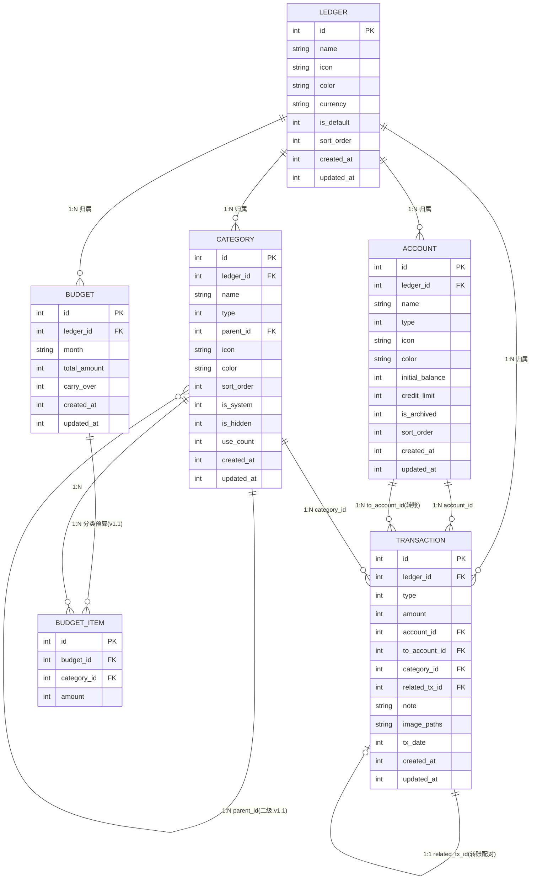
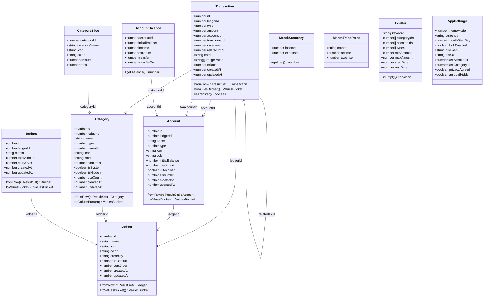
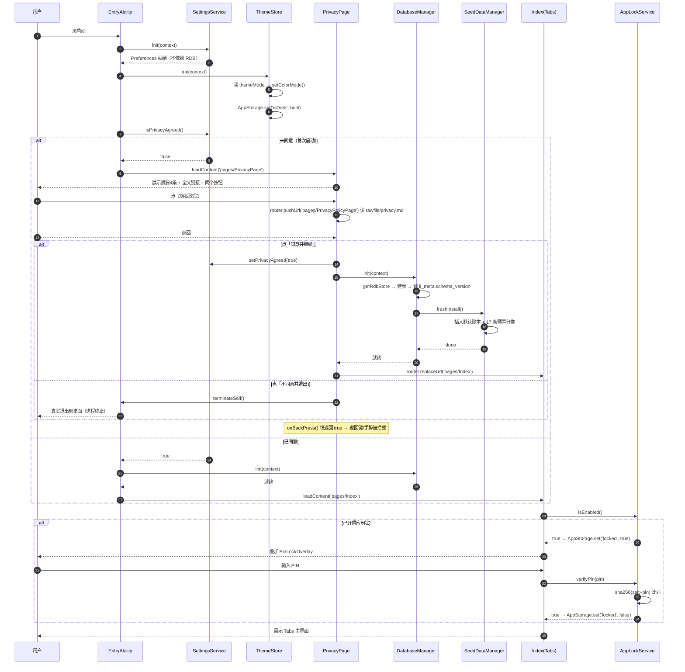
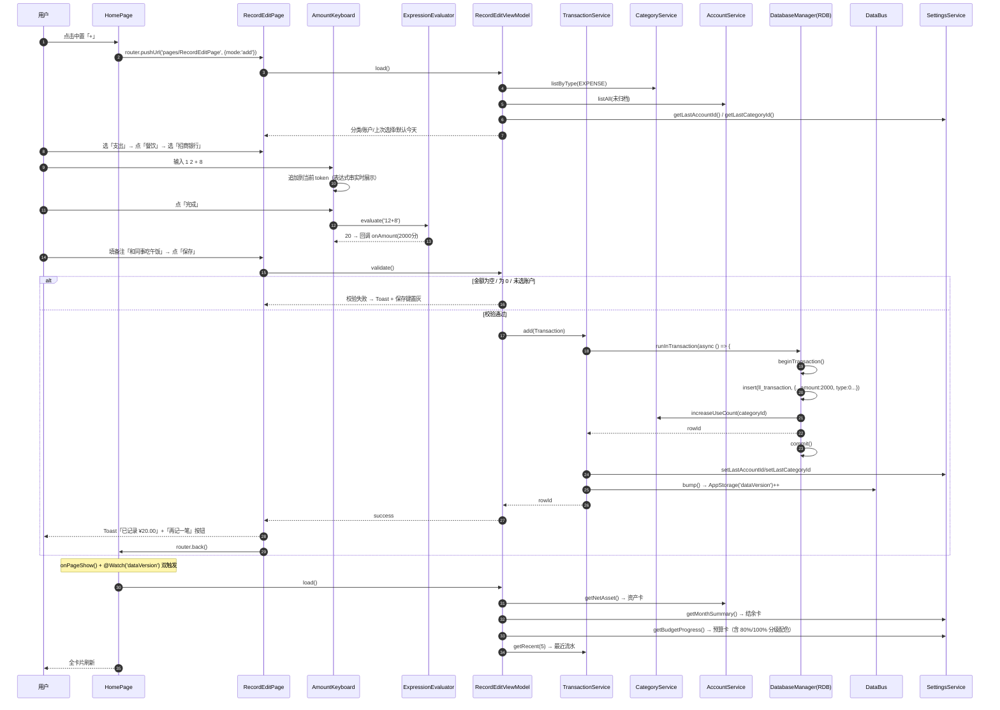
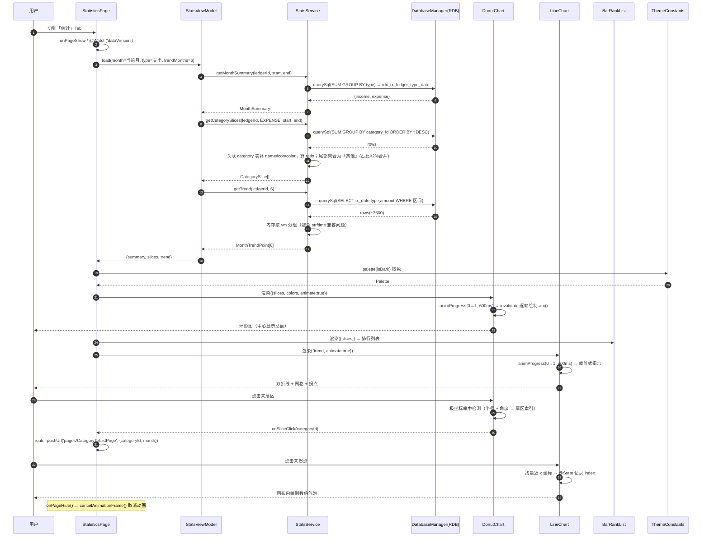
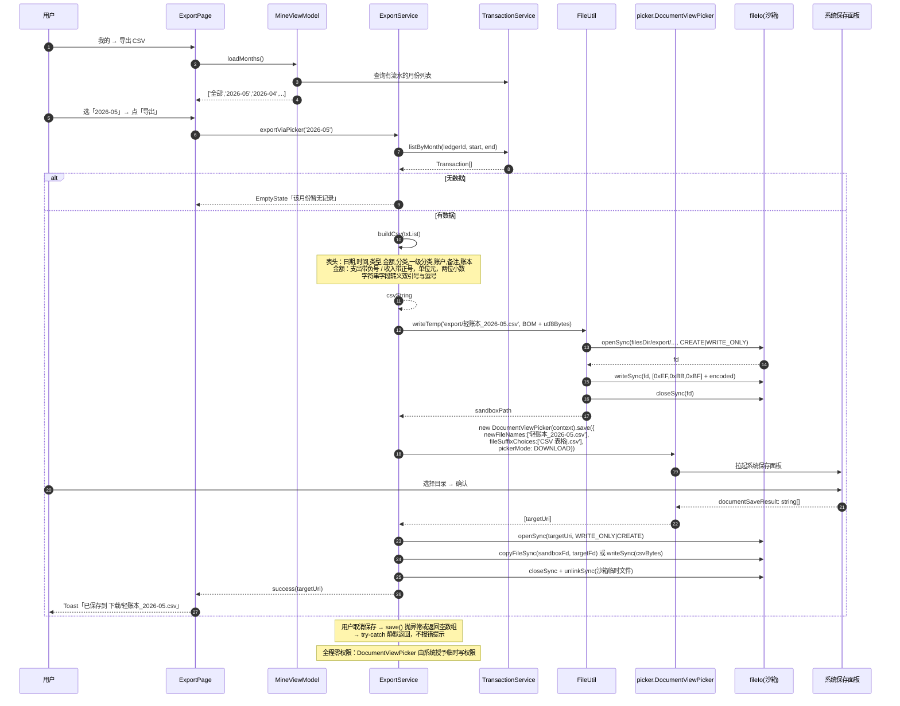
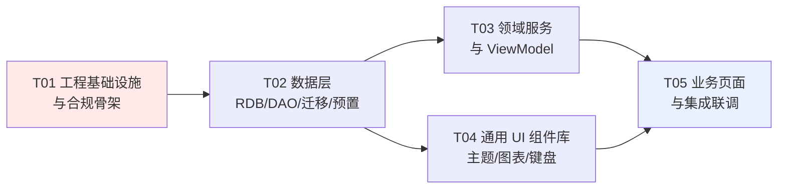

# 轻账本 LifeLedger · 系统架构设计与任务分解

| 项目 | 内容 |
|---|---|
| 文档语言 | 中文 |
| 文档版本 | **v1.1**（已与 PRD v1.1 对齐，无待确认项） |
| 编写人 | 高见远（Architect） |
| 上游输入 | `docs/PRD.md` **v1.1**（许清楚，含 R1 改名 / R2 口径更正 / F-2.9 新增 / 8.1 范围锁定清单） |
| 项目代号 | LifeLedger |
| 应用名称 | 轻账本（暂定，待用户确认） |
| 包名 | `com.<devname>.lifeledger` |
| 目标平台 | HarmonyOS NEXT，Stage 模型，ArkTS + ArkUI 声明式 |
| 数据形态 | **纯本地存储，零网络、零第三方 SDK、零敏感权限** |
| 工作目录 | `E:\workset\鸿蒙系统应用开发` |
| 交付目标 | 页面精美、功能丰富、可通过华为应用市场审核并上架 |

> **本文档是工程师的施工图。** 所有目录、文件名、类名、表结构、任务均按"照着就能写"的粒度给出。任何与本文档冲突的实现，须先回到本文档修订。

---

## 目录

- [0. 与 PRD 的差异与澄清（先读）](#0-与-prd-的差异与澄清先读)
- [1. 技术选型与论证](#1-技术选型与论证)
- [2. 合规设计专章（最高优先级）](#2-合规设计专章最高优先级)
- [3. 完整工程目录树](#3-完整工程目录树)
- [4. 数据模型](#4-数据模型)
- [5. 分层架构与模块职责](#5-分层架构与模块职责)
- [6. 关键流程时序图](#6-关键流程时序图)
- [7. 任务列表（施工图）](#7-任务列表施工图)
- [8. 依赖包清单](#8-依赖包清单)
- [9. 共享知识：跨文件约定](#9-共享知识跨文件约定)
- [10. 风险与遗留事项](#10-风险与遗留事项)

---

## 0. 与 PRD 的差异与澄清（先读）

> **本章所有条目均已拍板定稿**（齐活林 2026-09 确认），无待确认项。工程师按本章执行即可。

| # | 事项 | PRD 原文 | 架构处理（已定稿） | 状态 |
|---|---|---|---|---|
| D1 | **P0 条数** | 团队传达为"P0 全部 30 条" | 逐条统计为 **41 条原 P0**（含第 3.9 章合规 7 条）+ PM 新增 **F-2.9 预置「现金」账户** = **42 条**。**以 42 条为准**（与 PRD v1.1 第 3.9 章统计表、8.1 锁定清单一致），本文档全量覆盖，不漏项 | ✅ 已确认 |
| D2 | **收入分类「理财」** | F-1.5 收入分类含"理财" | 与 F-9.6「禁用理财/收益等金融敏感词」**硬冲突**，会被机器扫描命中。**确认改名「利息」**（语义贴合"钱生钱"，不触发金融资质）。代码在 `CategoryPresets.ets` 单点定义，改名零成本。见 2.6 节全局文案约束 | ✅ 已确认 |
| D3 | **趋势折线图 F-4.4** | P1 | **确认提升为 v1.0 范围**（近 6 个月双折线）。理由：统计页只有环形图撑不起"页面精美"硬目标，而 `LineChart` 抽象已在 T04，增量可控。PRD 需求池中该条**按 v1.0 对待** | ✅ 已确认 |
| D4 | **图片凭证 F-1.9** | P1 | **v1.0 不实现**。`ImageService.ets` 仅保留接口骨架（T03），`RecordEditPage` 不渲染图片区。v1.1 增量开启 | ✅ 已定 |
| D5 | **多账本** | P1（F-2.5/F-2.6） | **数据模型 v1.0 即带 `ledger_id` 并写入默认账本 id=1；UI 不开放切换器**。`LedgerSwitcher.ets` 组件 v1.0 只展示当前账本名，不做切换交互 | ✅ 已定 |
| D6 | **分类预算 F-3.2** | P1 | 建表 `ll_budget_item` 预留，**v1.0 不实现 UI** | ✅ 已定 |
| D7 | **应用名称** | 待用户确认 | 代码结构不依赖名称；`app.json5` 与 `string.json` 的 `app_name` 单点定义，改名 2 处即可 | ⏳ 用户 |
| D8 | **游标分页** | PRD 未提 | 明细页 v1.0 按月查询（单月数据量 ≤ 数千），**不做分页**；1 万条总量下按月加载无性能问题 | ✅ 已定 |
| D9 | **预置账户（PM 已立项为 F-2.9 / P0）** | PRD v1.0 未提，v1.1 新增 F-2.9 | **确认预置 1 条「现金」账户（type=0，期初 0）**。理由：不预置则用户首次记账前必须先建账户，直接破坏 US-1「3 秒记一笔」核心体验；且首次启动空账户会影响审核对"功能完整性"的观感。⚠️ 该账户 **`is_system=0`**，用户可改名/改色/归档/删除，**不得做成不可改的内置项** | ✅ 已确认 |
| D10 | **`requestPermissions` 写法** | PRD 建议"空或删字段" | **保留空数组 `[]` 而非删除字段** —— 自证确实审视过权限，是审核加分项 | ✅ 已定 |
| D11 | **Setting 存储位置** | PRD 草案含 `Setting` 实体 | **走 Preferences 不走 RDB**。关键时序论证：隐私同意状态必须在数据库初始化**之前**读到 | ✅ 已定 |

### 0.1 v1.0 范围最终定义（与 PRD v1.1 第 8.1 节锁定清单完全对齐）

| 构成 | 内容 | 状态 |
|---|---|---|
| **P0 全量** | 第 3 章 **42 条**（41 条原 P0，含 3.9 合规 7 条 + PM 新增 **F-2.9 预置「现金」账户**） | ✅ 锁定 |
| **P1 上调项 ①** | F-7.1 主题与深色模式 | ✅ 锁定 |
| **P1 上调项 ②** | F-7.4 PIN 应用锁 | ✅ 锁定 |
| **P1 上调项 ③** | F-4.4 趋势折线图 | ✅ 锁定 |
| **预留不实现** | F-2.5 / F-2.6 多账本 UI | ⏸ 表结构预留 `ledger_id`（写入 id=1），UI 不开放 |
| **预留不实现** | F-1.9 图片凭证 | ⏸ `ImageService` 接口预留，v1.0 不做 |
| **预留不实现** | F-3.2 分类预算 | ⏸ `ll_budget_item` 表预留，v1.0 不做 |
| **v1.0 权限** | `requestPermissions` **完全为空** `[]` | ✅ 锁定 |

> **v1.0 交付口径：42 条 P0 + 3 项上调 = 45 条需求。**
> 范围变更原则（PRD 8.3）：**只上调不削减**，任何削减需 PM 与 team-lead 双方确认。

---

## 1. 技术选型与论证

### 1.1 核心技术栈

| 层次 | 选型 | 论证 |
|---|---|---|
| 语言 | **ArkTS**（Stage 模型） | HarmonyOS NEXT 唯一原生开发语言；静态类型 + 严格模式，编译期拦截空指针，利于稳定性 |
| UI 框架 | **ArkUI 声明式（V1 状态管理）** | V1（`@State/@Prop/@Link/@Observed/@Provide/@Consume`）在 API 20+ 完全成熟，资料与示例最丰富；V2（`@ObservedV2/@Trace`）虽新但生态薄、坑多。**本项目状态极简（主题 + 数据版本号 + 页面数据），V1 完全够用且更不易出错** |
| 关系数据 | **`@kit.ArkData` relationalStore (RDB)** | 系统级 SQLite 封装，**无需任何权限**，支持事务、索引、`GROUP BY`、预编译 SQL。1 万条量级性能绰绰有余 |
| 键值配置 | **`@kit.ArkData` Preferences** | 系统级轻量 KV，**无需权限**。存放设置项、隐私同意状态、PIN 盐值哈希、schema 之外的运行态 |
| 文件 | **应用沙箱 `filesDir` + `@kit.CoreFileKit` fileIo** | 应用私有目录，卸载即清除，天然符合隐私声明 |
| 跨应用文件 | **`@kit.CoreFileKit` picker（PhotoViewPicker / DocumentViewPicker）** | **免权限**的唯一正确路径，见第 2.3 节 |
| 图表 | **Canvas 自绘** | 零依赖、零审核风险、视觉完全统一。见 1.5 |
| 密码学 | **`@kit.CryptoArchitectureKit` cryptoFramework** | 系统级 SHA-256 + 随机数，用于 PIN 加盐哈希，**无需权限** |
| 路由 | **`@kit.ArkUI` router** | 见 1.6 论证 |
| 导出编码 | **`util.TextEncoder` + fileIo** | 手写 UTF-8 BOM，保证 Excel 打开中文不乱码 |

### 1.2 目标 API 版本结论（回答 PRD Q5）

#### 结论表

| 配置项 | 取值 | 配置位置 |
|---|---|---|
| `compileSdkVersion` | **不手写**，由 DevEco Studio 决定（若模板生成了则保持与 target 同值） | `build-profile.json5` → `app`（部分模板无此字段） |
| `compatibleSdkVersion` | **`6.0.0(20)`** | `build-profile.json5` → `app.products[0]` |
| `targetSdkVersion` | **`26.0.0`**（DevEco Studio ≥ 26.0.0 Release）<br>降级值 `6.1.1(24)`（IDE 为 6.1.1 Release） | `build-profile.json5` → `app.products[0]` |
| `runtimeOS` | `"HarmonyOS"` | 同上 |
| `model` / `bundleName` | Stage 模型 / `com.<devname>.lifeledger` | `AppScope/app.json5`、`entry/src/main/module.json5` |

#### 配置样例（照抄）

```json5
// build-profile.json5（工程根）
{
  "app": {
    "signingConfigs": [],
    "products": [
      {
        "name": "default",
        "signingConfig": "default",
        "compatibleSdkVersion": "6.0.0(20)",
        "targetSdkVersion": "26.0.0",
        "runtimeOS": "HarmonyOS",
        "buildOption": {
          "strictMode": {
            "caseSensitiveCheck": true,
            "useNormalizedOHMUrl": true
          }
        }
      }
    ],
    "buildModeSet": [
      { "name": "debug" },
      { "name": "release" }
    ]
  },
  "modules": [
    {
      "name": "entry",
      "srcPath": "./entry",
      "targets": [
        { "name": "default", "applyToProducts": ["default"] }
      ]
    }
  ]
}
```

#### 论证

**（1）硬门槛**

- 华为自 2024-11-10 起，应用市场仅允许集成 **API 12 Release** 及以上 SDK 的应用上架。因此 `targetSdkVersion ≥ 12` 是不可突破的下限。
- 但把 target 停在 12 是**错误**的：target 决定系统对应用启用的行为变更基线，过低会导致在新系统上出现兼容性差异，且华为历史上多次抬高门槛（12 → 15 → 17 → 20…）。**新应用必须取当前 IDE 配套的最新 Release 版本**。

**（2）存量设备覆盖（华为官方数据，2026-09-06 更新）**

| HarmonyOS 版本 | API 版本 | 设备量占比 |
|---|---|---|
| 7.0.0 | 26.0.0 | 5.27% |
| 6.1.1 | 6.1.1(24) | **86.82%** |
| 6.1.0 | 6.1.0(23) | 5.50% |
| 6.0.2 | 6.0.2(22) | 1.58% |
| 6.0.1 | 6.0.1(21) | 0.41% |
| 6.0.0 | 6.0.0(20) | 0.04% |
| 5.1.1 及以下 | ≤ 19 | 0.38% |
| 5.0.0(12) ~ 5.0.4(16) | 12–16 | **0%** |

- `compatibleSdkVersion = 6.0.0(20)` → 覆盖 **99.62%** 设备。
- `compatibleSdkVersion = 6.1.0(23)` → 覆盖 97.59%。
- 差距约 2%，而**本项目用到的所有系统能力，其最低 API 要求均 ≤ 12**（relationalStore=10、Preferences=9、picker.DocumentViewPicker=12、Canvas=8、cryptoFramework=11、`@kit.*` 导入=12）。把 compatible 压到 20 **不产生任何适配成本，白赚 2% 覆盖**。
- 不建议再往下压到 API 12：HarmonyOS 5.x 设备占比已归零，且 API 12–19 区间存在若干行为差异，收益为零、风险为正。**20 是收益/成本最优点**，也与华为官方"建议最低兼容版本 6.0.0 起步"一致。

**（3）target 取 26.0.0**

- DevEco Studio **26.0.0 Release（26.0.0.821）** 于 2026-08-28 发布，配套 API 26.0.0 / HarmonyOS SDK 26.0.0.105，官方标注"新开发应用：推荐使用"。
- ⚠️ **版本号格式变更（重要坑）**：从 API 26.0.0 起，HarmonyOS 开发套件版本号统一采用**语义化版本格式 `X.Y.Z`**，取代原有的 `X.Y.Z(N)` 格式。因此**必须写 `26.0.0`，不要写 `7.0.0(26)`**，否则工程同步报错。
- 而 `compatibleSdkVersion` 使用旧格式 `6.0.0(20)` 是**正确且必须**的（20 属于 6.0.0 时代，官方仍以 `6.0.0(20)` 表述）。**两个字段格式不同，不要当成笔误去"修正"。**

**（4）降级路径**

若本地 DevEco Studio 版本低于 26.0.0（例如 6.1.1 Release），SDK 中不存在 26.0.0，则：

```
compatibleSdkVersion 保持 "6.0.0(20)"   ← 不变
targetSdkVersion     改为 IDE 默认值，如 "6.1.1(24)"
```

**唯一必须满足的硬约束：`targetSdkVersion ≥ 12` 且 `compatibleSdkVersion ≤ targetSdkVersion`。** 两种取值均可正常上架。

### 1.3 存储选型论证

| 数据 | 存储 | 理由 |
|---|---|---|
| 账本/账户/分类/流水/预算 | **RDB (relationalStore)** | 需要 `GROUP BY`、区间查询、事务、索引。Preferences 无法满足 |
| 设置项（主题、货币、上次账户/分类） | **Preferences** | 轻量 KV，同步读，秒开 |
| 隐私同意状态、PIN 盐+哈希、应用锁开关 | **Preferences** | 需在**数据库初始化之前**读取（隐私拦截前置），故不能放 RDB |
| CSV 临时文件、图片凭证（v1.1） | **沙箱 `filesDir`** | 私有目录，卸载即清 |
| 用户可见的导出文件 | 经 **DocumentViewPicker** 写到用户指定目录 | 免权限 |

**关键顺序约束**：Preferences 的读取不依赖 RDB，因此隐私弹窗拦截能在 RDB 初始化之前完成。RDB 初始化放在隐私同意之后（见时序图 ①）。

### 1.4 状态管理方案选型

| 方案 | 评估 | 结论 |
|---|---|---|
| **AppStorage** | 进程级全局单例，跨页面/跨 Ability 共享，支持 `@StorageLink` 双向同步 | ✅ **采纳**：只放 3 个极简全局标量 |
| **LocalStorage** | 页面级，需显式传递 | ❌ 不用：与 AppStorage 并存易混淆 |
| **自定义 @Observed Store** | 适合复杂领域状态 | ⚠️ **限制使用**：本项目无复杂领域状态，引入反而增加心智负担 |
| **页面 @State + 无状态 ViewModel** | 页面持有数据，ViewModel 只提供 `load/refresh` 异步方法 | ✅ **采纳**：主体模式 |

**最终方案（三件套）**

1. **AppStorage 只存 3 个键**（全部在 `constants/AppConstants.ets` 定义常量名）：

   | 键 | 类型 | 用途 | 写入方 |
   |---|---|---|---|
   | `isDark` | `boolean` | 当前是否深色，驱动全量色板 | `ThemeStore` / `EntryAbility.onConfigurationUpdate` |
   | `dataVersion` | `number` | **数据版本号**：任何写库操作后 `+1`，所有页面监听并重载 | `DataBus.bump()` |
   | `locked` | `boolean` | 应用锁是否已锁定（未解锁） | `AppLockService` / `EntryAbility.onForeground` |

2. **页面数据用 `@State` 持有**，由 ViewModel 的 `async load()` 填充。ViewModel 是**无状态的服务编排层**，不继承任何响应式基类。

3. **跨页面刷新协议（核心机制）**：

```
任意写操作（记一笔 / 转账 / 编辑 / 删除 / 改预算 / 改账户）
   └─> DataBus.bump()  →  AppStorage.set('dataVersion', ++n)

任意页面：
   @StorageLink('dataVersion') @Watch('onDataChanged') dv: number
   onDataChanged() { this.vm.load(...) }
   onPageShow()    { this.vm.load(...) }   // 兜底：router.back() 返回时也会重载
```

> 这套机制是"记账后首页预算进度、最近流水、明细列表、统计页全部自动刷新"的**唯一真相源**，避免事件总线、避免手动回调链。工程师只需记住：**写库必 bump**。

### 1.5 图表方案：Canvas 自绘

| 图表 | 组件 | 实现要点 |
|---|---|---|
| 环形图 | `components/chart/DonutChart.ets` | `CanvasRenderingContext2D` + `arc()` 逐扇区绘制；中心文字用 `fillText`；点击命中检测用极坐标（半径 + 角度反算扇区） |
| 折线图 | `components/chart/LineChart.ets` | 双折线 + 圆点 + 渐变填充 + 网格；点击取最近拐点显示气泡（由组件 `@State` 绘制，不用系统 Popup） |
| 分类排行 | `components/chart/BarRankList.ets` | 非 Canvas，用 `Row/Stack/Progress` 组合实现（文字排版交给系统更稳、更清晰） |
| 进度环 | `components/home/BudgetProgressCard.ets` 内 | 复用 `DonutChart`，传单扇区数据 |

**公共抽象 `ChartCanvasBase.ets`**（不渲染，仅导出工具函数）：

```
dp2px / px2dp 换算
animProgress(from, to, duration, onUpdate)   // 基于 requestAnimationFrame 的补间
hexToRgba(hex, alpha)                        // 色值转透明色，用于深色模式叠加
drawRoundRect(ctx, x, y, w, h, r)
```

**动画约定**：所有 Canvas 图表暴露 `animate: boolean` 入参。
- 进度环：`600ms` ease-out 从 0 绘制到目标角度
- 环形分类图：`400ms` 逐扇区展开
- 折线图：`400ms` 从左到右裁剪式揭示
- 动画统一由 `animProgress` 驱动 `invalidate()`；**页面不可见时（`onPageHide`）必须 `cancelAnimationFrame`**，否则后台绘制浪费资源。

**色值来源**：Canvas 无法使用 `$r()`，统一从 `ThemeConstants.ets` 的 TS 色板取（`palette(isDark)`），见第 9.3 节。

### 1.6 路由选型：router（而非 Navigation）

| 方案 | 论证 |
|---|---|
| Navigation + NavPathStack | 官方推荐、未来方向；但多 Tab + 多子页面栈需为每个 Tab 维护独立栈，写法繁琐，工程师易错 |
| **router.pushUrl** | ✅ **采纳**。API 20/26 均完全可用（仅 Lint 提示为"不再演进"，不影响编译与上架）。写法简单、可读性强 |

**迁移保护**：所有页面路径集中在 `constants/RouteConstants.ets`，页面内禁止硬编码字符串。未来迁移 Navigation 只改该文件与 `Index.ets` 容器，业务页面零改动。

### 1.7 依赖包：零第三方

见第 8 节。**`entry/oh-package.json5` 的 `dependencies` 必须保持为空对象**，不安装任何 ohpm 包。

---

## 2. 合规设计专章（最高优先级）

> 本章为**硬约束**。任何与之冲突的设计一律以本章为准。本章直接决定能否上架。

### 2.1 权限最终结论表

#### v1.0 结论：`module.json5` 中 **不写 `requestPermissions` 字段**（等价零权限）

| 权限 | v1.0 结论 | 论证 |
|---|---|---|
| `ohos.permission.INTERNET` | ❌ **绝对禁止** | 一旦申请，隐私政策须说明联网用途，与"纯本地"定位根本冲突；且会触发 ICP/备案审查 |
| `ohos.permission.GET_NETWORK_INFO` | ❌ **绝对禁止** | 同上；且本项目无网络状态依赖 |
| `ohos.permission.READ_IMAGEVIDEO` / `WRITE_IMAGEVIDEO` | ❌ **禁止** | 图片凭证改用 **PhotoViewPicker**（v1.1 启用），系统选择器授予临时只读授权，免权限 |
| `ohos.permission.READ_WRITE_DOWNLOAD_DOCUMENT` 等文件权限 | ❌ **禁止** | CSV 导出改用 **DocumentViewPicker**，备份恢复同理 |
| `ohos.permission.CAMERA` | ❌ **禁止** | 拍照凭证由用户在系统相册/相机中完成，App 只接收 Picker 返回的 URI |
| `ohos.permission.LOCATION` / `APPROXIMATELY_LOCATION` | ❌ **禁止** | 与记账无关 |
| `ohos.permission.READ_CONTACTS` / `READ_CALENDAR` / `MICROPHONE` | ❌ **禁止** | 与记账无关 |
| `ohos.permission.DISTRIBUTED_DATASYNC` | ❌ **禁止** | 会引发"数据跨设备传输"质疑；本项目为单机 |
| 设备标识符（OAID / AAID / UDID / ODID） | ❌ **禁止** | 无广告、无统计，无任何正当理由获取 |
| `ohos.permission.PUBLISH_AGENT_REMINDER` | ⏸ **v1.0 不申请** | 记账提醒 **F-7.3 是 P1，不在 v1.0 范围**。预算超支预警 **F-3.4 用卡片颜色 + 文案实现（P0），不依赖通知**。故 v1.0 无需此权限 |
| `ohos.permission.ACCESS_BIOMETRIC` | ⏸ **v1.0 不申请** | 生物解锁 **F-7.5 是 P2**。v1.0 应用锁用纯 PIN（SHA-256 加盐哈希，零权限） |
| `ohos.permission.VIBRATE` | ❌ **不申请** | 键盘震动非必需；若需触感反馈，系统 Input 自带 |
| `ohos.permission.KEEP_BACKGROUND_RUNNING` | ❌ **禁止** | 无后台任务 |

**`module.json5` 目标形态（节选）**

```json5
{
  "module": {
    "name": "entry",
    "type": "entry",
    "deviceTypes": ["phone"],          // 首版只声明手机
    "requestPermissions": [],          // ← 显式空数组（或整段删除；推荐保留空数组以自证）
    "abilities": [
      {
        "name": "EntryAbility",
        "srcEntry": "./ets/ability/EntryAbility.ets",
        "orientation": "portrait",     // 锁定竖屏
        "launchType": "singleton",
        "exported": true,
        "skills": [{ "entities": ["entity.system.home"], "actions": ["ohos.want.action.home"] }]
      }
    ]
  }
}
```

> **推荐保留 `"requestPermissions": []`**：空数组比删除字段更能自证"我们确实审视过权限"，在人工审核与自查文档中是加分项。

#### v1.1 增量启用提醒权限时的操作清单（备忘）

若后续实现 F-7.3，需做 4 件事（v1.0 不做）：

1. `module.json5` 增加：
   ```json5
   "requestPermissions": [
     {
       "name": "ohos.permission.PUBLISH_AGENT_REMINDER",
       "reason": "$string:reminder_reason",
       "usedScene": { "abilities": ["EntryAbility"], "when": "always" }
     }
   ]
   ```
2. `resources/zh_CN/element/string.json` 增加 `reminder_reason`，**文案必须与隐私政策第 4 条逐字一致**（见 2.5）。
3. **场景化申请**：仅在用户点击「记账提醒」开关时才真正调用 `publishReminder`，绝不在启动时申请。
4. 隐私政策同步更新：新增该权限条目 + "拒绝后仍可正常使用"表述，并在 AGC 隐私声明托管处同步修改。

### 2.2 零网络架构保证（工程级机制，防回退）

仅有"文档约定"不够，必须有**可执行的自检**。以下三项写入 `docs/` 并在提测前执行。

**（1）依赖自检**

```
检查 entry/oh-package.json5 与 oh-package.json5：dependencies / devDependencies 均为空
```

**（2）代码关键字自检（提测前必跑，期望全部 0 命中）**

```bash
# 在 E:\workset\鸿蒙系统应用开发 下执行（Git Bash）
# ⚠️ 排除规则（AR-2，已定稿）：必须 --exclude=PermissionGuard.ets —— 该文件本身收录
#    FORBIDDEN_PATTERNS 词表，禁用词字符串会在其中合法出现，不排除则脚本必然自命中。
#    除该文件外，任何命中一律视为违规，不允许再扩大排除范围。
grep -rEn \
  --exclude=PermissionGuard.ets \
  -e "@ohos\.net\.(http|socket|webSocket)" \
  -e "http\.createHttp" \
  -e "request\.uploadFile|request\.downloadFile" \
  -e "socket\.construct" \
  -e "web_webview|WebviewController" \
  -e "geoLocationManager|@ohos\.geolocation" \
  -e "INTERNET|GET_NETWORK_INFO|READ_IMAGEVIDEO|CAMERA|LOCATION|DISTRIBUTED_DATASYNC" \
  -e "OAID|AAID|UDID|deviceInfo\." \
  entry/src AppScope
```

> - `deviceInfo.` 例外：若仅为"关于页展示型号"而使用，仍需谨慎——**v1.0 关于页不展示设备信息**，直接零命中。
> - **PermissionGuard.ets 的兜底保证（AR-2 配套）**：该文件被排除出 grep 后，其自身合规由 **人工 code review** 把关——review 时确认它只含 `FORBIDDEN_PATTERNS` 词表常量，无任何运行时逻辑、无任何真实网络/权限 API 调用。QA 终扫按 `--exclude=PermissionGuard.ets` 口径执行并在测试报告注明。

**（3）权限自检**

```bash
grep -rn "requestPermissions" entry/src/main/module.json5   # 结果必须是 []
grep -c "name" entry/src/main/module.json5                  # 人工核对无权限条目
```

**（4）架构级隔离**

- `utils/PermissionGuard.ets`：**不放运行时逻辑**，只导出一份 `FORBIDDEN_PATTERNS` 常量数组 + `assertNoNetworkUsage()`（在 debug 构建下遍历源码不可行，故退化为"文档化清单 + 上述 grep 脚本"）。
- **服务层只有 `service/` 目录能触碰系统文件/数据库 API**；`pages/` 与 `components/` 禁止 `import` `@kit.CoreFileKit` 的 `fs`、禁止 `import relationalStore`。通过目录职责约束降低违规面。

### 2.3 免权限替代方案：两条 Picker 路径

#### 路径 A：图片凭证 → `PhotoViewPicker`（v1.1 启用）

```
用户点「添加凭证」
  └─> new photoAccessHelper.PhotoViewPicker(context)
        .select({ maxSelectNumber: 3, MIMEType: photoAccessHelper.PhotoViewMIMETypes.IMAGE_TYPE })
  └─> 返回 photoUris: string[]   （临时只读授权 URI，App 退出后失效）
  └─> ImageService.copyToSandbox(uri)
        fs.openSync(uri, fs.OpenMode.READ_ONLY)
        fs.copyFileSync(srcFd, destFd)   // dest = filesDir/images/<txId>_<n>.jpg
  └─> 可选压缩：image.createImageSource(fd) → createPixelMap({desiredSize}) → imagePacker.packToData({format:'image/jpeg', quality:70})
  └─> 沙箱内路径写入 ll_transaction.image_paths（JSON 字符串数组）
  └─> 展示时直接用沙箱路径（file:// 或 path），永久可读，无需再授权
```

**要点**：
- Picker 返回的 URI **必须复制到沙箱**，不能直接存 URI（授权会失效）。
- 复制失败需捕获异常并提示"读取图片失败，请重试"。
- 删除流水时同步删除其沙箱图片文件（避免孤儿文件）。

#### 路径 B：CSV 导出 → `DocumentViewPicker`（v1.0 P0，F-6.1）

```
用户点「导出 CSV」→ 选择月份/全部
  └─> ExportService.buildCsvContent(month)         // 纯字符串拼装
  └─> fs 写入沙箱临时文件 filesDir/export/轻账本_2026-05.csv（UTF-8 BOM）
  └─> new picker.DocumentViewPicker(context).save({
        newFileNames: ['轻账本_2026-05.csv'],
        fileSuffixChoices: ['CSV 表格|.csv'],
        pickerMode: picker.DocumentPickerMode.DOWNLOAD   // 默认落在"下载"目录
      })
  └─> 返回 documentSaveResult: string[]            // 用户指定位置的 URI
  └─> fs.openSync(uri, fs.OpenMode.WRITE_ONLY | fs.OpenMode.CREATE)
      fs.writeSync(fd, csvBuffer); fs.closeSync(fd)
      —— 或 —— 直接 fs.copyFileSync(sandboxFd, targetFd)
  └─> promptAction.showToast('已保存到 下载/轻账本_2026-05.csv')
```

**要点**：
- `save()` 返回 `Promise<string[]>`，用户对**取消**操作表现为抛异常或返回空数组，**必须 try-catch 且静默处理取消**（不报错提示）。
- 先写沙箱再拷贝，而不是直接往目标 URI 流式写：沙箱写入可校验成功（如磁盘不足可提前提示），拷贝是原子性更好的操作。
- **BOM 必须写**：`new Uint8Array([0xEF, 0xBB, 0xBF])`，否则 Excel 打开中文乱码（F-6.1 明确要求）。

### 2.4 首次启动隐私弹窗：架构位置与"真实退出"

#### 为什么不用"页面内弹窗"

若把隐私弹窗做在 `Index.ets` 上层的 `CustomDialog` / 半模态页，存在三个可被绕过的口子：
1. 返回手势 / 返回键可直接关闭弹窗或退出页面；
2. `Index` 会先被渲染一帧，用户可能看到主界面（"假装同意"）；
3. 弹窗的"不同意"只能关弹窗，App 仍在运行，审核时会被判为"不同意仍能使用"。

#### 采用方案：Ability 层前置路由 + 独立全页

```
EntryAbility.onCreate()
  └─> SettingsService.init(context)          // Preferences 初始化（不依赖 RDB）
  └─> ThemeStore.init(context)               // 读主题 + 设系统 colorMode

EntryAbility.onWindowStageCreate(windowStage)
  └─> const agreed = await SettingsService.isPrivacyAgreed()   // Preferences 同步读
  └─> windowStage.loadContent(agreed ? 'pages/Index' : 'pages/PrivacyPage')
  └─> 同意后进入 Index，此时才 DatabaseManager.init()（创建表 + 预置数据）
```

`PrivacyPage.ets` 关键实现：

| 要求 | 实现 |
|---|---|
| 视觉是弹窗 | 整页 `backgroundColor('#80000000')`（用 `palette.mask`）+ 居中 24vp 圆角白卡；**路由上它是独立页面** |
| 不可跳过 | `onBackPress(): boolean { return true; }` ← **返回 true 表示已消费返回事件**，返回键/手势均被拦截 |
| 摘要 4 条 | ① 不收集任何个人信息 ② 数据仅存本机沙箱 ③ 不发起任何网络请求 ④ 不接入任何第三方 SDK |
| 全文链接 | 点《隐私政策》→ `router.pushUrl('pages/PrivacyPolicyPage')`（读 `rawfile/privacy.md`） |
| 同意并继续 | `SettingsService.setPrivacyAgreed(true)` → `DatabaseManager.init()` → `router.replaceUrl('pages/Index')` |
| **不同意并退出** | `(getContext(this) as common.UIAbilityContext).terminateSelf()` — **真实终止进程回到桌面**，不做任何"假装退出" |
| 默认不勾选 | 无任何默认勾选态；必须显式点击「同意并继续」 |

> `router.replaceUrl` 而非 `pushUrl`：确保从 Index 返回时不会退回隐私页。

#### 应用锁叠加层（PIN，F-7.4）

```
Index.ets 根布局 = Stack {
  Tabs(...)                                        // 5 Tab 主内容
  if (locked) { PinLockOverlay() }                 // 全屏覆盖，zIndex 最高
}
```

- `locked` 来自 `AppStorage`；`EntryAbility.onForeground()` 时若距上次离开 > 30s 则 `AppLockService.lock()`（写 `locked=true`）。
- PIN 校验：PBKDF2(SHA-256) 派生值与 Preferences 中 `pin_v2` 比对；升级前的 `sha256(salt + pin)` 仍可校验，成功后自动迁移并清除旧哈希。
- 错误 5 次：进入 30 秒等待，`pin_fail_count` / `pin_lock_until` 写入 Preferences（重启与后台切换不清除）；等待期内拒绝校验，成功后清零。
- 忘记密码：明确提示"需清空全部数据以重置，且数据不可恢复"，二次确认后 `DatabaseManager.clearAllData()` + 重置 PIN。

### 2.5 隐私政策一致性保证

| 保证项 | 工程做法 |
|---|---|
| 应用内文本单一真相源 | 隐私政策全文放 `entry/src/main/resources/rawfile/privacy.md`，`PrivacyPolicyPage` 读取渲染；弹窗摘要页**只写 4 条要点 + 链接**，不复制全文（避免两处不一致） |
| 权限 reason 与政策一致 | v1.0 零权限，无 reason 文案。v1.1 启用提醒时：`string.json` 的 `reminder_reason` 与 `privacy.md` 第 4 条**逐字一致**，由 QA 在合规自检时对照核验 |
| AGC 托管一致 | 上架时以 `rawfile/privacy.md` 原文提交 AGC 隐私声明托管，不做二次改写 |
| 用户协议 | `rawfile/agreement.md`，侧重免责与"数据由用户自行保管，建议定期导出备份" |
| 客服邮箱 | `string.json` 单点定义 `feedback_email`；关于页与我的页共用；点击用 `systemShare`/`want` 拉起邮件应用（纯本地 intent，无网络权限） |

### 2.6 文案合规工程化

`（1）绝对化用语自检（期望 0 命中）`

```bash
grep -rEn "最好的|第一的|顶级|极致|首选|唯一|国家级|最全|最强|最佳" \
  entry/src/main/resources/*/element/string.json entry/src/main/resources/rawfile
```

`（2）金融敏感词自检（期望 0 命中；「理财」已按 D2 更名为「利息」）`

```bash
grep -rEn "理财|投资|基金|股票|借贷|收益|返利|提现|保本|贷款|利率|开户|存款|证券|保险|期货|外汇|比特币|虚拟币|分期|额度|账单分期" \
  entry/src/main/resources/*/element/string.json entry/src/main/resources/rawfile
```

> **扫描范围说明**：本脚本扫的是资源文件。但按下面 2.6.1 的全局约束，代码中的**分类名**同样受管，因此还需扫 `constants/CategoryPresets.ets` 与 `constants/AccountPresets.ets`（见脚本 2b）。

`（2b）分类名 / 账户名金融敏感词自检（期望 0 命中）`

```bash
grep -rEn "理财|投资|基金|股票|借贷|收益|返利|提现|保本|贷款|利率|开户" \
  entry/src/main/ets/constants/CategoryPresets.ets \
  entry/src/main/ets/constants/AccountPresets.ets
```

`（3）所有 UI 文案必须走 string.json`：`pages/` 与 `components/` 中禁止硬编码中文字符串（除 `$r()` 引用）。架构评审时 grep 检查 `Text('` 后紧跟中文的情况。

#### 2.6.1 全局文案约束（硬规则，D2 定稿）

> **适用范围：分类名、账户名/类型名、按钮文案、Toast 提示语、空状态文案、对话框文案、关于页文本、隐私政策、用户协议、应用描述。**
> **一句话：凡是用户能看见的中文字符串，一律适用。**

**禁用词表（两级）**

| 级别 | 词 | 处置 |
|---|---|---|
| **A 级 · 绝对禁用** | 理财、投资、基金、股票、借贷、收益、返利、提现、保本 | 命中即改，**无任何豁免** |
| **B 级 · 需架构师单独评估** | 贷款、利率、开户、存款、证券、保险、期货、外汇、分期、额度 | 若确属描述性使用（如"信用卡额度"），需架构师书面确认后放行 |
| **C 级 · 绝对化用语** | 最、第一、顶级、极致、首选、唯一、国家级、最佳、最强、最全 | 命中即改（PRD F-9.5） |

**工程落地**

1. **唯一真相源**：所有面向用户的文案集中在 `resources/zh_CN/element/string.json` 与 `resources/rawfile/*.md`；分类名/账户类型名集中在 `constants/CategoryPresets.ets` / `constants/AccountPresets.ets`。**这 4 处之外出现用户可见中文即为违规**。
2. **已确认的改名**：收入分类 **「理财」→「利息」**（D2）。支出分类与账户类型经核对**无命中词**。
3. **账户类型名的特别说明**：`支付宝`、`微信` 属第三方品牌名，作为**账户类型的描述性使用**予以保留（PRD F-2.1 明确要求）。`信用卡`、`借记卡` 为通用金融工具名称，非金融业务表述，**保留**。但**不得**出现"信用卡额度管理"之外的衍生表述（如"提现"、"分期"）。
4. **自检时机**：T01 完成时初扫、T05 集成完成后终扫、提测前 QA 复扫，**三次均须 0 命中**。
5. **新增文案的准入**：任何人在上述 4 处新增用户可见文案前，先过一遍 A/B/C 三级词表。

---

## 3. 完整工程目录树

> **工程师请严格按此树建文件。** `entry/src/main/ets` 下分 7 个目录：`ability / pages / components / model / service / viewmodel / utils / constants`。

```
E:\workset\鸿蒙系统应用开发\
│
├── AppScope/
│   ├── app.json5                                # bundleName / versionCode / versionName / icon / label
│   └── resources/
│       └── base/
│           ├── element/string.json              # 全局字符串（app_name）
│           └── media/
│               ├── app_icon.png                 # 512×512 应用图标
│               └── app_icon_foreground.png       # 分层前景（华为图标规范）
│
├── entry/
│   ├── hvigorfile.ts
│   ├── oh-package.json5                         # dependencies 必须为空
│   ├── build-profile.json5
│   └── src/
│       ├── main/
│       │   ├── module.json5                     # requestPermissions: []   abilities 声明
│       │   │
│       │   ├── ets/
│       │   │   ├── ability/
│       │   │   │   └── EntryAbility.ets         # 隐私前置路由 / 主题初始化 / 前后台锁定
│       │   │   │
│       │   │   ├── pages/                       # 路由页面（@Entry）
│       │   │   │   ├── PrivacyPage.ets          # 首次启动隐私弹窗页（全页伪装弹窗）
│       │   │   │   ├── Index.ets                # 主容器：Tabs + PinLockOverlay
│       │   │   │   ├── HomePage.ets             # Tab1 首页
│       │   │   │   ├── RecordsPage.ets          # Tab2 明细
│       │   │   │   ├── PlaceholderPage.ets      # Tab3 占位（"+"不切换，兜底）
│       │   │   │   ├── StatisticsPage.ets       # Tab4 统计
│       │   │   │   ├── MinePage.ets             # Tab5 我的
│       │   │   │   ├── RecordEditPage.ets       # 记账/编辑（全屏拉起）
│       │   │   │   ├── TransactionDetailPage.ets# 流水详情
│       │   │   │   ├── CategoryTxListPage.ets   # 环形图下钻：某分类流水列表
│       │   │   │   ├── AccountManagePage.ets    # 账户管理
│       │   │   │   ├── AccountEditPage.ets      # 账户新增/编辑
│       │   │   │   ├── CategoryManagePage.ets   # 分类管理（v1.0 只读 + 排序/隐藏）
│       │   │   │   ├── BudgetSettingPage.ets    # 预算设置
│       │   │   │   ├── ExportPage.ets           # 导出 CSV
│       │   │   │   ├── ThemeSettingPage.ets     # 主题与货币
│       │   │   │   ├── AppLockSettingPage.ets   # 应用锁开关 / PIN 设置
│       │   │   │   ├── PinVerifyPage.ets        # PIN 校验（设置流程内二次输入）
│       │   │   │   ├── AboutPage.ets            # 关于（含无网络声明）
│       │   │   │   ├── PrivacyPolicyPage.ets    # 隐私政策全文（读 rawfile）
│       │   │   │   └── UserAgreementPage.ets    # 用户协议全文（读 rawfile）
│       │   │   │
│       │   │   ├── components/
│       │   │   │   ├── common/
│       │   │   │   │   ├── EmptyState.ets       # 统一空状态（插画+文案+按钮）
│       │   │   │   │   ├── ErrorState.ets        # 统一异常态（重试）
│       │   │   │   │   ├── LoadingState.ets     # 统一加载态（骨架/转圈）
│       │   │   │   │   ├── CardContainer.ets    # 卡片容器（圆角16 阴影/描边）
│       │   │   │   │   ├── SectionHeader.ets    # 区块标题 + 右侧"查看全部"
│       │   │   │   │   ├── NavTitleBar.ets      # 带返回箭头的标题栏
│       │   │   │   │   ├── SettingItem.ets      # 设置行（图标+标题+值+箭头）
│       │   │   │   │   ├── ConfirmDialog.ets    # 二次确认弹窗（危险操作红色）
│       │   │   │   │   ├── AmountText.ets       # 等宽数字金额文本（支持隐藏）
│       │   │   │   │   └── PinLockOverlay.ets   # 应用锁全屏覆盖层
│       │   │   │   ├── home/
│       │   │   │   │   ├── LedgerSwitcher.ets   # 顶部账本名（v1.0 只读展示）
│       │   │   │   │   ├── AssetCard.ets        # 总资产/负债/净资产 渐变大卡
│       │   │   │   │   ├── MonthSummaryCard.ets # 本月收/支/结余 双色条
│       │   │   │   │   ├── BudgetProgressCard.ets# 环形预算进度 + 日均可用
│       │   │   │   │   └── RecentListCard.ets   # 最近 5 条（含空状态引导）
│       │   │   │   ├── record/
│       │   │   │   │   ├── TypeSwitchTabs.ets   # 支出/收入/转账 三态切换
│       │   │   │   │   ├── AmountKeyboard.ets   # 自绘计算器键盘（含连续运算）
│       │   │   │   │   ├── CategoryGrid.ets     # 分类宫格 4列
│       │   │   │   │   ├── AccountSelector.ets  # 账户下拉/弹层选择
│       │   │   │   │   ├── DateSelector.ets     # 日期选择（禁未来）
│       │   │   │   │   └── NoteInput.ets        # 备注输入（100 字上限）
│       │   │   │   ├── list/
│       │   │   │   │   ├── MonthSwitcher.ets    # 明细页月份切换 + 月度合计
│       │   │   │   │   ├── SearchBar.ets        # 关键词搜索
│       │   │   │   │   ├── TxDayGroupHeader.ets # 日分组头（今天/昨天/月-日 周X）
│       │   │   │   │   └── TxListItem.ets       # 单条流水（支持 swipeAction）
│       │   │   │   └── chart/
│       │   │   │       ├── ChartCanvasBase.ets  # 图表工具函数集（非组件）
│       │   │   │       ├── DonutChart.ets       # 环形图（可点击扇区）
│       │   │   │       ├── LineChart.ets        # 双折线趋势图（可点拐点）
│       │   │   │       └── BarRankList.ets      # 分类排行条形（非 Canvas）
│       │   │   │
│       │   │   ├── model/                       # 纯数据实体 + DTO
│       │   │   │   ├── Ledger.ets
│       │   │   │   ├── Account.ets
│       │   │   │   ├── Category.ets
│       │   │   │   ├── Transaction.ets
│       │   │   │   ├── Budget.ets
│       │   │   │   ├── TxFilter.ets             # 检索筛选条件
│       │   │   │   ├── StatsModels.ets          # 统计 DTO：CategorySlice/MonthTrend/MonthSummary/AccountBalance
│       │   │   │   └── AppSettings.ets          # 设置聚合模型
│       │   │   │
│       │   │   ├── service/
│       │   │   │   ├── DatabaseManager.ets      # RDB 单例：init/建表/事务/清库
│       │   │   │   ├── SchemaConstants.ets      # DDL + 索引 + CURRENT_SCHEMA_VERSION
│       │   │   │   ├── MigrationManager.ets     # 版本迁移框架
│       │   │   │   ├── SeedDataManager.ets      # 预置分类/账户/默认账本
│       │   │   │   ├── DataBus.ets              # dataVersion bump（跨页面刷新）
│       │   │   │   ├── SettingsService.ets      # Preferences 读写
│       │   │   │   ├── LedgerService.ets
│       │   │   │   ├── AccountService.ets       # 含余额计算
│       │   │   │   ├── CategoryService.ets
│       │   │   │   ├── TransactionService.ets   # 含转账事务
│       │   │   │   ├── BudgetService.ets        # 含超支分级
│       │   │   │   ├── StatsService.ets         # 聚合查询
│       │   │   │   ├── ExportService.ets        # CSV 生成 + Picker 保存
│       │   │   │   ├── ImageService.ets         # v1.1 图片凭证（v1.0 仅接口）
│       │   │   │   └── AppLockService.ets       # PIN 哈希校验 + 锁状态
│       │   │   │
│       │   │   ├── viewmodel/
│       │   │   │   ├── ThemeStore.ets           # 色板与主题模式
│       │   │   │   ├── HomeViewModel.ets
│       │   │   │   ├── RecordEditViewModel.ets
│       │   │   │   ├── RecordsViewModel.ets
│       │   │   │   ├── StatsViewModel.ets
│       │   │   │   └── MineViewModel.ets
│       │   │   │
│       │   │   ├── utils/
│       │   │   │   ├── MoneyUtil.ets            # 分↔元、格式化、千分位
│       │   │   │   ├── DateUtil.ets             # UTC 毫秒 ↔ 本地、月区间、日标签
│       │   │   │   ├── ExpressionEvaluator.ets  # 键盘连续运算求值
│       │   │   │   ├── CryptoUtil.ets           # SHA-256 加盐哈希
│       │   │   │   ├── FileUtil.ets             # 沙箱路径、CSV 文件读写
│       │   │   │   ├── ToastUtil.ets            # Toast 封装
│       │   │   │   ├── LogUtil.ets              # hilog 封装（含耗时打点）
│       │   │   │   ├── WindowUtil.ets           # 沉浸式状态栏
│       │   │   │   └── PermissionGuard.ets      # 违规模式清单（自检用常量）
│       │   │   │
│       │   │   └── constants/
│       │   │       ├── AppConstants.ets         # AppStorage 键名、限额、默认值
│       │   │       ├── RouteConstants.ets       # 页面路由路径常量
│       │   │       ├── ThemeConstants.ets       # Palette 接口 + 深浅两套色板
│       │   │       ├── CategoryPresets.ets      # 支出11/收入6 预置分类
│       │   │       ├── AccountPresets.ets       # 账户类型预置
│       │   │       └── IconConstants.ets        # 图标名→资源映射
│       │   │
│       │   └── resources/
│       │       ├── base/
│       │       │   ├── element/
│       │       │   │   ├── string.json          # 全部 UI 文案（唯一真相源）
│       │       │   │   ├── color.json           # 系统级颜色（状态栏等）
│       │       │   │   └── float.json           # 圆角/字号/间距
│       │       │   ├── media/                   # 分类图标 ≥60 个（PNG，2vp 线性风格）
│       │       │   │   ├── ic_cat_food.png
│       │       │   │   ├── ic_cat_traffic.png
│       │       │   │   ├── ...（按 IconConstants 命名）
│       │       │   │   └── ic_launcher_foreground.png
│       │       │   └── profile/
│       │       │       ├── main_pages.json      # ★ 所有 @Entry 页面必须在此注册
│       │       │       └── backup_config.json   # （可选，不做则删除）
│       │       ├── zh_CN/element/string.json    # 中文文案（与 base 同构）
│       │       ├── en_US/element/string.json    # 预留（可先复制中文）
│       │       └── rawfile/
│       │           ├── privacy.md               # 隐私政策全文
│       │           └── agreement.md             # 用户协议全文
│       │
│       ├── mock/                                # （可为空）
│       ├── ohosTest/                            # （QA 阶段补充）
│       └── test/                                # （QA 阶段补充）
│
├── hvigor/
│   └── hvigor-config.json5
├── oh-package.json5
├── build-profile.json5                          # ★ API 版本配置处
├── hvigorfile.ts
├── .gitignore
└── docs/
    ├── PRD.md
    ├── ARCHITECTURE.md                          # 本文档
    ├── class-diagram.mermaid
    └── sequence-diagram.mermaid
```

### 3.1 目录职责边界（强制）

| 目录 | 允许 | 禁止 |
|---|---|---|
| `pages/` | 组合组件、持有 `@State`、`router` 跳转、调 ViewModel、**调 `service/` 门面（见 9.0 白名单）** | ❌ `import relationalStore / preferences / fs` ❌ 任何 SQL / 列名 / 表名 ❌ **`import DatabaseManager / MigrationManager / SeedDataManager / SchemaConstants`（AR-1）** |
| `components/` | 纯 UI、`@Prop/@Link` 入参、调 `utils/` | ❌ 调 Service ❌ `router` 跳转（除 `SettingItem` 统一回调外） |
| `viewmodel/` | 编排 Service 调用、数据整形 | ❌ 持有 UI 状态 ❌ `import DatabaseManager`（经 Service 门面访问） |
| `service/` | 唯一的数据库/文件/系统 API 使用层；`DatabaseManager` 仅限本目录 + 白名单两处 | ❌ 引用任何 UI 组件 |
| `model/` | 纯数据类 + `fromRow/toValuesBucket` | ❌ 任何业务逻辑 |
| `utils/` | 无副作用纯函数 | ❌ 持有状态 |
| `constants/` | 常量与预设数据 | ❌ 任何逻辑 |

**可 grep 的边界检查**（提测前随 2.2 脚本一起跑）：

```bash
# pages / components / viewmodel 三个 UI 目录不得触碰数据基础设施
grep -rEn "from\s+.*('|\").*(DatabaseManager|MigrationManager|SeedDataManager|SchemaConstants)('|\")" \
  entry/src/main/ets/pages entry/src/main/ets/components entry/src/main/ets/viewmodel
# 期望：仅 pages/Index.ets 命中 1 处（AR-1 白名单），其余 0 命中
```

#### 架构裁决 AR-1：数据库初始化的归属（2026-09，工程师 T01/T02 验收后提出）

**问题**：`PrivacyPage`「同意并继续」后需触发 `DatabaseManager.init()`，与"pages 不碰数据库"的分层精神冲突。

**裁决：采用方案 B（下沉），并以「幂等 ready gate」从机制上消除竞态。**

| 决策点 | 结论 |
|---|---|
| init 触发点 | **收敛为 Index 一处**：`Index.aboutToAppear()` 调 `DatabaseManager.init(context)`（不 await，fire-and-forget）。`EntryAbility` 已同意路径的 init 调用**保留为预热优化**（幂等，无副作用），但**正确性只依赖 Index 这一处** |
| PrivacyPage 职责收窄 | 同意按钮 → `SettingsService.setPrivacyAgreed(true)` → **立即** `router.replaceUrl(Index)`，**不再等待 init**。数据库初始化期间的等待由 Index 的子页面经 gate 自然吸收（显示 LoadingState），点击响应零延迟 |
| 竞态消除机制 | **「任何页面首次读库前 init 必已完成」不是时序约定，是机制保证**：`DatabaseManager.init()` 幂等（缓存并返回同一 Promise）；所有 Service 的数据库访问入口 `await DatabaseManager.ready()`。见下方代码契约 |
| 分层规则同步澄清 | pages **允许** import `service/` 门面（`SettingsService` 等）与 `utils/`；**禁止** import 数据基础设施四件套（`DatabaseManager / MigrationManager / SeedDataManager / SchemaConstants`）与 `relationalStore / preferences / fs` 原生 API。即：**禁的是数据访问实现，不是 Service 门面** |

**DatabaseManager 代码契约（工程师照此改造，约 15 行）**

```ts
export class DatabaseManager {
  private static initPromise?: Promise<void>;

  /** 幂等：多处调用安全（Index 触发 + EntryAbility 预热），返回同一 Promise */
  static init(ctx: common.Context): Promise<void> {
    if (!DatabaseManager.initPromise) {
      DatabaseManager.initPromise = DatabaseManager.doInit(ctx);  // 建表/迁移/seed
    }
    return DatabaseManager.initPromise;
  }

  /** Service 层统一入口：未初始化则兜底自启（防御性），然后等待就绪 */
  static async ready(): Promise<void> {
    if (!DatabaseManager.initPromise) {
      DatabaseManager.initPromise = DatabaseManager.doInit(getContext());
    }
    return DatabaseManager.initPromise;
  }
}
```

> **执行要求**：`service/` 下所有触碰数据库的方法（含 `getStore()`）**第一行 `await DatabaseManager.ready()`**。
> **为什么不是方案 A**：A 在"工程师正确 await"的前提下也无竞态，但正确性靠人的自觉；且 A 下用户点「同意」要卡等首建库 + seed（低端机 100–300ms+）才跳转，感知性能差。B 把等待转移到 Index 的加载态里，同时让"库何时就绪"只有一个答案（Index），排查成本最低。

---

## 4. 数据模型

### 4.1 ER 关系图



> **Setting 不建表**：走 Preferences（原因见 1.3 节的"关键顺序约束"）。
> **TransferLink 不建表**：用 `ll_transaction.related_tx_id` 同表互指（PRD 第 4 章已确认简化）。

### 4.2 表结构 DDL

> 全部定义在 `service/SchemaConstants.ets`，由 `DatabaseManager.init()` 按序执行。
> **金额字段全部 INTEGER（单位：分）**；**时间字段全部 INTEGER（UTC 毫秒）**。

```sql
-- ============ 0. 元数据表（schema 版本追踪） ============
CREATE TABLE IF NOT EXISTS ll_meta (
  key   TEXT PRIMARY KEY,
  value TEXT NOT NULL
);

-- ============ 1. 账本 ============
CREATE TABLE IF NOT EXISTS ll_ledger (
  id          INTEGER PRIMARY KEY AUTOINCREMENT,
  name        TEXT    NOT NULL,
  icon        TEXT    NOT NULL DEFAULT 'book',
  color       TEXT    NOT NULL DEFAULT '#5B67F5',
  currency    TEXT    NOT NULL DEFAULT 'CNY',
  is_default  INTEGER NOT NULL DEFAULT 0,
  sort_order  INTEGER NOT NULL DEFAULT 0,
  created_at  INTEGER NOT NULL,
  updated_at  INTEGER NOT NULL
);

-- ============ 2. 账户 ============
CREATE TABLE IF NOT EXISTS ll_account (
  id               INTEGER PRIMARY KEY AUTOINCREMENT,
  ledger_id        INTEGER NOT NULL DEFAULT 1,
  name             TEXT    NOT NULL,
  type             INTEGER NOT NULL DEFAULT 0,   -- 0现金 1借记卡 2信用卡 3支付宝 4微信 5其他
  icon             TEXT    NOT NULL DEFAULT 'wallet',
  color            TEXT    NOT NULL DEFAULT '#5B67F5',
  initial_balance  INTEGER NOT NULL DEFAULT 0,   -- 期初余额（分），可为负
  credit_limit     INTEGER NOT NULL DEFAULT 0,   -- 信用额度（分），仅信用卡用，v1.0 预留
  is_archived      INTEGER NOT NULL DEFAULT 0,   -- 1=已归档，不计入总资产
  sort_order       INTEGER NOT NULL DEFAULT 0,
  created_at       INTEGER NOT NULL,
  updated_at       INTEGER NOT NULL
);
CREATE INDEX IF NOT EXISTS idx_account_ledger
  ON ll_account(ledger_id, is_archived, sort_order);

-- ============ 3. 分类 ============
CREATE TABLE IF NOT EXISTS ll_category (
  id          INTEGER PRIMARY KEY AUTOINCREMENT,
  ledger_id   INTEGER NOT NULL DEFAULT 1,
  name        TEXT    NOT NULL,
  type        INTEGER NOT NULL,                  -- 0=支出 1=收入
  parent_id   INTEGER NOT NULL DEFAULT 0,         -- 0=一级；v1.0 恒为 0
  icon        TEXT    NOT NULL DEFAULT 'more',
  color       TEXT    NOT NULL DEFAULT '#F5544B',
  sort_order  INTEGER NOT NULL DEFAULT 0,
  is_system   INTEGER NOT NULL DEFAULT 0,         -- 1=内置预置（不可删除）
  is_hidden   INTEGER NOT NULL DEFAULT 0,
  use_count   INTEGER NOT NULL DEFAULT 0,         -- 使用频次，用于常用置顶(v1.2)
  created_at  INTEGER NOT NULL,
  updated_at  INTEGER NOT NULL
);
CREATE INDEX IF NOT EXISTS idx_category_ledger_type
  ON ll_category(ledger_id, type, is_hidden, sort_order);

-- ============ 4. 流水（核心表） ============
CREATE TABLE IF NOT EXISTS ll_transaction (
  id             INTEGER PRIMARY KEY AUTOINCREMENT,
  ledger_id      INTEGER NOT NULL DEFAULT 1,
  type           INTEGER NOT NULL,                -- 0=支出 1=收入 2=转账
  amount         INTEGER NOT NULL,                -- 正整数，单位分
  account_id     INTEGER NOT NULL,                -- 转账时为"转出账户"
  to_account_id  INTEGER NOT NULL DEFAULT 0,       -- 转账时为"转入账户"；非转账为 0
  category_id    INTEGER NOT NULL DEFAULT 0,       -- 转账为 0
  related_tx_id  INTEGER NOT NULL DEFAULT 0,       -- 配对流水 id；非转账为 0
  note           TEXT    NOT NULL DEFAULT '',
  image_paths    TEXT    NOT NULL DEFAULT '',      -- JSON 字符串数组，最多 3 个沙箱路径
  tx_date        INTEGER NOT NULL,                -- 业务发生时间，UTC 毫秒
  created_at     INTEGER NOT NULL,
  updated_at     INTEGER NOT NULL
);
CREATE INDEX IF NOT EXISTS idx_tx_ledger_type_date
  ON ll_transaction(ledger_id, type, tx_date);    -- ★ 月度收支/分类聚合主力索引
CREATE INDEX IF NOT EXISTS idx_tx_ledger_date
  ON ll_transaction(ledger_id, tx_date);          -- ★ 月度全量/趋势查询
CREATE INDEX IF NOT EXISTS idx_tx_account
  ON ll_transaction(account_id);
CREATE INDEX IF NOT EXISTS idx_tx_related
  ON ll_transaction(related_tx_id);               -- ★ 转账配对删除

-- ============ 5. 预算 ============
CREATE TABLE IF NOT EXISTS ll_budget (
  id            INTEGER PRIMARY KEY AUTOINCREMENT,
  ledger_id     INTEGER NOT NULL DEFAULT 1,
  month         TEXT    NOT NULL,                 -- 'yyyy-MM'
  total_amount  INTEGER NOT NULL DEFAULT 0,       -- 月度总预算（分）
  carry_over    INTEGER NOT NULL DEFAULT 0,       -- 结转开关，v1.0 预留
  created_at    INTEGER NOT NULL,
  updated_at    INTEGER NOT NULL
);
CREATE UNIQUE INDEX IF NOT EXISTS uk_budget_ledger_month
  ON ll_budget(ledger_id, month);

-- ============ 6. 分类预算项（v1.0 建表预留，v1.1 启用） ============
CREATE TABLE IF NOT EXISTS ll_budget_item (
  id           INTEGER PRIMARY KEY AUTOINCREMENT,
  budget_id    INTEGER NOT NULL,
  category_id  INTEGER NOT NULL,
  amount       INTEGER NOT NULL DEFAULT 0
);
CREATE INDEX IF NOT EXISTS idx_budget_item_budget
  ON ll_budget_item(budget_id);
```

**索引说明（共 7 个，克制设计）**

| 索引 | 服务的核心查询 | 说明 |
|---|---|---|
| `idx_tx_ledger_type_date` | 月度收支合计、分类聚合、环形图 | **最重要**。`WHERE ledger_id=? AND type=? AND tx_date BETWEEN ?` 走索引前缀，聚合只扫描当月数据 |
| `idx_tx_ledger_date` | 趋势图、月度全量列表、CSV 导出 | 覆盖不指定 type 的区间查询 |
| `idx_tx_account` | 账户余额计算、账户流水 | 1 万条下扫 1 个账户约数百行 |
| `idx_tx_related` | 转账配对删除 | `WHERE id=? OR related_tx_id=?` |
| `idx_account_ledger` / `idx_category_ledger_type` | 列表排序查询 | 小表，成本可忽略 |
| `uk_budget_ledger_month` | 按月唯一 | 支持 UPSERT 语义 |

> 不再加更多索引：流水表写入频繁（每笔记账 1–2 次 insert），索引过多会拖慢写入。当前 4 个写入索引在 1 万条量级下写入开销 < 1ms。

### 4.3 实体类定义（Mermaid Class Diagram）



### 4.4 枚举与常量约定（`constants/AppConstants.ets`）

| 常量 | 值 | 说明 |
|---|---|---|
| `TxType.EXPENSE` / `INCOME` / `TRANSFER` | `0` / `1` / `2` | 流水类型 |
| `CategoryType.EXPENSE` / `INCOME` | `0` / `1` | 分类类型 |
| `AccountType.CASH` / `DEBIT` / `CREDIT` / `ALIPAY` / `WECHAT` / `OTHER` | `0`–`5` | 账户类型 |
| `ThemeMode.SYSTEM` / `LIGHT` / `DARK` | `0` / `1` / `2` | 主题模式 |
| `BudgetLevel.NORMAL` / `WARN` / `OVER` | `0` / `1` / `2` | 80%/100% 分级 |
| `DEFAULT_LEDGER_ID` | `1` | v1.0 唯一账本 |
| `KEY_IS_DARK` / `KEY_DATA_VERSION` / `KEY_LOCKED` | `'isDark'` / `'dataVersion'` / `'locked'` | AppStorage 键 |
| `MAX_NOTE_LENGTH` | `100` | 备注上限 |
| `MAX_IMAGE_COUNT` | `3` | 凭证上限 |
| `BUDGET_WARN_RATIO` | `0.8` | 黄色预警阈值 |
| `LOCK_TIMEOUT_MS` | `30000` | 后台超时重锁 |

### 4.5 DB 版本迁移机制

**为什么用 `ll_meta` 而不是 `PRAGMA user_version`**：`PRAGMA` 语句经 relationalStore 的返回值解析不稳定，且无法承载"迁移日志"。自建 meta 表可同时存 `schema_version` 与 `last_migrate_at`，可读可测。

```
DatabaseManager.init(context)
  ├─ getRdbStore(context, { name: 'lifeledger.db', securityLevel: S1 })
  ├─ CREATE TABLE IF NOT EXISTS ll_meta ...
  ├─ const cur = readMetaInt('schema_version', 0)
  ├─ if (cur === 0)  → MigrationManager.freshInstall()   // 全量建表 + 预置数据 → 写 version=CURRENT
  ├─ if (cur < CURRENT) → MigrationManager.upgrade(cur)  // 逐级执行 MIGRATIONS[i]
  └─ if (cur > CURRENT) → 只读降级保护（提示用户备份后重装，禁止写库）

CURRENT_SCHEMA_VERSION = 1

MIGRATIONS: Array<{ from: number, to: number, sql: string[], migrate?: (db) => Promise<void> }> = [
  // 未来示例（v1.1 多账本）：
  // { from:1, to:2, sql:['ALTER TABLE ll_transaction ADD COLUMN tag TEXT NOT NULL DEFAULT ""'] },
  // { from:2, to:3, sql:[...], migrate: async(db)=>{ /* 数据整形 */ } }
]
```

**迁移执行规则（写入 `MigrationManager.ets` 注释）**

1. **逐级升级**：`for (let v = cur; v < CURRENT; v++) exec(MIGRATIONS[v])`，禁止跨级跳步。
2. **每级一个事务**：`beginTransaction()` → 执行 `sql[]` + `migrate()` → 成功后 `UPDATE ll_meta SET value=? WHERE key='schema_version'` → `commit()`；任一异常 `rollBack()` 并向上抛，由 UI 捕获显示"数据升级失败，请备份后重装"。
3. **只增不改**：v1.1 起新增字段一律 `ALTER TABLE ... ADD COLUMN ... NOT NULL DEFAULT <默认值>`；禁止 `DROP COLUMN`、禁改字段类型。
4. **预置数据不重复插入**：`SeedDataManager` 用 `INSERT OR IGNORE` 或先查 `is_system=1` 数量再决定。
5. **清库保留 schema**：`clearAllData()` 只 `DELETE FROM` 业务表（不 DROP），随后把 `schema_version` 保持不变，并重新跑一次 seed。

### 4.6 预置数据（`constants/CategoryPresets.ets` / `AccountPresets.ets`）

#### 支出分类 11 类（F-1.5）

| # | 名称 | 图标 | 色值 |
|---|---|---|---|
| 1 | 餐饮 | `ic_cat_food` | `#F5544B` |
| 2 | 交通 | `ic_cat_traffic` | `#5B67F5` |
| 3 | 购物 | `ic_cat_shop` | `#8B5CF6` |
| 4 | 居住 | `ic_cat_house` | `#F59E0B` |
| 5 | 娱乐 | `ic_cat_game` | `#EC4899` |
| 6 | 医疗 | `ic_cat_medical` | `#06B6D4` |
| 7 | 教育 | `ic_cat_edu` | `#3B82F6` |
| 8 | 人情 | `ic_cat_gift` | `#F97316` |
| 9 | 通讯 | `ic_cat_phone` | `#14B8A6` |
| 10 | 日用 | `ic_cat_daily` | `#84CC16` |
| 11 | 其他 | `ic_cat_more` | `#8A8F9E` |

#### 收入分类 6 类

| # | 名称 | 图标 | 色值 | 备注 |
|---|---|---|---|---|
| 1 | 工资 | `ic_cat_salary` | `#12B76A` | |
| 2 | 兼职 | `ic_cat_parttime` | `#22C55E` | |
| 3 | **利息** | `ic_cat_interest` | `#10B981` | ⚠️ **原 PRD v1.0 写作「理财」，已按 D2 正式更名为「利息」**。理由：与 F-9.6 禁用金融敏感词硬冲突，会被审核机器扫描命中。**PRD v1.1 已同步修订**（F-1.5 已改为「利息」并附修订记录） |
| 4 | 红包 | `ic_cat_redpacket` | `#EF4444` | |
| 5 | 报销 | `ic_cat_reimburse` | `#0EA5E9` | |
| 6 | 其他 | `ic_cat_more` | `#8A8F9E` | |

#### 账户类型 6 类（F-2.1）

| type | 名称 | 默认色 | 默认期初 |
|---|---|---|---|
| 0 | 现金 | `#12B76A` | 0 |
| 1 | 借记卡 | `#5B67F5` | 0 |
| 2 | 信用卡 | `#F5544B` | 0 |
| 3 | 支付宝 | `#1677FF` | 0 |
| 4 | 微信 | `#07C160` | 0 |
| 5 | 其他 | `#8A8F9E` | 0 |

> **账户类型名合规说明**：`支付宝`/`微信` 为第三方品牌名，作为账户类型的**描述性使用**予以保留（PRD F-2.1 明确要求）。`信用卡`/`借记卡` 为通用金融工具名称，非金融业务表述，保留。三者**均不在 2.6.1 的 A 级禁用词表内**，无需改名。

#### v1.0 首次安装预置内容（D9 定稿）

| 内容 | 数量 | 说明 |
|---|---|---|
| 默认账本 | 1 条 | `id=1`，名称「个人账本」，`is_default=1` |
| 支出分类 | 11 条 | `is_system=1`（内置，不可删除，可隐藏/排序） |
| 收入分类 | 6 条 | `is_system=1`（内置，不可删除，可隐藏/排序） |
| **「现金」账户** | **1 条** | **F-2.9（P0，PM v1.1 新增）**。`type=0`，`initial_balance=0`，`sort_order=0`，**`is_system=0`** |

> ⚠️ **`is_system` 字段的重要区分**（工程师别写错）：
> - **分类** `is_system=1` → 不可删除（但可隐藏、可排序），保证分类体系完整
> - **预置的「现金」账户** `is_system=0` → **完全等同用户自建账户**，可改名、改色、改图标、归档、删除
>
> 原因（D9 拍板理由）：不预置账户则用户首次记账前必须先去「我的 → 账户管理」建一个，直接违反 PRD 定的「3 秒记一笔」核心目标。但预置不等于绑架——用户如果不想要这个账户，必须能删掉它。
>
> **删除保护仍按既有规则**：`AccountService.hasTransactions(id) === true` 时禁止删除，提示"该账户已有流水，请先归档"。这与 `is_system` 无关，是独立的业务规则。

**兜底提示**：若用户把「现金」账户也删了、一个账户都不剩，记账页顶部显示引导条"还没有账户，添加一个开始记账"并跳转到 `AccountManagePage`（F-8.6 空状态要求）。

### 4.7 关键查询 SQL（性能设计）

> 目标：1 万条流水下，统计页全部聚合 + 图表渲染 **< 300ms**（PRD 非功能需求）。
> 实际预期：SQL 聚合 5–15ms，内存整形 1–5ms，Canvas 绘制 10–30ms，**总计 < 60ms**。

| 场景 | SQL | 走索引 | 预估 |
|---|---|---|---|
| 月度收支合计 | `SELECT type, SUM(amount) FROM ll_transaction WHERE ledger_id=? AND type IN (0,1) AND tx_date>=? AND tx_date<? GROUP BY type` | `idx_tx_ledger_type_date` | < 3ms |
| 分类聚合（环形图） | `SELECT category_id, SUM(amount) AS t FROM ll_transaction WHERE ledger_id=? AND type=? AND tx_date>=? AND tx_date<? GROUP BY category_id ORDER BY t DESC` | 同上 | < 5ms |
| 趋势（近 N 月） | `SELECT tx_date, type, amount FROM ll_transaction WHERE ledger_id=? AND type IN (0,1) AND tx_date>=? AND tx_date<?` → **内存按月分组** | `idx_tx_ledger_date` | < 8ms + 内存 < 2ms |
| 账户余额 | 见下 | `idx_tx_account` | < 3ms |
| 月度流水列表 | `SELECT * FROM ll_transaction WHERE ledger_id=? AND tx_date>=? AND tx_date<? ORDER BY tx_date DESC` | `idx_tx_ledger_date` | < 10ms |
| 关键词搜索 | `SELECT * FROM ll_transaction WHERE ledger_id=? AND tx_date>=? AND tx_date<? AND (note LIKE ? OR category_id IN (SELECT id FROM ll_category WHERE name LIKE ?) OR account_id IN (SELECT id FROM ll_account WHERE name LIKE ?)) ORDER BY tx_date DESC` | 主 + 子查询 | < 15ms |

**账户余额计算（实时，不冗余，避免脏数据）**

```sql
SELECT
  (SELECT COALESCE(SUM(amount),0) FROM ll_transaction WHERE account_id=? AND type=1) AS income,
  (SELECT COALESCE(SUM(amount),0) FROM ll_transaction WHERE account_id=? AND type=0) AS expense,
  (SELECT COALESCE(SUM(amount),0) FROM ll_transaction WHERE type=2 AND to_account_id=?)   AS transfer_in,
  (SELECT COALESCE(SUM(amount),0) FROM ll_transaction WHERE type=2 AND account_id=?)      AS transfer_out
```

```
balance = initialBalance + income - expense + transfer_in - transfer_out
```

> 4 个子查询可合并为 1 次扫描的 `SUM(CASE WHEN ...)`，工程师按可读性选择；1 万条下差异可忽略。
> **总资产 = Σ(未归档账户 balance)**；**总负债 = Σ(信用卡账户 balance < 0 的绝对值)**；**净资产 = 总资产 - 总负债**。

**性能兜底**：`StatsService` 每个方法开头 `LogUtil.timeStart(tag)`、结尾 `LogUtil.timeEnd(tag)`，debug 构建打印耗时，QA 用此验证 < 300ms 指标。

---

## 5. 分层架构与模块职责

```mermaid
graph TD
    subgraph UI层["UI 层（pages / components）"]
        P1[PrivacyPage]
        P2[Index · Tabs 容器]
        P3[HomePage]
        P4[RecordsPage]
        P5[RecordEditPage]
        P6[StatisticsPage]
        P7[MinePage + 设置页群]
        C1[common 通用组件]
        C2[home/record/list 业务组件]
        C3[chart Canvas 图表]
    end

    subgraph VM层["ViewModel 层（viewmodel）"]
        V0[ThemeStore 主题]
        V1[HomeViewModel]
        V2[RecordEditViewModel]
        V3[RecordsViewModel]
        V4[StatsViewModel]
        V5[MineViewModel]
    end

    subgraph S层["Service 层（service）"]
        S1[TransactionService 记账/转账]
        S2[AccountService 账户/余额]
        S3[CategoryService 分类]
        S4[BudgetService 预算/分级]
        S5[StatsService 聚合查询]
        S6[ExportService CSV]
        S7[SettingsService Preferences]
        S8[AppLockService PIN]
        S9[SeedDataManager 预置数据]
    end

    subgraph D层["Data 层（service/dao 内聚）"]
        D1[DatabaseManager RDB 单例]
        D2[SchemaConstants DDL]
        D3[MigrationManager 版本迁移]
        D4[relationalStore RDB]
        D5[Preferences]
        D6[fileIo 沙箱文件]
    end

    subgraph U层["基础（utils / constants / model）"]
        U1[MoneyUtil 分↔元]
        U2[DateUtil 时区]
        U3[CryptoUtil SHA256]
        U4[ExpressionEvaluator]
        U5[ThemeConstants 色板]
        U6[RouteConstants]
        U7[model 实体]
    end

    P1 --> V0
    P2 --> V0
    P3 --> V1
    P4 --> V3
    P5 --> V2
    P6 --> V4
    P7 --> V5

    V1 --> S1
    V1 --> S2
    V1 --> S4
    V1 --> S5
    V2 --> S1
    V2 --> S3
    V3 --> S1
    V3 --> S5
    V4 --> S5
    V5 --> S6
    V5 --> S7
    V5 --> S8

    S1 --> D1
    S2 --> D1
    S3 --> D1
    S4 --> D1
    S5 --> D1
    S9 --> D1
    S6 --> D6
    S7 --> D5
    S8 --> D5

    D1 --> D2
    D1 --> D3
    D1 --> D4

    C3 --> U5
    S1 --> U1
    S5 --> U2
    S8 --> U3
    V2 --> U4

    style D层 fill:#F3F4FF
    style 合规["零权限 / 零网络 / 零SDK"] fill:#FFECEC
```

### 5.1 模块职责表

| 模块 | 文件 | 职责 |
|---|---|---|
| **EntryAbility** | `ability/EntryAbility.ets` | ① Preferences 初始化 ② 主题初始化与系统色模式监听 ③ 隐私同意前置路由 ④ 前后台锁定 ⑤ `onConfigurationUpdate` 同步系统深色 |
| **DatabaseManager** | `service/DatabaseManager.ets` | RDB 单例；`init()`（**幂等，缓存 Promise**）/ **`ready()`（Service 层统一入口，gate）** / `getStore()` / `runInTransaction(fn)` / `clearAllData()`。**引用白名单见 3.1 节 AR-1** |
| **MigrationManager** | `service/MigrationManager.ets` | `freshInstall()` / `upgrade(from)` / 迁移脚本数组 |
| **SeedDataManager** | `service/SeedDataManager.ets` | 首次安装写入默认账本 + 17 条预置分类；幂等 |
| **DataBus** | `service/DataBus.ets` | `bump()` 唯一职责：递增 `AppStorage('dataVersion')` |
| **TransactionService** | `service/TransactionService.ets` | `add()` / `addTransfer()` / `update()` / `delete()` / `getById()` / `listByMonth()` / `search()` |
| **AccountService** | `service/AccountService.ets` | CRUD + `getBalance(accountId)` + `getAllBalances()` + `getNetAsset()` |
| **CategoryService** | `service/CategoryService.ets` | CRUD + `listByType()` + `increaseUseCount()` |
| **BudgetService** | `service/BudgetService.ets` | `getByMonth()` / `save()` + `getLevel(used, total)` |
| **StatsService** | `service/StatsService.ets` | `getMonthSummary()` / `getCategorySlices()` / `getTrend(months)` / `getRecent(n)` |
| **ExportService** | `service/ExportService.ets` | `buildCsv()` / `exportViaPicker(month)` |
| **SettingsService** | `service/SettingsService.ets` | Preferences 读写 + `isPrivacyAgreed()` / `setPrivacyAgreed()` |
| **AppLockService** | `service/AppLockService.ets` | `setPin()` / `verifyPin()` / `isEnabled()` / `lock()` / `unlock()` |
| **ThemeStore** | `viewmodel/ThemeStore.ets` | 主题模式切换 + `setColorMode` + 同步 `AppStorage('isDark')` |

---

## 6. 关键流程时序图

### 6.1 ① 首次启动与隐私弹窗拦截



> **⚠️ v1.2 裁决修订（AR-1，见 3.1 节）——本图两处与最终实现不同，以本说明为准**：
> 1. 图中「同意 → `DB.init()` → `replaceUrl(Index)`」改为「同意 → `SettingsService.setPrivacyAgreed(true)` → **立即** `replaceUrl(Index)`」——PrivacyPage 不再等待数据库初始化。
> 2. `DB.init()` 的实际触发点移至 **`Index.aboutToAppear()`**（已同意路径 EntryAbility 的 init 调用保留为预热）。时序上「同意」与「init」从串行变为并行：Index 先展示加载态，Service 经 `ready()` gate 等待就绪后填充数据。
> 3. 图中「已同意」路径的 `EA->>DB: init` 语义不变，但不再是正确性依赖，仅是预热。
> 其余流程（隐私拦截、真实退出、应用锁叠加）不受影响。

### 6.2 ② 记一笔支出并落库



### 6.3 ③ 转账双流水事务

```mermaid
sequenceDiagram
    autonumber
    participant U as 用户
    participant RC as RecordEditPage
    participant VM as RecordEditViewModel
    participant TS as TransactionService
    participant DB as DatabaseManager(RDB)
    participant AS as AccountService
    participant BUS as DataBus

    U->>RC: 切到「转账」Tab
    RC->>RC: 隐藏分类宫格，显示「从账户 → 到账户」
    U->>RC: 从「招商银行」→ 到「现金」，金额 500.00
    U->>RC: 点「保存」
    RC->>VM: validate()
    alt 转出与转入账户相同 / 金额为 0
        VM-->>RC: Toast「转出与转入账户不能相同」
    else 通过
        VM->>TS: addTransfer(fromId, toId, amount, note, date)
        TS->>DB: runInTransaction(async (store) => {
            DB->>DB: beginTransaction()
            DB->>DB: insert(TxA{type:2, accountId:from, toAccountId:to, amount, relatedTxId:0})
            DB-->>TS: idA
            DB->>DB: insert(TxB{type:2, accountId:to, toAccountId:from, amount, relatedTxId:idA})
            DB-->>TS: idB
            DB->>DB: update(TxA) SET related_tx_id = idB WHERE id = idA
            DB->>DB: commit()
        })
        Note over DB: 任一步异常 → rollBack() → 两条都不落库
        TS->>BUS: bump()
        TS-->>VM: {idA, idB}
        VM-->>RC: success
        RC-->>U: Toast「已记录转账 ¥500.00」
        RC->>RC: router.back()
    end

    Note over U,BUS: —— 删除侧 ——
    U->>RC: 明细页点某条转账 → 删除
    RC->>RC: ConfirmDialog「将同时删除对应的另一条转账记录」
    U->>RC: 确认
    RC->>TS: delete(idA)
    TS->>DB: runInTransaction(async (store) => {
        DB->>DB: beginTransaction()
        DB->>DB: SELECT related_tx_id FROM ll_transaction WHERE id = idA
        DB-->>TS: idB
        DB->>DB: DELETE WHERE id IN (idA, idB)
        DB->>DB: commit()
    })
    TS->>BUS: bump()
    TS-->>RC: 删除成功

    Note over AS: 余额为实时计算，无需回写冗余字段<br/>转账不进入收支统计（type=2 被 WHERE type IN (0,1) 排除）
```

### 6.4 ④ 统计页数据聚合与图表渲染



### 6.5 ⑤ CSV 导出走 DocumentViewPicker（免权限）



---

## 7. 任务列表（施工图）

> **分组原则**：按功能模块/层次分组，共 **5 个任务（T01–T05）**，每个任务内部展开到**文件级 + 类/方法级**施工清单。
> **依赖**：T01 → T02 → {T03, T04} → T05（T03 与 T04 可并行）。



---

### T01 · 工程基础设施与合规骨架

| 项 | 内容 |
|---|---|
| **依赖** | 无 |
| **优先级** | P0 |
| **验收标准** | DevEco Studio 可编译、可安装到真机；启动后进入 PrivacyPage；点「不同意」进程真实退出；点「同意」进入空白 Index；深浅色切换生效；`requestPermissions` 为 `[]` |
| **PRD 需求** | F-7.11（图标/启动页）、F-9.1（隐私弹窗）、F-9.2（零权限）、F-9.3（无网络声明）、F-9.4（无 SDK）、F-9.5（文案合规）、F-9.7（分级）、F-7.7（隐私政策入口）、F-7.9（关于页）、F-7.10（语言）、F-7.1（深色模式） |

**施工清单**

| 文件 | 内容要点 |
|---|---|
| `build-profile.json5` | `compatibleSdkVersion: "6.0.0(20)"`、`targetSdkVersion: "26.0.0"`（IDE 低则降级为 `6.1.1(24)`） |
| `AppScope/app.json5` | `bundleName: "com.<devname>.lifeledger"`、`versionCode: 1`、`versionName: "1.0.0"`、icon/label 引用 |
| `entry/src/main/module.json5` | `requestPermissions: []`、`deviceTypes: ["phone"]`、`orientation: "portrait"`、`EntryAbility` 声明 |
| `entry/oh-package.json5` | `dependencies: {}`（零第三方，留注释说明） |
| `entry/src/main/resources/base/profile/main_pages.json` | 注册全部 21 个页面路径 |
| `ability/EntryAbility.ets` | `onCreate` 初始化 SettingsService/ThemeStore；`onWindowStageCreate` 隐私前置路由；`onForeground` 超 30s 重锁；`onConfigurationUpdate` 同步系统深色 |
| `constants/AppConstants.ets` | 全部枚举 + AppStorage 键名 + 阈值常量（见 4.4） |
| `constants/RouteConstants.ets` | 21 条页面路径常量 |
| `constants/ThemeConstants.ets` | `Palette` 接口 + `LightPalette` / `DarkPalette`（见 9.3 色板表）+ `palette(isDark)` 函数 |
| `viewmodel/ThemeStore.ets` | `init/setMode/applySystemMode`；调 `applicationContext.setColorMode()`；写 `AppStorage('isDark')` |
| `utils/LogUtil.ets` | hilog 封装 + `timeStart/timeEnd` 耗时打点 |
| `utils/ToastUtil.ets` | `promptAction.showToast` 封装（深浅色自适应） |
| `utils/WindowUtil.ets` | 沉浸式状态栏 + 状态栏图标色随主题 |
| `utils/PermissionGuard.ets` | `FORBIDDEN_PATTERNS` 常量数组（自检脚本的 TS 侧镜像） |
| `service/SettingsService.ets` | Preferences 封装；`isPrivacyAgreed/setPrivacyAgreed`；主题/货币/上次账户分类/金额隐藏 读写 |
| `pages/PrivacyPage.ets` | 全页伪装弹窗；摘要 4 条；`onBackPress() => true`；同意/退出逻辑。**AR-1 修订：同意后仅 `SettingsService.setPrivacyAgreed(true)` + 立即 `replaceUrl(Index)`，不 import DatabaseManager** |
| `pages/PrivacyPolicyPage.ets` | 读 `rawfile/privacy.md` 渲染 |
| `pages/UserAgreementPage.ets` | 读 `rawfile/agreement.md` 渲染 |
| `pages/Index.ets` | Tabs 骨架（先空 TabContent）+ `PinLockOverlay` 挂载点 |
| `pages/PlaceholderPage.ets` | Tab3 占位兜底 |
| `components/common/PinLockOverlay.ets` | 全屏 PIN 锁覆盖层骨架（T03 接逻辑） |
| `components/common/NavTitleBar.ets` | 带返回的标题栏 |
| `components/common/CardContainer.ets` | 卡片容器（圆角 16，浅色阴影/深色描边） |
| `components/common/EmptyState.ets` | 统一空状态（icon+文案+可选按钮） |
| `components/common/ErrorState.ets` | 异常态（文案+重试） |
| `components/common/LoadingState.ets` | 加载态 |
| `components/common/SettingItem.ets` | 设置行 |
| `components/common/ConfirmDialog.ets` | 二次确认（危险操作红色主按钮） |
| `components/common/AmountText.ets` | 等宽数字金额，支持 `hidden` 掩码 `****` |
| `resources/base|zh_CN/element/string.json` | 全量文案（**不得出现绝对化用语与金融敏感词**） |
| `resources/base/element/float.json` | 圆角 16/12/8/24、字号 17/14/12、间距 |
| `resources/base/element/color.json` | 系统级颜色（状态栏、Picker 等） |
| `resources/rawfile/privacy.md` | 隐私政策全文（10 条必备条款，见 PRD 6.2） |
| `resources/rawfile/agreement.md` | 用户协议全文（免责 + 建议定期导出） |
| `resources/base/media/*` | 512×512 图标 + 分层前景 + 分类图标占位 |
| `.gitignore` | 忽略 `build/`、`oh_modules/`、`.idea/`、`.hvigor/` |

---

### T02 · 数据层（RDB / 迁移 / 预置 / DAO 内聚）

| 项 | 内容 |
|---|---|
| **依赖** | T01 |
| **优先级** | P0 |
| **验收标准** | 首次启动建表成功 `schema_version=1`；预置 17 条分类 + 1 条「现金」账户（F-2.9）；**该账户能在账户管理页被改名与删除**（验证 `is_system=0` 未被误写成 1）；插入 1 万条测试流水后，月度聚合/分类聚合/趋势查询各 < 50ms（用 LogUtil 打点验证）；重复启动不重复插入（幂等） |
| **PRD 需求** | F-2.1、F-2.2、F-2.3、**F-2.9（预置现金账户）**、F-1.5、F-1.4（表结构）、数据模型整章、非功能"数据"条 |

**施工清单**

| 文件 | 内容要点 |
|---|---|
| `service/SchemaConstants.ets` | `CURRENT_SCHEMA_VERSION = 1`；`CREATE_TABLES: string[]`（6 张表 DDL）；`CREATE_INDEXES: string[]`（7 个索引）；字段名常量 |
| `service/DatabaseManager.ets` | 单例；`init(ctx)`（**幂等，缓存并返回同一 Promise，多处调用安全**）；**`ready()`**（Service 层统一 gate 入口，未初始化时兜底自启并等待）；`getStore()`；`runInTransaction<T>(fn)`（begin/commit/rollBack 包装，异常必 rollBack）；`clearAllData()`（DELETE 业务表 + 重跑 seed）。**AR-1 契约见 3.1 节：本文件仅允许 `service/` 内部、`Index.aboutToAppear`（初始化触发）、`EntryAbility`（预热）三处引用** |
| `service/MigrationManager.ets` | `freshInstall()`；`upgrade(from)` 逐级执行；`MIGRATIONS` 数组（v1.0 为空数组但框架完整）；读/写 `ll_meta.schema_version` |
| `service/SeedDataManager.ets` | 幂等插入：① 默认账本（id=1, name='个人账本', is_default=1）② 支出 11 / 收入 6 预置分类（`is_system=1`，`sort_order` 递增）③ **预置「现金」账户（`type=0`, `initial_balance=0`, `sort_order=0`, `is_system=0`）**。见下方约束 4 |
| `constants/CategoryPresets.ets` | 支出 11 + 收入 6 的 `{name, icon, color, sortOrder}` 数组。**收入第 3 项为「利息」（原「理财」，D2 已定稿改名）**，不得写回「理财」 |
| `constants/AccountPresets.ets` | 6 类账户类型 `{type, name, color}` |
| `constants/IconConstants.ets` | 图标名 → `$r('app.media.xxx')` 映射函数 |
| `model/Ledger.ets` | 字段 + `fromRow(ResultSet)` + `toValuesBucket()` |
| `model/Account.ets` | 同上 |
| `model/Category.ets` | 同上 |
| `model/Transaction.ets` | 同上 + `isTransfer()`；`imagePaths` 用 `JSON.parse/stringify` 与 `image_paths` 列互转 |
| `model/Budget.ets` | 同上 |
| `model/TxFilter.ets` | 筛选条件 + `isEmpty()` |
| `model/StatsModels.ets` | `AccountBalance`（含 `get balance()`）、`CategorySlice`、`MonthSummary`（含 `get net()`）、`MonthTrendPoint` |
| `model/AppSettings.ets` | 设置聚合模型（与 Preferences 键一一对应） |
| `service/DataBus.ets` | `bump()` → `AppStorage.set('dataVersion', n+1)` |
| `utils/MoneyUtil.ets` | `fenToYuan(fen)`、`yuanToFen(yuan string)`、`format(fen, currency, showSign)`、`parseInput(text)`（键盘输入串→分） |
| `utils/DateUtil.ets` | `now()`、`startOfMonth(ts)`、`endOfMonth(ts)`、`monthKey(ts)`、`formatDate(ts)`、`formatTime(ts)`、`dayLabel(ts)`（今天/昨天/05-07 周三）、`monthRange(backN)`、`isFuture(ts)` |
| `utils/CryptoUtil.ets` | `sha256Hex(text)`、`randomHex(len)`、`hashPin(pin, salt)` |

**关键实现约束**

1. `runInTransaction` 签名：
   ```ts
   async runInTransaction<T>(fn: (store: relationalStore.RdbStore) => Promise<T>): Promise<T>
   ```
   内部：`store.beginTransaction()` → `await fn(store)` → `store.commit()`；catch → `store.rollBack()` → rethrow。
   ⚠️ **异步 SQL 必须 await 完成后再 commit**，否则操作丢失（官方明确警告）。
2. `ResultSet` 用完**必须 `close()`**，统一在 `fromRow` 调用方的 `try/finally` 中关闭。
3. 金额**只存 INTEGER 分**；`MoneyUtil` 是唯一允许做 `÷100` 的地方。
4. **预置「现金」账户的 `is_system` 必须为 `0`**（D9 定稿）：
   ```ts
   // SeedDataManager.insertDefaultCashAccount()
   { ledgerId: 1, name: '现金', type: AccountType.CASH, icon: 'wallet',
     color: '#12B76A', initialBalance: 0, creditLimit: 0,
     isArchived: false, sortOrder: 0,
     isSystem: false,        // ← 关键：不是内置项，用户可改名/改色/归档/删除
     createdAt: now, updatedAt: now }
   ```
   ⚠️ 常见错误：把账户表也照抄分类表写成 `is_system=1`，导致用户删不掉预置账户。**分类 `is_system=1`，账户 `is_system=0`，两者不同。**
5. `seedIfNeeded()` 必须**幂等**：先查 `ll_account` 是否有记录，有则跳过；分类按 `is_system=1 AND name=?` 判重（支持后续新增预置分类时增量补齐）。

---

### T03 · 领域服务与 ViewModel

| 项 | 内容 |
|---|---|
| **依赖** | T01、T02 |
| **优先级** | P0 |
| **验收标准** | 单元测试/手动验证：记一笔、转账（含配对删除）、账户余额联动、预算分级、CSV 内容正确（UTF-8 BOM + 9 字段）、PIN 校验通过；**AR-1 落地验证：不点隐私同意直接冷启动（已同意态）数据正常；同意后立即跳转，首页在 init 完成前显示加载态、完成后自动填充（无白屏、无报错）；`service/` 全部数据库方法首行有 `await DatabaseManager.ready()`** |
| **PRD 需求** | F-1.1、F-1.3、F-1.4、F-1.8、F-1.10、F-2.3、F-3.1、F-3.3、F-3.4、F-5.3、F-5.7、F-6.1、F-6.2、F-7.4、F-8.1、F-8.2、F-8.3 |

**施工清单**

| 文件 | 内容要点 |
|---|---|
| `service/TransactionService.ets` | `add(tx)`（事务内 insert + `increaseUseCount` + 记 lastAccount/lastCategory + bump）；`addTransfer(from,to,amount,note,date)`（**双 insert + 回填 relatedTxId，单事务**）；`update(tx)`；`delete(id)`（**事务内查 related 并双删**）；`getById`；`listByMonth`；`listByFilter(TxFilter)`；`search(keyword)`；`getRecent(n)`；`listMonthsWithData()` |
| `service/AccountService.ets` | CRUD；`archive(id)`；`hasTransactions(id)`（有流水禁止删除，提示先归档）；`getBalance(accountId)`（4 子查询）；`getAllBalances()`；`getNetAsset()` → `{totalAsset, totalDebt, netAsset}` |
| `service/CategoryService.ets` | `listByType(type)`（过滤 `is_hidden`）；`add/update/hide`；`increaseUseCount(id)`；`sortOrder` 维护 |
| `service/BudgetService.ets` | `getByMonth(month)`（UPSERT 语义，走 `uk_budget_ledger_month`）；`save(month, totalAmount)`；`getProgress(month)` → `{total, used, remain, dailyAvailable, level}`；`getLevel(used,total)` → `NORMAL/WARN/OVER`（0.8 / 1.0） |
| `service/StatsService.ets` | `getMonthSummary(month)`；`getCategorySlices(month, type)`（合并 <2% 为"其他"）；`getTrend(nMonths)`（**单次区间查询 + 内存按 ym 分组**）；每方法首行 `LogUtil.timeStart` |
| `service/ExportService.ets` | `buildCsv(txList)`（BOM 前置、字段转义、金额符号规则）；`exportViaPicker(month)`（写沙箱 → `DocumentViewPicker.save()` → 拷贝 → 清理临时文件）；取消静默处理 |
| `service/ImageService.ets` | **v1.0 仅接口骨架**：`pickImages()` / `copyToSandbox()` / `deleteByTx()`，方法体 `throw new Error('v1.1')` 或返回空（并注释） |
| `service/AppLockService.ets` | `isEnabled()`；`setPin(pin)`（生成 salt → `hashPin` → 存 Preferences）；`verifyPin(pin)`；`clearPin()`；`lock()/unlock()`（写 `AppStorage('locked')`）；`isUnlocked()` |
| `utils/FileUtil.ets` | `sandboxPath(sub)`；`writeBytes(path, bytes)`；`readText(path)`；`deleteFile(path)`；`copyToUri(src, uri)` |
| `utils/ExpressionEvaluator.ets` | `evaluate(expr: string): number`（支持 `+ -`，左结合；非法输入返回 0 或抛可控异常）；`appendToken(cur, input)`；`MAX_LENGTH=20` |
| `viewmodel/HomeViewModel.ets` | `load()` → 资产总览 / 本月结余 / 预算进度 / 最近 5 条；`toggleAmountHidden()` |
| `viewmodel/RecordEditViewModel.ets` | `load(params)`；`setType/setCategory/setAccount/setDate/setNote/setAmount`；`validate()`；`save()`（add / addTransfer / update 三分支）；`loadForEdit(txId)` |
| `viewmodel/RecordsViewModel.ets` | `load(month, keyword, filter)`；按日分组 `Map<string, TxGroup>`；`deleteTx(id)`；`prevMonth/nextMonth` |
| `viewmodel/StatsViewModel.ets` | `load(month, type, trendMonths)`；`switchType`；`switchMonth` |
| `viewmodel/MineViewModel.ets` | `loadSummary()`（账本/账户/分类数量、预算状态、锁状态、主题、货币）；`exportCsv(month)`；`clearAllData()` |

**关键实现约束**

1. **所有写操作末尾必须调 `DataBus.bump()`** —— 这是跨页面刷新的唯一机制。
2. 转账三条铁律：① 两条 `type=2` ② `related_tx_id` 互指 ③ 删除时事务内双删。
3. 统计查询**排除 `type=2`**（`WHERE type IN (0,1)`）。
4. CSV 字段顺序（F-6.2）：`日期,时间,类型,金额,分类,一级分类,账户,备注,账本`；一级分类 v1.0 与分类同值。

---

### T04 · 通用 UI 组件库（主题、图表、键盘）

| 项 | 内容 |
|---|---|
| **依赖** | T01、T02 |
| **优先级** | P0 |
| **验收标准** | 深浅色切换后所有组件无对比度问题；**环形图 + 折线图**动画流畅且可点击；键盘 `12+8+5` 显示 `25`；大字体 130% 不截断 |
| **PRD 需求** | F-1.2（数字键盘）、F-4.2（环形图）、F-4.3（排行榜）、**F-4.4（趋势折线图 —— 已由 P1 提升为 v1.0 范围，D3 定稿）**、F-7.1（深色）、5.1 设计语言整章、F-8.6（空状态） |

**施工清单**

| 文件 | 内容要点 |
|---|---|
| `components/chart/ChartCanvasBase.ets` | 导出函数：`dp2px`、`animProgress(from,to,duration,onUpdate)`（rAF 封装，返回 cancel）、`hexToRgba(hex,alpha)`、`drawRoundRect`、`niceMax(value)`（坐标轴取整） |
| `components/chart/DonutChart.ets` | `@Prop slices: CategorySlice[]`；`animate: boolean`；`onSliceClick` 回调；极坐标命中检测；中心 `fillText` 总额；空数据时画灰色底环 |
| `components/chart/LineChart.ets` | **F-4.4，v1.0 必做（D3 定稿）**。`@Prop points: MonthTrendPoint[]`；双折线（支出/收入）+ 渐变填充 + 网格 + X 轴月份标签；点击拐点显示气泡（画布内绘制）；`animate` 裁剪式揭示；默认展示近 6 个月 |
| `components/chart/BarRankList.ets` | 非 Canvas：`Row` 内 `图标 + 名称 + 金额 + 占比 + 条形（宽度百分比）`；Top3 高亮 |
| `components/record/AmountKeyboard.ets` | 4×4 网格（1-9、.、0、00、+、－、退格、完成）；实时表达式展示；`onAmount(fen)`；完成键主色渐变；键盘主色随支出/收入切换 |
| `components/record/TypeSwitchTabs.ets` | 支出/收入/转账 三态，选中态主色胶囊 |
| `components/record/CategoryGrid.ets` | 4 列宫格；图标 + 名称；选中态描边 + 主色；支持「更多」跳转分类管理 |
| `components/record/AccountSelector.ets` | 弹层选择账户（图标 + 名称 + 余额） |
| `components/record/DateSelector.ets` | `DatePickerDialog`；禁未来（可配置开关） |
| `components/record/NoteInput.ets` | `TextInput` + `maxLength(100)` + 字数提示 |
| `components/home/AssetCard.ets` | 渐变主色大卡；总资产 + 信用卡欠款；右上角眼睛切换金额隐藏 |
| `components/home/MonthSummaryCard.ets` | 支出/收入/结余 + 双色比例条 |
| `components/home/BudgetProgressCard.ets` | `DonutChart` 单扇区；已用/剩余/日均可用；`level` 驱动配色（正常主色 / 警告黄 / 超支红）；未设预算时显示"去设置" |
| `components/home/RecentListCard.ets` | 最近 5 条；空则渲染 `EmptyState`（"还没有记录，点下方 ＋ 记下第一笔"） |
| `components/home/LedgerSwitcher.ets` | v1.0 只展示当前账本名 + 下拉箭头（**不可点**，或点击 Toast"多账本功能即将上线"） |
| `components/list/MonthSwitcher.ets` | `‹ 2026年5月 ›` + 该月收支合计 |
| `components/list/SearchBar.ets` | 实时关键词（300ms 防抖） |
| `components/list/TxDayGroupHeader.ets` | 今天/昨天/月-日 周X + 当日收入/支出 |
| `components/list/TxListItem.ets` | 图标+分类+备注+金额+账户+时间；`swipeAction` 出编辑/删除 |

**关键实现约束**

1. **所有组件取色必须走 `palette(isDark)`**，禁止硬编码色值、禁止 `if (isDark) A else B` 散落各处。
2. Canvas 组件在 `aboutToDisappear` / 页面 `onPageHide` 时**必须 cancelAnimationFrame**。
3. 键盘 `00` 键逻辑：当前 token 非空且为数字时追加两个 0；否则忽略（避免前导 0 混乱）。
4. 图表在 `slices.length === 0` 时渲染灰色空环 + 中心「暂无数据」，**禁止白屏**。

---

### T05 · 业务页面与集成联调

| 项 | 内容 |
|---|---|
| **依赖** | T01、T02、T03、T04 |
| **优先级** | P0 |
| **验收标准** | 真机全流程跑通：记一笔 → 首页刷新 → 明细可见 → 统计正确 → 导出 CSV 能保存 → 深色正常 → 应用锁生效；冷启动 < 1s；1 万条下统计页 < 300ms；无崩溃 |
| **PRD 需求** | F-1.1、F-1.2、F-1.3、F-1.4、F-1.10、F-2.1、F-3.1、F-4.1、F-4.2、F-4.3、F-5.1、F-5.2、F-5.3、F-5.6、F-5.7、F-6.1、F-7.4、F-7.8、F-7.9、F-8.1~F-8.6、F-9.5 |

**施工清单**

| 文件 | 内容要点 |
|---|---|
| `pages/Index.ets` | `Tabs` 5 Tab；**自定义 `@Builder TabBuilder`**；第 3 项渲染中置"+"圆钮；`Tabs({index: this.currentIndex})` 受控 + `onChange` 拦截 index===2 强改回并 `router.pushUrl('pages/RecordEditPage')`；`Stack` 上叠 `PinLockOverlay` |
| `pages/HomePage.ets` | 组装 `LedgerSwitcher/AssetCard/MonthSummaryCard/BudgetProgressCard/RecentListCard`；`@StorageLink('dataVersion') @Watch` 重载；`onPageShow` 兜底 |
| `pages/RecordEditPage.ets` | 全屏；顶部 ✕/✓；`TypeSwitchTabs` + 大号金额 + `CategoryGrid`/双账户选择 + `AccountSelector` + `DateSelector` + `NoteInput` + `AmountKeyboard`；支持 `mode=add/edit`；保存后 Toast + 「再记一笔」 |
| `pages/RecordsPage.ets` | `MonthSwitcher` + `SearchBar` + 日分组 `List`；`swipeAction`；点进详情；空状态 |
| `pages/TransactionDetailPage.ets` | 全字段展示；编辑/删除（删除二次确认；转账提示"将同时删除对应转账记录"） |
| `pages/CategoryTxListPage.ets` | 环形图下钻：某月某分类的流水列表 |
| `pages/StatisticsPage.ets` | 月度三数字 + `DonutChart` + `BarRankList` + **`LineChart`（近 6 月趋势，F-4.4 v1.0 必做）**；月份/类型切换；三态齐全 |
| `pages/MinePage.ets` | 分组设置列表（`SettingItem` 组装），跳转各设置页 |
| `pages/AccountManagePage.ets` | 账户列表 + 余额；新增/编辑/归档；有流水时禁止删除（提示先归档）；空状态引导 |
| `pages/AccountEditPage.ets` | 名称/类型/图标/颜色/期初余额 |
| `pages/CategoryManagePage.ets` | 支出/收入 Tab；v1.0 支持**隐藏/排序**（`is_hidden` / `sort_order`）；新增自定义分类（UI 可先只做隐藏与排序，新增留 v1.1） |
| `pages/BudgetSettingPage.ets` | 月度总预算输入 + 保存；展示已用/剩余 |
| `pages/ExportPage.ets` | 月份选择 + 导出按钮 + 进度 + 结果提示 |
| `pages/ThemeSettingPage.ets` | 浅色/深色/跟随系统 三选一；货币符号选择 |
| `pages/AppLockSettingPage.ets` | 开关 + 设置/修改 PIN（输入 + 二次确认）；忘记密码入口 |
| `pages/PinVerifyPage.ets` | PIN 校验（修改 PIN 流程内） |
| `pages/AboutPage.ets` | 版本号、功能说明、**无网络声明**、开源许可（无第三方则写"未使用任何第三方库"）、隐私政策/用户协议入口 |
| `AppScope/resources/base/media/app_icon*.png` | 512×512 + 分层前景，符合华为图标规范（无透明、无阴影、无文字） |

**关键实现约束**

1. **"+"按钮拦截写法**（必须这样，否则会切到空 Tab）：
   ```ts
   Tabs({ barPosition: BarPosition.End, index: this.currentIndex, controller: this.tabsController })
     .onChange((index: number) => {
       if (index === 2) {
         this.tabsController.changeIndex(this.currentIndex);   // 强制回弹
         router.pushUrl({ url: RouteConstants.RECORD_EDIT, params: { mode: 'add' } });
         return;
       }
       this.currentIndex = index;
     })
   ```
2. 所有页面必须有**空状态 + 异常态 + 加载态**三态（PRD 5.5、F-8.6）。
3. 所有 `@Entry` 页面必须已在 `main_pages.json` 注册，否则 `router.pushUrl` 失败。
4. 页面内**禁止硬编码中文**，一律 `$r('app.string.xxx')`。

---

### 任务总览表

| 任务 | 名称 | 涉及文件数 | 依赖 | 优先级 | 覆盖 PRD 需求 |
|---|---|---|---|---|---|
| T01 | 工程基础设施与合规骨架 | ~32 | — | P0 | F-9.1~9.7（7）+ F-7.1/7.7/7.9/7.10/7.11（5）= 12 |
| T02 | 数据层（RDB/迁移/预置/实体） | ~20 | T01 | P0 | F-2.1/2.2/2.3 + **F-2.9**（4）+ 数据模型章（2）= 6 |
| T03 | 领域服务与 ViewModel | ~17 | T01,T02 | P0 | F-1.1/1.3/1.4/1.8/1.10/2.3/3.1/3.3/3.4/5.3/5.7/6.1/6.2/7.4/8.1/8.2/8.3 = 15 |
| T04 | 通用 UI 组件库 | ~18 | T01,T02 | P0 | F-1.2/4.2/4.3/**4.4**/7.1 + 5.1 设计语言 + F-8.6 = 7 |
| T05 | 业务页面与集成联调 | ~20 | T01–T04 | P0 | F-1.1/4.1/5.1/5.2/5.6/5.7/7.8/7.9/8.1~8.6/9.5 = 20 |
| **合计** | **5 个任务** | **~107 个文件** | | | **42 条 P0 + 3 项上调 = 45 条需求** |

> **v1.0 交付口径（与 PRD v1.1 第 8.1 节锁定清单一致）**：
> **42 条 P0**（41 条原 P0 含合规 7 条 + 新增 F-2.9 预置现金账户）+ **F-7.1 深色模式** + **F-7.4 PIN 应用锁** + **F-4.4 趋势折线图** = **45 条**。
> 已按此口径逐条核对任务覆盖，无遗漏、无超出。

---

## 8. 依赖包清单

### 结论：**零第三方依赖**

```json5
// entry/oh-package.json5
{
  "name": "entry",
  "version": "1.0.0",
  "description": "轻账本 LifeLedger - 纯本地记账",
  "main": "",
  "author": "",
  "license": "",
  "dependencies": {},       // ← 必须为空。任何新增依赖需架构师 + PM 双签
  "devDependencies": {}
}
```

**全部能力来自 HarmonyOS 系统 Kit（无需安装、无需权限）**

| Kit | 用途 | 引入方式 |
|---|---|---|
| `@kit.ArkUI` | 组件、Canvas、`router`、`promptAction` | 系统内置 |
| `@kit.ArkData` | `relationalStore`、`Preferences` | 系统内置 |
| `@kit.AbilityKit` | `UIAbility`、`common`、`ConfigurationConstant` | 系统内置 |
| `@kit.CoreFileKit` | `fileIo`、`picker`、`fileUri` | 系统内置 |
| `@kit.CryptoArchitectureKit` | `cryptoFramework`（SHA-256 / 随机数） | 系统内置 |
| `@kit.BasicServicesKit` | `BusinessError` | 系统内置 |
| `@kit.PerformanceAnalysisKit` | `hilog` | 系统内置 |
| `@kit.ImageKit` | `image`（v1.1 图片压缩） | 系统内置 |

> **变更流程**：任何人试图执行 `ohpm install <pkg>`，必须先在架构文档中补充论证并说明：① 该库是否含网络请求 ② 是否申请权限 ③ 是否引入第三方 SDK 声明义务。默认答案都是"否"，因此默认拒绝。

---

## 9. 共享知识：跨文件约定

### 9.0 分层引用白名单（架构裁决 AR-1 / AR-2 定稿，强制）

> 完整论证见 3.1 节「架构裁决 AR-1」。此处为工程师速查。

| 规则 | 内容 | 检查方式 |
|---|---|---|
| pages 允许 import | `service/` 门面（`SettingsService` 等）、`utils/`、`constants/`、`model/`、`components/`、`viewmodel/` | — |
| pages 禁止 import | `DatabaseManager / MigrationManager / SeedDataManager / SchemaConstants`（数据基础设施四件套）；`relationalStore / preferences / fs` 原生 API；任何 SQL / 列名 / 表名 | 3.1 节 grep 脚本，**仅 `pages/Index.ets` 允许命中 DatabaseManager 1 处** |
| viewmodel / components 禁止 import | 数据基础设施四件套（经 Service 门面访问数据） | 同上，0 命中 |
| `DatabaseManager.init()` 触发点 | `Index.aboutToAppear()`（正确性依赖，唯一必须）；`EntryAbility` 已同意路径（预热，可选） | code review |
| `ready()` gate | `service/` 下所有触碰数据库的方法第一行 `await DatabaseManager.ready()` | code review + T03 验收 |
| 合规自检排除 | 2.2 节 grep 脚本 `--exclude=PermissionGuard.ets`（AR-2，该文件自身收录词表必然命中）；该文件合规由人工 review 把关 | QA 终扫按此口径 |

### 9.1 命名规范

| 对象 | 规范 | 示例 |
|---|---|---|
| 页面文件 | `XxxPage.ets` | `RecordEditPage.ets` |
| 组件文件 | `Xxx.ets`（PascalCase） | `DonutChart.ets` |
| 类/接口 | PascalCase | `TransactionService`、`Palette` |
| 方法/变量 | camelCase | `getMonthSummary`、`totalAmount` |
| 常量 | UPPER_SNAKE | `CURRENT_SCHEMA_VERSION` |
| 数据库表 | `ll_` 前缀 + 小写下划线 | `ll_transaction` |
| 数据库列 | 小写下划线 | `to_account_id` |
| TS 实体字段 | camelCase | `toAccountId` |
| 资源字符串键 | 模块_语义 | `home_asset_total`、`record_save_success` |
| 图标资源 | `ic_<域>_<名>.png` | `ic_cat_food.png` |
| 路由常量 | UPPER_SNAKE | `RouteConstants.RECORD_EDIT` |

> **列 ↔ 字段转换**只在 `model/Xxx.ets` 的 `fromRow` / `toValuesBucket` 中出现，其他任何位置不得出现数据库列名字符串。

### 9.2 金额与时间约定（全项目铁律）

| 规则 | 说明 |
|---|---|
| **存储** | 金额一律 `INTEGER`，**单位：分**。`¥20.00` → `2000` |
| **计算** | 全程整数运算，**禁止任何浮点金额运算** |
| **展示** | 只经 `MoneyUtil.format(fen)` → `÷100` + 千分位 + 两位小数；**除法只允许出现在 MoneyUtil 内** |
| **符号** | 数据库 `amount` 恒为正；方向由 `type` 决定。UI 展示时支出加 `-`、收入加 `+` |
| **输入** | 键盘输入串 → `ExpressionEvaluator.evaluate()` → 元（number）→ `MoneyUtil.yuanToFen()` → 分（整数） |
| **时间存储** | UTC 毫秒时间戳（`INTEGER`） |
| **时间展示** | 只经 `DateUtil` 按本地时区格式化 |
| **月区间** | `[startOfMonth(ts), endOfMonth(ts))` **左闭右开**；`endOfMonth` 返回下月 0 点 |
| **月键** | `'yyyy-MM'` 字符串，用于 `ll_budget.month` 与月份切换 |

### 9.3 色板系统（`constants/ThemeConstants.ets`）

> 深浅色切换**数据驱动**：组件只写 `palette(this.isDark).bgCard`，不写 `if (isDark)`。

| 键 | 浅色 | 深色 | 用途 |
|---|---|---|---|
| `bgPage` | `#F5F6FA` | `#12141A` | 页面背景 |
| `bgCard` | `#FFFFFF` | `#1C1F27` | 卡片背景 |
| `bgElevated` | `#FFFFFF` | `#252932` | 弹层/悬浮 |
| `gradStart` | `#5B67F5` | `#5B67F5` | 主色渐变起点 |
| `gradEnd` | `#8B5CF6` | `#8B5CF6` | 主色渐变终点 |
| `primary` | `#5B67F5` | `#7B85F7` | 主按钮/强调 |
| `expense` | `#F5544B` | `#FF6B61` | 支出 |
| `income` | `#12B76A` | `#3DDC97` | 收入 |
| `transfer` | `#5B67F5` | `#7B85F7` | 转账 |
| `warning` | `#F59E0B` | `#FBBF24` | 预算 80% 预警 |
| `danger` | `#F5544B` | `#FF6B61` | 超支/危险操作 |
| `textPrimary` | `#1A1C25` | `#EDEEF2` | 主文本 |
| `textSecondary` | `#8A8F9E` | `#9BA1B0` | 次文本 |
| `textTertiary` | `#B4B9C7` | `#6B7280` | 辅助文本 |
| `divider` | `#EEF0F5` | `#2A2E38` | 分割线 |
| `mask` | `#80000000` | `#B3000000` | 遮罩 |
| `chartGrid` | `#EEF0F5` | `#2A2E38` | 图表网格 |
| `chartAxis` | `#8A8F9E` | `#6B7280` | 坐标轴文字 |
| `chartEmpty` | `#EEF0F5` | `#2A2E38` | 空数据底环 |
| `shadow` | `rgba(0,0,0,0.06)` | `transparent` | 阴影（深色改用描边） |

**圆角 / 字号（`float.json`）**

| 用途 | 值 |
|---|---|
| 卡片圆角 | `16vp` |
| 按钮圆角 | `12vp` |
| 标签圆角 | `8vp` |
| 全屏弹层顶部圆角 | `24vp` |
| 标题字号 | `17fp`（中粗） |
| 正文字号 | `14fp` |
| 辅助字号 | `12fp` |
| 大号金额 | `32fp`（等宽数字） |

**组件标准写法**

```ts
@Component
struct SomeCard {
  @StorageLink(AppConstants.KEY_IS_DARK) isDark: boolean = false;
  private get c(): Palette { return palette(this.isDark); }

  build() {
    Column() { ... }
    .backgroundColor(this.c.bgCard)
    .borderRadius($r('app.float.radius_card'))
    .shadow(this.isDark ? undefined : { radius: 8, color: this.c.shadow, offsetY: 2 })
  }
}
```

### 9.4 路由常量（`constants/RouteConstants.ets`）

| 常量 | 路径 | 页面 |
|---|---|---|
| `PRIVACY` | `pages/PrivacyPage` | 隐私弹窗页 |
| `INDEX` | `pages/Index` | Tabs 主容器 |
| `HOME` / `RECORDS` / `STATISTICS` / `MINE` | — | Tab 内页（非独立路由） |
| `RECORD_EDIT` | `pages/RecordEditPage` | 记账/编辑 |
| `TX_DETAIL` | `pages/TransactionDetailPage` | 流水详情 |
| `CATEGORY_TX_LIST` | `pages/CategoryTxListPage` | 分类下钻 |
| `ACCOUNT_MANAGE` / `ACCOUNT_EDIT` | `pages/AccountManagePage` / `pages/AccountEditPage` | 账户 |
| `CATEGORY_MANAGE` | `pages/CategoryManagePage` | 分类 |
| `BUDGET_SETTING` | `pages/BudgetSettingPage` | 预算 |
| `EXPORT` | `pages/ExportPage` | 导出 |
| `THEME_SETTING` | `pages/ThemeSettingPage` | 主题与货币 |
| `APPLOCK_SETTING` / `PIN_VERIFY` | `pages/AppLockSettingPage` / `pages/PinVerifyPage` | 应用锁 |
| `ABOUT` / `PRIVACY_POLICY` / `USER_AGREEMENT` | `pages/AboutPage` / `pages/PrivacyPolicyPage` / `pages/UserAgreementPage` | 关于类 |

> **全部 21 个页面必须同步登记到 `resources/base/profile/main_pages.json`**。

### 9.5 错误处理方式

| 层 | 做法 |
|---|---|
| Service | 只允许 **throw** 业务异常（`new Error(message)`），**禁止在 Service 内弹 Toast**（保持可测性） |
| ViewModel | `try/catch` → 返回 `{ ok: boolean, message?: string }` 统一结果对象 |
| Page | 根据结果 Toast 或渲染 `ErrorState`；数据库异常统一提示"操作失败，请重试"；存储空间不足单独识别并提示"存储空间不足" |
| 全局 | `EntryAbility` 不做全局兜底（ArkUI 无全局异常钩子）；改为要求每个 `async` 页面方法必有 `try/catch` |

**统一结果类型**

```ts
export interface Result<T> { ok: boolean; data?: T; message?: string; }
```

**Toast 文案统一在 `string.json`**：`toast_save_success`、`toast_save_failed`、`toast_storage_full`、`toast_delete_confirm` 等。

### 9.6 空状态 / 异常态 / 加载态（全站统一）

| 组件 | 触发 | 内容 |
|---|---|---|
| `EmptyState` | 列表/图表数据为空 | 图标 + 主文案 + 副文案 + 可选按钮（如"记下第一笔"） |
| `ErrorState` | 加载失败 | 图标 + "加载失败" + 重试按钮 |
| `LoadingState` | 首次加载 | 骨架块（不转圈，观感更好） |

**每个页面的三态清单（QA 对照）**

| 页面 | 空状态文案 |
|---|---|
| 首页·最近流水 | "还没有记录，点下方 ＋ 记下第一笔" |
| 明细页 | "本月还没有记录" |
| 统计页 | "本月还没有数据，记一笔后再来看看" |
| 账户管理 | "还没有账户，添加一个开始记账" |
| 分类管理 | "暂无分类" |
| 导出页 | "该月份暂无记录" |

---

## 10. 风险与遗留事项

> **架构侧 4 项待确认（R1/R4/R5/R6）已由齐活林于 2026-09 全部拍板**，结论见第 0 章 D2/D1/D3/D9，本章不再列为"待确认"。以下为**仍需在工程/项目侧跟进**的事项。

### 10.1 已关闭的架构待确认项（存档）

| # | 事项 | 拍板结论 | 落地位置 |
|---|---|---|---|
| ~~R1~~ | 收入分类「理财」改名 | ✅ **改为「利息」**，并扩展为全局文案禁用词约束 | 第 0 章 D2、2.6.1 节、4.6 节分类表 |
| ~~R4~~ | P0 条数 41 vs 30 | ✅ **以 41 条为准**（合规章 7 条此前漏统计） | 第 0 章 D1、7 章任务总览 |
| ~~R5~~ | F-4.4 趋势图是否进 v1.0 | ✅ **纳入 v1.0**（由 P1 提升） | 第 0 章 D3、T04、T05 |
| ~~R6~~ | 是否预置账户 | ✅ **预置 1 条「现金」账户，`is_system=0` 可删可改** | 第 0 章 D9、4.6 节、T02 |

### 10.2 仍需跟进的风险

| # | 事项 | 影响 | 行动 | 责任方 |
|---|---|---|---|---|
| R2 | **DevEco Studio 实际版本未知** | 决定 `targetSdkVersion` 能否取 `26.0.0` | 工程师开工前先查 `Help > About`，按 1.2 节降级路径处理 | 工程师 |
| R3 | **`26.0.0` 语义化版本格式变更** | 写 `7.0.0(26)` 会同步失败 | 已写入文档，工程师照抄即可 | 工程师 |
| R7 | **软著未启动** | 上架最长路径依赖（约 30 天） | 立即启动，与开发并行 | 项目 |
| R8 | **客服邮箱未定** | 审核硬门槛 | 尽早确定可达邮箱，写入 `string.json` 的 `feedback_email` | PM |
| R9 | **图标资源未产出** | 上架必需（512×512 + 分层） | 与 T05 并行启动设计 | 设计 |
| R10 | **分类图标 ≥60 个** | 分类宫格与图表观感 | v1.0 至少产出 17 个（预置分类）+ 20 个通用备用；不足时用色块+首字兜底 | 设计 |
| R11 | **两份文档需保持同步** | 后续若 PRD 再修订，架构文档未跟随会导致工程师按错文档写代码 | ✅ **PRD v1.1 已与本文档对齐**（F-1.5 改「利息」、F-4.4 上调 v1.0、新增 F-2.9）。后续任一方变更须通知另一方同步 | PM / 架构师 |
| R12 | **`hasTransactions` 的删除拦截** | 有流水账户禁止删除 | 已设计为先归档；删除按钮置灰并提示。**预置「现金」账户同样适用此规则**（`is_system=0` 不豁免） | 已定 |
| R13 | **二级分类 / 分类预算** | v1.1 数据结构已预留 | 表结构已建，无需迁移 | — |

---

## 附：给工程师的五条开工提醒

1. **先建 T01 全部文件并跑通空壳编译**，再动 T02。ArkTS 对未注册页面、缺失资源的报错很隐蔽，先让骨架跑起来能省一半时间。
2. **`main_pages.json` 与 `RouteConstants.ets` 必须同步**，漏一个就是运行时"页面不存在"。
3. **任何写库操作后调 `DataBus.bump()`**，忘了就是"记账了但首页不刷新"——这是本项目最容易犯的错。
4. **分类 `is_system=1`、预置现金账户 `is_system=0`** —— 两个字段值不同，别照抄。写反了用户就删不掉预置账户。
5. **收入分类第 3 项是「利息」不是「理财」** —— 见 D2，写回「理财」会在审核机器扫描时命中。
6. **数据库初始化只认 `Index.aboutToAppear()` + `ready()` gate** —— PrivacyPage 不碰 DatabaseManager，Service 方法首行 `await DatabaseManager.ready()`（见 3.1 节 AR-1）。

---

## 变更记录

| 版本 | 日期 | 变更内容 | 来源 |
|---|---|---|---|
| v1.0 | 2026-09-09 | 初版架构设计与任务分解 | 架构师 |
| **v1.1** | 2026-09-09 | **D2** 收入分类「理财」→「**利息**」，并扩展为 2.6.1 全局文案禁用词约束（A/B/C 三级词表 + 4 处真相源 + 三次自检时机）；<br>**D1** P0 口径更正为 **42 条**（41 条原 P0 + PM 新增 F-2.9），与 PRD v1.1 对齐；<br>**D3** F-4.4 趋势折线图**由 P1 提升为 v1.0**，更新 T04/T05；<br>**D9** 新增预置「现金」账户（F-2.9），明确 `is_system=0` 可删可改，补充 T02 幂等与易错点；<br>新增 **D10**（`requestPermissions` 保留空数组）、**D11**（Setting 走 Preferences）两条决策存档；<br>0.1 节重写为与 PRD 8.1 完全对齐的范围锁定表；<br>第 10 章拆分"已关闭项存档"与"仍需跟进风险"，新增 R11（PRD 同步修订）、R12（预置账户删除规则） | 架构师（team-lead 拍板） |
| **v1.2** | 2026-09-09 | **AR-1 分层裁决**（T01/T02 验收后工程师疑点）：数据库初始化归属采用**方案 B 下沉**——`PrivacyPage` 同意后立即跳转、不再等 init；init 触发点收敛为 `Index.aboutToAppear()`（EntryAbility 调用降级为预热）；新增 **`DatabaseManager.ready()` 幂等 gate**，`service/` 全部数据库方法首行 `await ready()`，竞态由机制消除而非时序约定；3.1 节目录边界澄清：pages 禁止的是数据基础设施四件套与原生 API，**允许 import Service 门面**；新增可 grep 的分层边界检查；<br>**AR-2 自检脚本自命中修正**：2.2 节脚本加 `--exclude=PermissionGuard.ets`（该文件收录词表必然自命中），其自身合规改由人工 review 把关，QA 终扫按此口径；<br>6.1 时序图追加 v1.2 修订说明；新增 9.0 分层引用白名单速查表；T03 验收标准补充 AR-1 落地验证项 | 架构师（裁决工程师疑点） |

---

*文档结束 · 本文档已与 PRD v1.1 对齐。如有冲突，以本文档第 0 章与第 2 章为准，并回报架构师修订。*
