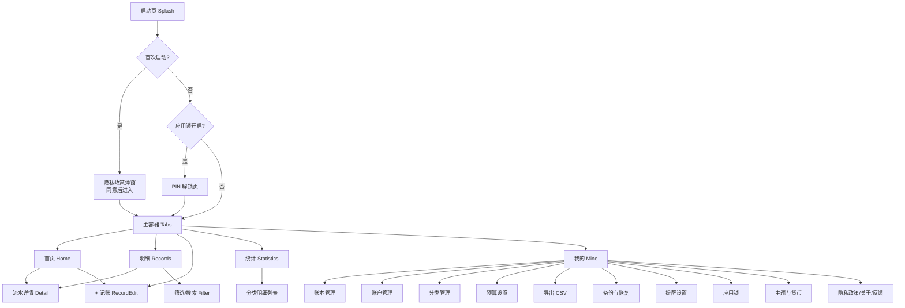
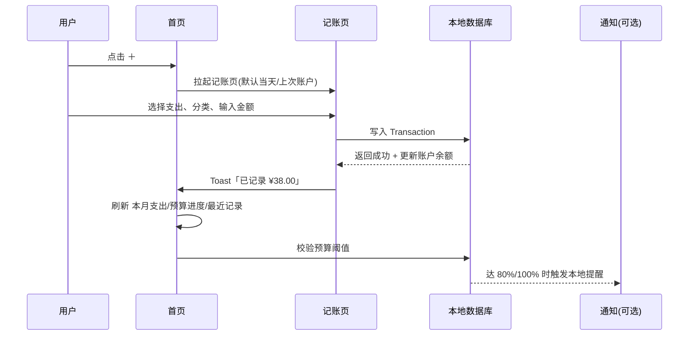
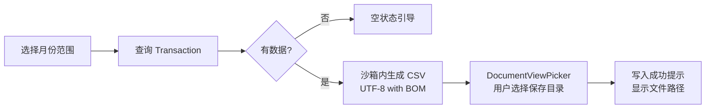

# 轻账本 · 生活账本（HarmonyOS NEXT）产品需求文档 PRD

| 项目 | 内容 |
|---|---|
| 文档语言 | 中文 |
| **文档版本** | **v1.1（🔒 已冻结 / FROZEN）** |
| 编写人 | 许清楚（Product Manager） |
| 项目代号 | LifeLedger |
| **应用名称** | **轻账本**（唯一，已锁定） |
| 开发者主体 | 个人开发者 |
| 目标平台 | HarmonyOS NEXT，Stage 模型 |
| **SDK 版本** | `compatibleSdkVersion: "6.0.0(20)"` / `targetSdkVersion: "26.0.0"`（**两字段格式不同，见 6.4 R5**） |
| 技术栈 | ArkTS + ArkUI（声明式 UI），无第三方 SDK |
| 数据形态 | **纯本地存储**（零服务器、零网络请求、零账号） |
| **v1.0 权限** | **`requestPermissions` 完全为空（零权限）** |
| 工作目录 | `E:\workset\鸿蒙系统应用开发` |
| 交付目标 | 页面精美、功能丰富、可通过华为应用市场审核并上架 |

> ## 🔒 文档状态：**已冻结（v1.1）**
>
> 本版为定稿版，工程师正按 **8.1 v1.0 范围锁定清单**施工。**范围变动会直接造成返工**，因此：
>
> **变更规则**（除非发现**上架驳回风险**，否则不再修订）：
> 1. **只上调不削减** —— v1.0 锁定的 42 条 P0 + 3 项上调项，任何削减需 PM 与 team-lead 双方确认；
> 2. **合规 7 条不可裁剪** —— 3.9 章 F-9.1~F-9.7 在任何排期压力下都不得降级；
> 3. **唯一例外** —— 发现会导致**审核驳回**的问题（如违规文案、权限误用），可立即修订并同步全员。
>
> 冻结前已完成的决策：名称「轻账本」、个人开发者主体、SDK 版本、零权限口径、P0 42 条口径、「利息」分类改名 —— 详见 **9.2 决策表**。

---

## 1. 产品定位与目标

### 1.1 一句话定位

> **轻账本 —— 一个装在口袋里的私人账本：不开账号、不联网、不推送广告，打开就是一本干干净净的账。**

### 1.2 目标用户画像

| 画像 | 特征 | 核心诉求 | 场景 |
|---|---|---|---|
| **A. 月光族青年**（主力，25–30 岁，一二线城市白领） | 收入固定、支出碎片化、对"钱花哪了"无感 | 3 秒记一笔 + 月底看清流向 | 通勤、午饭后、睡前补记 |
| **B. 家庭财务管理者**（30–45 岁，多为女性） | 负责全家开销、房贷车贷教育支出 | 多账本（家庭/个人/孩子）、月度预算、超支预警 | 月末对账、规划下月预算 |
| **C. 自由职业 / 小商户**（25–40 岁） | 收支不规则、公私款混杂 | 多账本隔离、自定义分类、CSV 导出对账 | 开票、报税、结算 |
| **D. 隐私敏感型用户**（全年龄） | 反感注册、反感通讯录/相册权限申请、反感广告 | 数据只在本机、零权限、生物锁 | 全生命周期 |

> 说明：A/B 为拉新主力，C 提升功能深度，D 是口碑传播与差异化锚点。

### 1.3 差异化（核心卖点，必须贯穿全产品）

| 维度 | 市面主流记账 App 常见做法 | 轻账本 |
|---|---|---|
| 账号 | 强制手机号/微信注册才能用，换机迁数据靠云同步 | **无账号**，打开即用，卸载即走 |
| 数据 | 上传云端，隐私政策里写"会收集设备信息" | **纯本地**，不联网、不上传、不收集任何信息 |
| 广告 | 开屏广告 + 信息流广告 + 会员去广告 | **零广告、零 SDK、零埋点** |
| 权限 | 申请存储/电话/位置/通讯录 | **零敏感权限**（仅可选本地通知），图片/文件走系统 Picker |
| 体积与启动 | 动辄 60MB+，启动 2s+ | 目标 < 20MB，冷启动 < 1s（本地数据，无网络等待） |
| 离线 | 断网即部分功能不可用 | **100% 离线可用**（纯本地，天然离线） |

### 1.4 竞品速览（仅用于定位校准，不做深入分析）

| 竞品 | 优势 | 用户抱怨点（我们的机会） |
|---|---|---|
| 随手记 | 功能全面、老牌、场景深 | 广告多、强制云端同步、功能臃肿、老 UI |
| 鲨鱼记账 | 记账快、模板化、上手快 | 广告极多、不开会员看不了完整报表 |
| 钱迹 | 极简、无广告 | 功能偏薄、图表弱、无多账本 |
| 叨叨记账 | 有情绪价值（养宠物/记账聊天） | 偏娱乐、正经记账能力弱 |

**定位空白**：「**无广告 + 纯本地 + 功能够用且漂亮**」三者目前无人同时做到 —— 这就是轻账本的生存空间。

### 1.5 产品目标（3 条，正交）

1. **够快**：单笔记账路径 ≤ 3 次点击、≤ 10 秒完成，这是留存的首要指标。
2. **够好看**：卡片化 + 圆角 + 渐变主色 + 自绘图表，视觉品质对标商业级产品，首屏即可建立"这是个正经 App"的信任感。
3. **够安全可信**：纯本地 + 零权限 + 应用锁 + 可导出，让用户敢于把真实账目放进来，并通过华为市场合规审核。

---

## 2. 用户故事

| # | 用户故事（As a … I want … so that …） | 优先级 |
|---|---|---|
| US-1 | 作为一名上班族，我想要在付款后 3 秒内完成一笔记账，这样才不会因为嫌麻烦而放弃记账。 | P0 |
| US-2 | 作为一名月光族，我想要在首页一眼看到「本月已花/剩余可用/日均可用」，这样能实时控制消费冲动。 | P0 |
| US-3 | 作为家庭财务管理者，我想要设置月度总预算和分类预算，并在快超支时收到提醒，这样能提前刹车。 | P0 |
| US-4 | 作为记账用户，我想要查看月度收支环形图、分类排行和近 6 个月趋势，这样能知道钱都花在哪、趋势是变好还是变差。 | P0 |
| US-5 | 作为多账户用户，我想要管理现金/银行卡/支付宝/微信等多个账户并能相互转账，这样账目不会记错地方。 | P0 |
| US-6 | 作为小商户，我想要按时间/分类/账户/金额/关键词检索历史流水，这样对账时能立刻定位到某一笔。 | P0 |
| US-7 | 作为注重隐私的用户，我想要 App 不联网、不要任何账号，这样我不担心自己的消费数据被上传。 | P0 |
| US-8 | 作为记账用户，我想要一键把全部账目导出成 CSV 到手机文件夹，这样能在电脑上用 Excel 做进一步分析。 | P0 |
| US-9 | 作为换机用户，我想要把数据备份成一个文件并手动恢复，这样换手机不会丢账。 | P1 |
| US-10 | 作为健忘用户，我想要设置每天 21:30 的记账提醒，这样不会漏记。 | P1 |
| US-11 | 作为隐私敏感用户，我想要给 App 加数字密码锁（可选生物解锁），这样别人拿到手机也看不到我的账。 | P1 |
| US-12 | 作为小商户，我想要维护多个账本（个人/店铺/装修），账目互不干扰，统计数据各自独立。 | P1 |
| US-13 | 作为用户，我想要自定义分类名称和图标，并且给每笔账拍一张凭证照片，这样账目可追溯。 | P1 |
| US-14 | 作为夜间使用用户，我想要深色模式和跟随系统主题，这样晚上记账不刺眼。 | P1 |
| US-15 | 作为长期用户，我想要查看同比/环比（本月 vs 上月 vs 去年同期），这样能判断消费是否真的在改善。 | P2 |

---

## 3. 需求池（P0 / P1 / P2）

> **统一的本地可行性约束**：每条需求均已通过"纯本地能否实现"检验。凡需网络、账号、云端、第三方 SDK 的一律不纳入（或标注为明确不做）。

### 3.1 记账主流程

| ID | 需求 | 说明 | 级别 |
|---|---|---|---|
| F-1.1 | 快速记账 | 首页悬浮/中置"+"按钮 → 记账页，默认当天、默认上次使用的账户与分类 | P0 |
| F-1.2 | 自绘数字键盘 | 计算器式键盘（0-9、.、+ -、退格、完成），支持连续运算（如 12+8+5） | P0 |
| F-1.3 | 支出 / 收入切换 | 顶部 Tab 切换，切换时键盘主色与分类列表同步变化 | P0 |
| F-1.4 | 转账 | 从一个账户转出到另一账户，生成一对关联流水，不计入收支统计 | P0 |
| F-1.5 | 分类体系 | 内置支出分类（餐饮/交通/购物/居住/娱乐/医疗/教育/人情/通讯/日用/其他，共 11 类）、收入分类（工资/兼职/**利息**/红包/报销/其他，共 6 类），带图标与色值 | P0 |
| F-1.6 | 分类自定义 | 增删改分类、选图标（内置图标集）、选颜色、拖动排序、隐藏内置分类 | P1 |
| F-1.7 | 二级分类 | 支持父子分类（如 购物 > 服饰 / 数码），统计时支持一二级切换口径 | P2 |
| F-1.8 | 备注 | 单行文本，上限 100 字 | P0 |
| F-1.9 | 图片凭证 | 通过**系统 PhotoViewPicker** 选择（**免权限**），裁剪压缩后存入应用沙箱，最多 3 张/笔，支持缩略图查看 | P1 |
| F-1.10 | 日期时间选择 | 默认当前，可回溯到任意日期（含补记），不可选未来（可配置开关） | P0 |
| F-1.11 | 记账后 Toast 与快捷连续记账 | 保存后提示"已记录"，提供"再记一笔"按钮 | P1 |
| F-1.12 | 常用分类置顶 | 按使用频次自动排序，把用户高频分类排在前面 | P2 |
| F-1.13 | 模板 / 常用金额 | 保存常用账目模板，一键重复记账（如每月房租） | P2 |

> **⚠️ 命名修订记录（R1，已定稿）**：F-1.5 收入分类原写作「理财」，与 F-9.6「禁用金融业务表述」直接冲突（华为审核存在机器扫描，分类名命中「理财」属于可被驳回的场景）。现**统一改为「利息」**——语义仍覆盖"存款产生的进账"，但属中性描述词，不构成金融业务表述。该分类在 `CategoryPresets` 单点定义，改名零成本。
> **连带要求**：分类名、账户名、字段名、备注默认值、Toast 文案、空状态文案**全部适用 F-9.6 禁用词规则**，不得只检查页面标题。

### 3.2 多账本与账户管理

| ID | 需求 | 说明 | 级别 |
|---|---|---|---|
| F-2.1 | 多账户 | 内置类型：现金、借记卡、信用卡、支付宝、微信、其他；可自定义名称/图标/颜色 | P0 |
| F-2.2 | 期初余额 | 每个账户可设期初余额；总资产 = Σ 账户余额（含期初 + 流水） | P0 |
| F-2.3 | 账户余额实时联动 | 每次记账/转账后自动更新对应账户余额 | P0 |
| F-2.4 | 信用卡额度管理 | 可设信用额度、账单日、还款日，首页显示可用额度 | P2 |
| F-2.5 | 多账本 | 支持创建多个账本（个人/家庭/店铺），账本间数据隔离，可切换 | P1 |
| F-2.6 | 账本切换 | 首页顶部账本切换器（下拉/横向标签），全局生效 | P1 |
| F-2.7 | 账户归档 | 不常用账户可归档（保留历史，不计入总资产） | P2 |
| F-2.8 | 账户流水查看 | 进入某账户可只看该账户流水与余额变化 | P2 |
| **F-2.9** | **首次启动预置「现金」账户** | **首次启动自动创建 1 个默认账户「现金」（期初余额 0），确保用户装完即可记账，无需先进设置页建账户** | **P0** |

> **F-2.9 决策说明**：本条为新增。原设计 v1.0 只预置分类不预置账户，代价是用户首次记账前必须先进「我的 → 账户管理」建账户，直接破坏 US-1「3 秒记一笔」的核心体验，且首次启动空账户会影响审核对"功能完整性"的观感。预置 1 个「现金」账户是零成本解法，用户后续可随时改名/归档/新增其他账户。

### 3.3 预算管理

| ID | 需求 | 说明 | 级别 |
|---|---|---|---|
| F-3.1 | 月度总预算 | 设置每月总支出预算，可按月设置或设为"每月沿用" | P0 |
| F-3.2 | 分类预算 | 为餐饮/交通/购物等设置独立预算额度 | P1 |
| F-3.3 | 预算进度展示 | 首页顶部环形/条形进度 + 剩余可用 + 日均可用（剩余预算 ÷ 剩余天数） | P0 |
| F-3.4 | 超支预警 | 支出达预算 80% 黄色预警、100% 红色超支，颜色与文案提示 | P0 |
| F-3.5 | 预算周期起日 | 支持自定义每月账期起始日（1 号 / 发薪日） | P2 |
| F-3.6 | 预算结转 | 本月结余可结转到下月（可选） | P2 |

### 3.4 统计与可视化（全部 Canvas 自绘，不引入图表库）

| ID | 需求 | 说明 | 级别 |
|---|---|---|---|
| F-4.1 | 月度收支概览 | 本月支出 / 收入 / 结余 三个数字卡 | P0 |
| F-4.2 | 分类环形图 | 本月支出（或收入）按分类占比的环形图，中心显示总额，点击扇区查看该分类明细 | P0 |
| F-4.3 | 分类排行榜 | 分类横向条形排行（图标 + 名称 + 金额 + 占比 + 条形） | P0 |
| F-4.4 | 趋势折线图 | 近 6 / 12 个月收支双折线，带月份切换与点击取值 | P1 → **v1.0 实施** |
| F-4.5 | 收支日历热力图 | 当月每日支出用色块深浅呈现，点击某天看当天流水 | P2 |
| F-4.6 | 同比环比 | 本月 vs 上月（环比）、本月 vs 去年同期（同比），带升降箭头与百分比 | P2 |
| F-4.7 | 账户分布 | 各账户余额占比图 | P2 |
| F-4.8 | 统计区间切换 | 本月 / 上月 / 本年 / 自定义区间 | P1 |

> **F-4.4 优先级上调说明（已定稿）**：趋势折线图原定 P1，现**纳入 v1.0 实施**。理由：①「页面精美」是本项目既定硬目标，统计页只有环形图 + 排行榜而无趋势图，视觉完整度与竞品差距明显；② 图表组件层已在 v1.0 为环形图/条形图抽象完毕，折线图属同层增量，边际成本低。此为**范围上调，非削减**，其余 P1 项维持原定版本。

### 3.5 检索与筛选

| ID | 需求 | 说明 | 级别 |
|---|---|---|---|
| F-5.1 | 流水列表 | 按日期倒序、按天分组，每天显示该日合计支出/收入 | P0 |
| F-5.2 | 月份切换 | 顶部月份选择器，显示该月收支合计 | P0 |
| F-5.3 | 关键词搜索 | 搜索备注、分类名、账户名，实时过滤 | P0 |
| F-5.4 | 多维筛选 | 按分类（多选）/ 账户（多选）/ 类型（支出收入转账）/ 金额区间 / 时间区间 组合筛选 | P1 |
| F-5.5 | 筛选结果统计 | 筛选后顶部显示"共 N 笔，支出 X，收入 Y" | P1 |
| F-5.6 | 流水详情 | 点击查看详情（金额、分类、账户、时间、备注、图片、所属账本） | P0 |
| F-5.7 | 编辑 / 删除流水 | 详情页可编辑或删除，删除需二次确认；删除转账时同步删除配对流水 | P0 |
| F-5.8 | 长按批量删除 | 列表长按进入多选模式 | P2 |

### 3.6 数据导出、备份与恢复

| ID | 需求 | 说明 | 级别 |
|---|---|---|---|
| F-6.1 | CSV 导出 | 一键导出全部或指定月份流水为 CSV（UTF-8 BOM，兼容 Excel），通过 **DocumentViewPicker 保存到用户指定目录**（免权限） | P0 |
| F-6.2 | CSV 字段 | 日期、时间、类型、金额、分类、一级分类、账户、备注、账本 | P0 |
| F-6.3 | 本地备份 | 导出加密/明文备份文件（JSON + 图片 zip 或单一备份文件）到用户目录 | P1 |
| F-6.4 | 恢复 | 从备份文件恢复，恢复前提示"将覆盖当前数据"并二次确认 | P1 |
| F-6.5 | 清空数据 | 一键清空全部数据，二次确认 + 输入确认 | P1 |
| F-6.6 | 自动本地备份 | 每月首次打开时自动在沙箱生成一份备份（不上传） | P2 |

### 3.7 设置与个性化

| ID | 需求 | 说明 | 级别 |
|---|---|---|---|
| F-7.1 | 主题与深色模式 | 浅色 / 深色 / 跟随系统 | P1 |
| F-7.2 | 货币符号 | ¥ / $ / € / £ 等，千分位与两位小数格式 | P1 |
| F-7.3 | 记账提醒 | 每日定时本地提醒（reminderAgentManager），可设时间、开关；**需 PUBLISH_AGENT_REMINDER** | P1 |
| F-7.4 | 应用锁 | 4/6 位数字 PIN，冷启动或后台返回时校验（PIN 存本地哈希，零权限） | P1 |
| F-7.5 | 生物解锁 | 可选开启指纹/面容解锁（申请 ACCESS_BIOMETRIC，用户可在系统里拒绝） | P2 |
| F-7.6 | 首页模块自定义 | 首页卡片顺序可调整、可隐藏 | P2 |
| F-7.7 | 隐私政策与用户协议 | 设置页 + 首次启动弹窗双入口 | P0 |
| F-7.8 | 客服反馈邮箱 | 设置页提供反馈邮箱入口（**审核必需**） | P0 |
| F-7.9 | 关于页 | 版本号、功能说明、开源许可声明、无网络声明 | P0 |
| F-7.10 | 语言 | 简体中文（可预留多语言结构） | P0 |
| F-7.11 | 图标/启动页 | 符合华为图标规范的 512×512 图标 + 简洁启动页 | P0 |

### 3.8 首页体验

| ID | 需求 | 说明 | 级别 |
|---|---|---|---|
| F-8.1 | 资产总览卡 | 总资产、总负债（信用卡）、净资产 | P0 |
| F-8.2 | 本月结余卡 | 本月收入 / 支出 / 结余 | P0 |
| F-8.3 | 预算进度卡 | 环形进度 + 剩余 + 日均可用 | P0 |
| F-8.4 | 快捷记账入口 | 中置悬浮"+"按钮 + 长按可跳特定类型 | P0 |
| F-8.5 | 最近流水 | 首页展示最近 5 条，点击进入明细页 | P0 |
| F-8.6 | 空状态引导 | 无数据时展示引导卡片（"记下第一笔"），不要空白页 | P0 |

### 3.9 合规相关功能（直接影响过审，按 P0 对待）

| ID | 需求 | 说明 | 级别 |
|---|---|---|---|
| F-9.1 | 首次启动隐私弹窗 | 首次进入必须弹出《隐私政策》摘要 + 全文链接 + 同意按钮；不同意则退出 | P0 |
| F-9.2 | 零权限设计 | **v1.0 实现 `requestPermissions` 完全为空**；图片与文件一律走系统 Picker（详见 6.1） | P0 |
| F-9.3 | 无网络声明 | 隐私政策与关于页明确写入"本应用不联网、不收集、不上传任何数据" | P0 |
| F-9.4 | 无广告无 SDK | 不接入任何广告、统计、推送、分享、支付 SDK | P0 |
| F-9.5 | 文案合规 | 全局禁用"最/第一/国家级/顶级/极致/首选/唯一"等绝对化用语（详见下方适用范围与豁免） | P0 |
| F-9.6 | 无金融业务表述 | 禁用"理财、投资、基金、股票、借贷、收益、返利、提现、保本"等可能触发金融资质要求的词（详见下方适用范围与豁免） | P0 |
| F-9.7 | 分级信息如实填写 | 无 UGC、无支付、无位置、无社交 → 申请 3+ | P0 |

**F-9.5 / F-9.6 的适用范围（避免团队漏查或过度自我审查）**

| 必须检查的位置 | 说明 |
|---|---|
| 应用名称、一句话简介、关键词 | 上架前必查，命中率最高 |
| 应用详情页长描述、更新说明 | 同上 |
| 截图内文案 | 含截图上的营销贴纸 |
| 界面文案 | 标题、按钮、Toast、空状态、引导语、关于页 |
| **分类名 / 账户名 / 字段名** | **易漏项**，本次「理财」分类即命中此处 |
| 备注默认值、示例数据 | 易漏项 |

**豁免说明（以下不算违规，无需改）**

- **序数/数量词用法**：如"记下第一笔""最近 5 条""第 1 个账本"，属描述性用法，非《广告法》禁止的比较性宣称，允许。
- **中性金融描述词**：如"利息""余额""账单""还款日""信用额度"，描述用户已有账目的客观属性，不构成金融业务经营表述，允许（F-1.5 改「利息」正是依据此条）。
- **本 PRD 第 6 章禁用词列表本身**：属内部规则文本，不会进入产品，无需修改。

**判断口诀**：**是否在宣称/推介一项金融服务？** 是 → 禁；只是在描述用户自己已经发生的钱款事实 → 可。

#### ⚠️ P0 条目统计（权威口径，以此为准）

| 章节 | P0 条数 | 明细 |
|---|---|---|
| 3.1 记账主流程 | 7 | F-1.1 / 1.2 / 1.3 / 1.4 / 1.5 / 1.8 / 1.10 |
| 3.2 多账本与账户 | 4 | F-2.1 / 2.2 / 2.3 / **2.9（新增预置现金账户）** |
| 3.3 预算管理 | 3 | F-3.1 / 3.3 / 3.4 |
| 3.4 统计与可视化 | 3 | F-4.1 / 4.2 / 4.3（另有 F-4.4 上调至 v1.0） |
| 3.5 检索与筛选 | 5 | F-5.1 / 5.2 / 5.3 / 5.6 / 5.7 |
| 3.6 导出备份恢复 | 2 | F-6.1 / 6.2 |
| 3.7 设置与个性化 | 5 | F-7.7 / 7.8 / 7.9 / 7.10 / 7.11 |
| 3.8 首页体验 | 6 | F-8.1 ~ F-8.6 |
| **3.9 合规相关功能** | **7** | **F-9.1 ~ F-9.7（全部）** |
| **合计** | **42** | — |

> **口径说明（R2）**：此前口头传达的"P0 共 30 条"为**错误数字**，真实为 **42 条**（41 条原 P0 + 新增 F-2.9）。排期与验收一律以本表 42 条为准。
> **特别提醒**：3.9 章 7 条合规需求**最容易被当作"非功能项"在排期时漏掉**，但这 7 条恰恰是决定能否上架的硬门槛，必须逐条验收（尤其是 F-9.1 隐私弹窗与 F-9.6 文案合规）。

### 3.10 明确不做（Out of Scope）

| 不做项 | 原因 |
|---|---|
| 云同步 / 账号系统 | 违反"纯本地"定位，且需 ICP/备案、隐私合规成本 |
| 网络请求（含检查更新） | 需 INTERNET 权限，需在隐私政策说明，增加审核风险 |
| 广告 / 统计埋点 / 推送 SDK | 增加审核风险与隐私负担 |
| 股票/基金/理财推荐 | 需金融资质，必被驳回 |
| 自动读取支付宝/微信账单 | 需读取通知栏或无障碍权限，高风险；改为用户手动导入 CSV（P2） |
| 应用内购买 / 会员体系 | 无账号体系，且与"免费无广告"定位冲突 |
| 社交分享排行榜 | 需 UGC 审核与内容安全机制 |

---

## 4. 数据模型草案（供架构师确认）

> 存储建议：关系型数据用 **relationalStore (RDB)**，配置项用 **Preferences**，图片与导出文件放**应用沙箱 filesDir**，跨应用读写一律走 **系统 Picker**。

| 实体 | 关键字段 | 说明 |
|---|---|---|
| `Ledger` 账本 | id, name, icon, color, currency, isDefault, sortOrder, createdAt | 顶层隔离单位 |
| `Account` 账户 | id, ledgerId, name, type(现金/借记卡/信用卡/支付宝/微信/其他), icon, color, initialBalance, creditLimit, isArchived, sortOrder | 余额可计算亦可冗余 |
| `Category` 分类 | id, ledgerId, name, type(支出/收入), parentId, icon, color, sortOrder, isSystem, isHidden, useCount | 支持二级 |
| `Transaction` 流水 | id, ledgerId, type(支出/收入/转账), amount, accountId, toAccountId, categoryId, note, imagePaths[], txDate, createdAt, updatedAt | 核心表，按 txDate 建索引 |
| `Budget` 预算 | id, ledgerId, month(yyyy-MM), totalAmount, items[{categoryId, amount}], carryOver | 按月 |
| `Setting` 设置 | theme, currency, monthStartDay, reminder{enabled,time}, appLock{pinHash,enabled,biometric}, lastAccountId, lastCategoryId | Preferences |
| `TransferLink` | 转账一对流水可用 `relatedTxId` 字段在同一张表内互指，无需独立表 | 简化 |

**注意事项**
- 金额统一用 **整数分（int64）** 存储，避免浮点精度问题；展示时 ÷100。
- 时间用 UTC 毫秒时间戳 + 本地时区格式化。
- 数据库需带 `schemaVersion` 与升级迁移逻辑（首次即设计好，避免后续升级丢数据）。

---

## 5. UI / UX 设计稿

### 5.1 设计语言

| 项 | 规范 |
|---|---|
| 整体风格 | 现代简约 + 卡片化 + 大圆角 + 轻阴影；信息密度中等，留白充足 |
| 主色 | 品牌渐变 `#5B67F5 → #8B5CF6`（蓝紫），用于主按钮、进度环、强调数字 |
| 支出色 | `#F5544B`（红系，符合中国用户"支出=红"直觉） |
| 收入色 | `#12B76A`（绿系），饱和度压低以与蓝紫主色协调，避免刺眼 |
| 中性色 | 背景 `#F5F6FA` / 卡片 `#FFFFFF` / 主文本 `#1A1C25` / 次文本 `#8A8F9E` / 分割线 `#EEF0F5` |
| 深色模式 | 背景 `#12141A` / 卡片 `#1C1F27` / 文本 `#EDEEF2`；支出 `#FF6B61`、收入 `#3DDC97` |
| 圆角 | 卡片 16vp，按钮 12vp，小标签 8vp，全屏弹层顶部 24vp |
| 字体 | 数字使用等宽数字（避免金额跳动），标题 17fp/中粗，正文 14fp，辅助 12fp |
| 阴影 | `shadow: 0 2vp 8vp rgba(0,0,0,0.06)`，深色模式改用 1vp 描边替代阴影 |
| 图标 | 线性图标为主，2vp 描边，与色值系统一一对应（分类图标库 ≥ 60 个） |
| 动效 | 页面切换 250ms 淡入位移；数字滚动 400ms；进度环绘制 600ms ease-out |
| 适配 | 支持深色、大字体（跟随系统字体缩放）、横屏用锁定竖屏（记账类竖屏体验更优） |

### 5.2 信息架构与导航



**导航方式**：底部 5 Tab（首页 / 明细 / + / 统计 / 我的），中间"+"为功能按钮（非页面），点击全屏拉起记账页。层级不超过 3 层，设置类页面一律从「我的」进入。

### 5.3 页面逐页设计（ASCII 线框 + 说明）

#### P1 · 首页（Home）

```
┌──────────────────────────────────────┐
│ 9:41                    🔔       ⋯   │  状态栏
├──────────────────────────────────────┤
│ ▼ 个人账本  ▸          净资产         │  账本切换器
│   ┌──────────────────────────────┐   │
│   │  总资产                        │   │
│   │  ¥ 28,460.50          👁      │   │  渐变主色大卡
│   │  信用卡欠款 -¥ 1,200.00        │   │  右上角眼睛=金额隐藏
│   └──────────────────────────────┘   │
│                                      │
│   ┌──────────────────────────────┐   │
│   │ 2026年5月          本月结余   │   │
│   │ 支出 4,320.00  收入 9,000.00  │   │
│   │ ███████████░░░░░  +4,680.00   │   │  条形：红=支出 绿=收入
│   └──────────────────────────────┘   │
│                                      │
│   ┌──────────────────────────────┐   │
│   │      ╭───╮   预算 5,000.00    │   │
│   │      │86%│   已用 4,320.00    │   │  环形进度
│   │      ╰───╯   剩余   680.00    │   │  <10% 变红
│   │   日均可用 ¥ 89.00（剩 8 天）  │   │
│   └──────────────────────────────┘   │
│                                      │
│   最近记录               查看全部 >   │
│   ┌──────────────────────────────┐   │
│   │ 🍜 餐饮   -38.00   今天 12:30 │   │
│   │ 🚇 交通    -6.00   今天 08:12 │   │
│   │ 💰 工资 +9,000.00  昨天 10:00 │   │
│   └──────────────────────────────┘   │
│                                      │
│              ┌────┐                  │
│              │ ＋ │                  │  悬浮记一笔
│              └────┘                  │
├──────────────────────────────────────┤
│  首页     明细     ＋     统计    我的 │  底部 Tab
└──────────────────────────────────────┘
```

- 页面整体可上下滚动；顶部渐变区域随滚动轻微收缩。
- 金额支持一键隐藏（隐私友好，社交场景可用）。
- 空状态：无数据时，最近记录区替换为引导卡 —— "还没有记录，点下方 ＋ 记下第一笔"。

#### P2 · 记账页（RecordEdit，全屏拉起）

```
┌──────────────────────────────────────┐
│ ✕                       保存 ✓        │
├──────────────────────────────────────┤
│  [ 支出 ]  [ 收入 ]  [ 转账 ]          │  Tab，选中态主色
├──────────────────────────────────────┤
│              ¥ 0.00                   │  大号金额显示
├──────────────────────────────────────┤
│  🍜 🍔 🚇 🛒 🏠 🎮 💊 📚 🎁            │  分类宫格
│  餐饮 餐饮 交通 购物 居住 娱乐 医疗 教育 人情   │  4列 x 2行 + 更多
│  ─────────────────────────────────   │
│  💳 招商银行          2026-05-09 ▾    │  账户选择 + 日期
│  📝 备注：和同事吃午饭                  │
│  🖼  [+] 添加凭证图片（最多3张）         │
├──────────────────────────────────────┤
│   1    2    3     ⌫                   │
│   4    5    6     ＋                  │  自绘计算器键盘
│   7    8    9     －                  │
│   .    0   00    完成                  │
└──────────────────────────────────────┘
```

- 键盘实时显示输入表达式（如 12+8），点"完成"结算金额并保存。
- 转账态：隐藏分类，改为「从账户 → 到账户」双选择器，可填手续费（P2）。
- 保存后：Toast "已记录 ¥38.00" + 按钮"再记一笔"。

#### P3 · 明细页（Records）

```
┌──────────────────────────────────────┐
│  ‹ 2026年5月 ›          🔍  ⚙筛选     │  月份切换 + 搜索 + 筛选
├──────────────────────────────────────┤
│  支出 4,320.00   收入 9,000.00   结余 │  月度汇总条
├──────────────────────────────────────┤
│  今天                    收 0  支 44  │  按日分组头
│   🍜 餐饮  -38.00   招商银行  12:30   │
│   🚇 交通   -6.00   现金     08:12   │
│  昨天                    收 9,000     │
│   💰 工资 +9,000.00  招商银行 10:00   │
│  05-07 周三             支 128.50    │
│   🛒 购物 -128.50  支付宝  19:20      │
└──────────────────────────────────────┘
```

- 日期头文案：今天 / 昨天 / 月-日 周X。
- 左滑单条：编辑 / 删除（带确认）。
- 筛选面板：底部半屏抽屉，包含类型、分类多选、账户多选、金额区间、时间区间，底部"重置/确定"。

#### P4 · 统计页（Statistics）

```
┌──────────────────────────────────────┐
│  统计           [本月▾][支出▾]        │
├──────────────────────────────────────┤
│  支出 ¥4,320.00        ¥9,000.00 收入 │
│    ╭─────────╮                        │
│    │  ╭───╮  │   排名                 │
│    │  │环形│  │   ① 餐饮 1,860 43%    │  环形图 + 排行榜
│    │  ╰───╯  │   ② 购物 1,020 24%    │
│    ╰─────────╯   ③ 交通   640 15%    │
├──────────────────────────────────────┤
│  近 6 个月趋势                        │
│     支出 ─── 收入 ───                 │
│  ¥9,000 ┤      ╭╮                    │  折线图（Canvas）
│         │   ╭──╯╰──╮                 │
│  ¥4,000 ┼───╯      ╰──                │
│         12月 1月 2月 3月 4月 5月      │
├──────────────────────────────────────┤
│  环比   支出 ↑12%   收入 —            │
│  同比   支出  ↓8%   收入 ↑5%          │
└──────────────────────────────────────┘
```

- 环形图支持点击扇区 → 下钻到该分类流水列表。
- 趋势图支持点击拐点显示该月数值气泡。

#### P5 · 我的（Mine）

```
┌──────────────────────────────────────┐
│  我的                                 │
├──────────────────────────────────────┤
│  📒 账本管理        3 个账本      >   │
│  💳 账户管理        5 个账户      >   │
│  🏷 分类管理        12 个分类     >   │
│  🎯 预算设置        未设置        >   │
├──────────────────────────────────────┤
│  📤 导出 CSV                      >   │
│  💾 备份与恢复                    >   │
│  🔔 记账提醒        21:30 已开启  >   │
│  🔒 应用锁          已开启        >   │
├──────────────────────────────────────┤
│  🎨 主题 / 深色模式  跟随系统      >   │
│  💱 货币符号        ¥ CNY         >   │
├──────────────────────────────────────┤
│  🔐 隐私政策                      >   │
│  📜 用户协议                      >   │
│  ✉️ 意见反馈（邮箱）               >   │
│  ℹ️ 关于轻账本  v1.0.0            >   │
└──────────────────────────────────────┘
```

- 「关于」页必须显著展示：**「本应用完全离线运行，不收集、不上传任何用户数据」**。

#### P6 · 其他页面要点

| 页面 | 要点 |
|---|---|
| 启动页 | 品牌 Logo + 名称，无广告位，≤ 1s 后自动进入（首次触发隐私弹窗） |
| 隐私弹窗 | 不可跳过；摘要 4 条 + 《隐私政策》全文链接 + 「同意并继续」（主色）/「不同意并退出」（次要按钮，必须真实可用） |
| PIN 锁 | 大圆点输入；连续错误 5 次后进入 30 秒等待（次数与截止时间持久化，后台切换或重启不清除），校验成功后清零；纯本地工具，等待不涉及账号或联网。底部提供"忘记密码"→ 提示需清空数据恢复（明确告知，避免纠纷） |
| 账户管理 | 列表 + 余额，右上角新增；长按拖动排序；左滑归档/删除（有流水时禁止删除，提示先归档） |
| 分类管理 | 支出/收入 Tab + 图标宫格 + 颜色选择 + 拖动排序 + 新增 |
| 预算设置 | 总预算输入框 + 分类预算列表（开关式），底部"保存" |
| 导出 | 选择月份/全部 → 生成 CSV → 系统保存面板 → 提示保存路径 |

### 5.4 关键交互流程





### 5.5 异常与边界

| 场景 | 处理 |
|---|---|
| 无数据 | 全站空状态插画 + 引导按钮，禁止白屏 |
| 金额输入非法（空/0/超长） | 保存按钮置灰 + 提示文案 |
| 账户余额为负 | 允许（如信用卡），红色显示 |
| 删除有转账关联的记录 | 同步删除配对记录，提示"将同时删除对应转账记录" |
| 恢复备份 | 二次确认 + 覆盖警告 + 恢复进度 |
| 存储不足 | 捕获写入异常，提示"存储空间不足" |
| 大字体/深色切换 | 全量适配，不允许出现文字截断或对比度不足 |

---

## 6. 合规与上架约束（重点章节）

> 本章为**硬约束**。任何与之冲突的设计一律以本章为准。

### 6.1 权限清单

| 权限 | 是否申请 | 用途 | 说明 |
|---|---|---|---|
| `ohos.permission.PUBLISH_AGENT_REMINDER` | **可选（P1）** | 每日记账提醒（后台代理提醒） | 仅在用户主动开启提醒前申请；拒绝不影响其他功能 |
| `ohos.permission.ACCESS_BIOMETRIC` | **可选（P2）** | 应用锁的指纹/面容解锁 | 可关闭；默认使用 PIN 锁（零权限） |
| `ohos.permission.INTERNET` | **绝对禁止** | — | 一旦申请，隐私政策需说明联网用途，与"纯本地"定位冲突 |
| `ohos.permission.GET_NETWORK_INFO` | **绝对禁止** | — | 同上 |
| `ohos.permission.READ_IMAGEVIDEO` / `WRITE_IMAGEVIDEO` | **绝对禁止** | — | 改用 **PhotoViewPicker**（系统选择器，免权限） |
| `ohos.permission.READ_WRITE_DOWNLOAD_DOCUMENT` 等文件权限 | **绝对禁止** | — | 改用 **DocumentViewPicker**（保存/打开面板，免权限） |
| `ohos.permission.CAMERA` | **绝对禁止** | — | 拍照凭证通过 PhotoViewPicker 调用系统相机完成，免权限 |
| `ohos.permission.LOCATION` / `APPROXIMATELY_LOCATION` | **绝对禁止** | 无关 | — |
| `ohos.permission.READ_CONTACTS` / `READ_CALENDAR` / `MICROPHONE` | **绝对禁止** | 无关 | — |
| `ohos.permission.DISTRIBUTED_DATASYNC` | **绝对禁止** | 无关 | 会引发"数据跨设备传输"质疑 |
| 设备标识符（OAID/AAID/UDID）获取 | **绝对禁止** | 无关 | 无广告无统计，不应获取 |

**目标（已升级，R3）：`module.json5` 中 `requestPermissions` 数组 —— v1.0 做到完全为空。**

> **为什么 v1.0 能拿到"完全为空"**（比原定目标更强）：
> - 记账提醒 F-7.3 属 P1，不在 v1.0 范围 → 不需要 `PUBLISH_AGENT_REMINDER`
> - 生物解锁 F-7.5 属 P2，且 v1.0 应用锁用 **PIN 码**（本地哈希校验）实现 → 不需要 `ACCESS_BIOMETRIC`
> - 图片凭证 F-1.9 与 CSV 导出 F-6.1 均通过**系统 Picker**（PhotoViewPicker / DocumentViewPicker）完成 → 不需要任何存储/媒体/相机权限
>
> **"零权限"是本产品最强的过审与口碑资产**，必须在下列位置作为核心卖点明示：
> ① 应用市场一句话简介；② 隐私政策开篇；③ 关于页；④ 应用详情页长描述首段；⑤ 截图首张（如加文案贴纸，措辞须为陈述句"不申请任何权限"，不得含绝对化用语）。
>
> **后续版本红线**：v1.1 若引入记账提醒，将首次出现权限申请。届时必须：① 场景化申请（用户主动打开提醒开关时才弹窗，不得冷启动即申请）；② 拒绝后 App 全功能仍可用；③ 同步更新隐私政策并在 AGC 重新托管。**不得为了保住"零权限"卖点而永久砍掉用户价值明确的功能** —— 卖点可以升级为"默认零权限，仅在你主动开启提醒时申请通知权限"。

### 6.2 隐私政策要求（必须逐条满足）

隐私政策需包含以下**必备条款**（建议同时在应用内与 AppGallery Connect 隐私声明托管处配置一致）：

1. **开篇明示**：「本应用**不收集、不上传、不共享**任何用户个人信息。」
2. **存储说明**：所有账目、账户与设置数据仅保存在**本机应用沙箱目录**，卸载应用即删除。
3. **网络说明**：「本应用**不发起任何网络请求**，不需要网络权限，可完全离线使用。」（并可加一句"这是刻意设计，不是缺陷"）
4. **权限说明（⚠️ 按 R3 口径写）**：明确写入「**本应用不申请任何系统权限**」。
   - **v1.0**（requestPermissions 为空）：不得以"逐条列出所申请权限"的口吻暗示存在权限申请；应写「本应用不申请通讯录、位置、存储、相机、麦克风、电话等任何权限，也不会获取任何设备标识符」。
   - **v1.1+**（若引入记账提醒）：改为逐条列出，说明用途与"拒绝后 App 全功能仍可正常使用"。
   - ⚠️ **严禁出现"我们尊重您的隐私，因此只申请必要权限"这类话术** —— 在零权限前提下属自相矛盾，且与 AGC 隐私声明托管勾选不一致会直接触发驳回。
5. **第三方 SDK**：明确声明「本应用**未接入任何第三方 SDK**（无广告、无统计、无推送、无支付）」。
6. **未成年人**：产品面向 3 岁以上；不针对未成年人定向收集信息。
7. **用户权利**：用户可在「我的 → 清空数据」随时删除全部本地数据；导出的数据由用户自行保管。
8. **联系方式**：提供有效的**客服邮箱**（审核会核验），并在设置页「意见反馈」可直接跳转。
9. **政策更新**：说明更新时会在应用内提示。
10. **呈现方式**：首次启动弹窗（不可跳过、默认不勾选同意）+ 设置页常驻入口，两者内容一致。
11. **一致性要求（新增）**：应用内隐私政策、**AGC 隐私声明托管勾选**、`module.json5` 实际权限声明、**代码里是否真的没调用任何网络/权限 API** —— 这四处必须完全一致。审核会交叉核验，任一处不一致即驳回。

> **待办 A3**：隐私政策文本需按上述第 4 条 R3 口径撰写（原设想含 PUBLISH_AGENT_REMINDER 说明，v1.0 不适用）。

> 另需一份《用户协议》（或使用条款），内容侧重免责：本应用为工具，数据由用户自行录入与保管，因设备丢失/卸载导致数据损失由用户承担（建议用户定期导出备份）。

### 6.3 华为应用市场审核常见驳回点规避

| # | 驳回点 | 规避措施 | 责任环节 |
|---|---|---|---|
| 1 | **功能不完整 / 空壳 / 仅有 WebView** | 全部功能原生实现，无 H5 页面；上传前自测全功能路径 | 开发/QA |
| 2 | **权限与功能不匹配 / 过度索取权限** | 零权限或仅 1 项；权限申请场景化（用户点开提醒开关时才弹） | 开发/QA |
| 3 | 隐私政策缺失或与实际行为不符 | 首次启动弹窗 + 设置页入口 + 内容与实际零收集一致 | PM/开发 |
| 4 | 未声明/未托管隐私声明 | 在 AppGallery Connect 完成隐私声明托管，与应用内一致 | 上架 |
| 5 | 缺少客服/反馈渠道或邮箱无效 | 设置页邮箱入口 + 上架资料填写真实有效邮箱 | PM |
| 6 | **应用名称含绝对化用语或侵权** | 名称不含"最、第一、顶级、极致、首选、国家级、唯一"；避开"随手记""挖财""钱迹"等已注册商标 | PM |
| 7 | 截图与实际应用不符 / 含边框水印 / 含竞品或"华为"字样 | 用真机实拍当前版本界面；不加边框、不加营销文案贴纸；至少 5 张 | QA/PM |
| 8 | 图标不合规（尺寸、圆角、透明、含品牌字样） | 512×512 PNG，按官方图标规范提供（含分层前景/背景），不含透明与阴影 | 设计 |
| 9 | **诱导行为**（诱导好评、诱导分享、诱导下载） | 不出现"好评送会员""分享解锁报表"等任何诱导 | PM |
| 10 | 含违规 SDK（广告、热更新、私自收集） | 零第三方 SDK，构建产物需自查 | 开发 |
| 11 | 应用分级评估不实 | 如实填写：无 UGC、无社交、无支付、无位置、无不良内容 → 3+ | PM |
| 12 | **文案涉金融资质** | 全局禁用"理财、投资、基金、股票、借贷、收益、返利、提现、保本" | PM/QA |
| 13 | 启动页开屏广告 / 强制跳转 | 无开屏广告，启动页 ≤ 1s 自动进入 | 开发 |
| 14 | 强制注册 / 不登录不可用 | 无账号体系，打开即用 | PM |
| 15 | 应用闪退 / 崩溃 / 兼容性问题 | 真机全流程回归 + 冷启动/低内存/旋转/深色场景测试 | QA |
| 16 | 元服务/应用描述中的功能未实现 | 应用描述只写已实现功能，不上架"即将推出" | PM |
| 17 | 版本号/版本名不规范 | versionCode 递增正整数，versionName 语义化（1.0.0） | 开发 |
| 18 | 未提供软件著作权等资质 | 上架前完成软著申请（个人开发者亦可申请，约 30 天） | 项目 |
| 19 | 自适应布局问题（折叠屏/平板/大字体） | 至少适配手机直板；大字体下不截断；声明支持设备类型 | 开发/QA |

### 6.4 应用基本信息建议

> **本节已锁定（R4）**：名称「轻账本」为用户拍板结果，SDK 版本为架构师定稿结果。以下为唯一事实源。

| 项 | **定稿值** | 备注 |
|---|---|---|
| **中文名称** | **「轻账本」**（唯一，不再有候选） | 用户已从候选中选定。不含绝对化用语。**上架前仍需做商标与市场查重**，须避开已注册商标：「随手记」「挖财」「钱迹」等；若查重不通过则回退讨论备选 |
| 英文/包名 | `com.<devname>.lifeledger` | 包名一经上架不可改，需慎重 |
| 一句话简介（≤ 40 字） | **「纯本地记账本：不联网、零权限、无广告，快速记一笔，看清钱花在哪。」** | 首句即打差异化。**已将「零权限」写进简介**（v1.0 requestPermissions 完全为空，是本产品最强卖点）。原「3 秒记一笔」改为「快速记一笔」，规避量化功效宣称风险 |
| 分类 | 财务 / 记账 | 选"财务"大类下的记账工具 |
| 关键词 | 记账、账本、记账本、预算、消费记录、日常开支、存钱、账单、生活记账、离线记账 | 8–10 个，避免堆砌竞品品牌词 |
| 年龄分级 | **3+** | 无 UGC、无支付、无位置、无社交 |
| 支持设备 | 手机（HarmonyOS NEXT） | 首版只声明手机，降低适配风险 |
| **compatibleSdkVersion** | **`6.0.0(20)`** | 架构师定稿，覆盖约 99.62% 存量设备 |
| **targetSdkVersion** | **`26.0.0`** | 架构师定稿 |

> **⚠️ SDK 版本号格式坑（R5，架构师提供，务必照抄不要"对齐"）**
>
> `compatibleSdkVersion` 与 `targetSdkVersion` **两个字段的版本号书写格式不同**：
> - `compatibleSdkVersion` 沿用**旧格式**：`"6.0.0(20)"` —— **带括号的 API Level 后缀**
> - `targetSdkVersion` 自 API 26 起改用**语义化格式**：`"26.0.0"` —— **不带括号**
>
> **切勿因为"看起来不一致"而把两者写成同一格式**（例如都写成 `26.0.0` 或都写成 `6.0.0(20)`），会导致编译或兼容性判定异常。
> **验收检查项**：构建后需在模拟器与真机上各跑一次，确认无版本号相关编译告警。

### 6.5 上架前置材料清单

| 材料 | 状态 | 备注 |
|---|---|---|
| **开发者主体** | ✅ **个人开发者**（已定） | 用户拍板。个人实名认证即可，无需营业执照 |
| **软件著作权证书** | 🔴 **进行中，需用户今日启动** | **华为上架必需。本项目最长路径依赖，阻塞上架。**<br>常规软著：约 30–60 天；<br>加急可选 **APP 电子版权证书**：约 5–10 天（若赶时间建议走此路径，需确认华为认可该形式） |
| 应用名称查重 | 🟡 上架前执行 | 已定「轻账本」，仍须做商标与市场查重，避开「随手记」「挖财」「钱迹」等已注册商标 |
| 应用图标（512×512 + 分层） | 待设计 | 按官方规范，无透明无阴影 |
| 应用截图 ≥ 5 张 | 待产出 | 真机实拍；**首张建议体现"零权限"卖点**，措辞须为陈述句，不得含绝对化用语 |
| 隐私政策文本 + 托管 | 进行中 | 应用内与 AGC 一致；**权限章节按 R3 零权限口径撰写**（严禁出现"只申请必要权限"类话术） |
| 用户协议文本 | 待产出 | — |
| 客服邮箱 | 待确认 | 需真实可达，审核会核验 |
| 应用分级评估表 | 待填写 | 3+，逐项如实勾选 |

---

## 7. 非功能需求

| 类别 | 指标 |
|---|---|
| 性能 | 冷启动 < 1s；记账保存 < 100ms；统计页图表渲染 < 300ms；1 万条流水列表流畅滚动 |
| 稳定性 | 无崩溃；数据库操作全部 try-catch；异常统一兜底提示 |
| 体积 | 安装包 < 20MB（无第三方 SDK，目标 10MB 级） |
| 兼容性 | 手机直板竖屏；深色模式；系统字体缩放 100%–130% 不截断；至少 2 款真机验证 |
| 数据 | 金额用整数分存储；DB 版本化迁移；关键写入事务化 |
| 可维护 | 分层清晰（数据层 / 领域层 / UI 层），组件可复用，图表组件独立封装 |
| 国际化 | 首版仅简体中文，但文案统一抽取到资源文件，预留多语言 |

---

## 8. 版本规划与 v1.0 范围锁定

### 8.1 v1.0.0 范围锁定清单（已定稿，团队按此执行）

| 构成 | 内容 | 状态 |
|---|---|---|
| **P0 全量** | 第 3 章 **42 条**（含 3.9 合规 7 条、新增 F-2.9 预置现金账户） | ✅ 锁定 |
| **P1 上调项 ①** | F-7.1 主题与深色模式 | ✅ 锁定 |
| **P1 上调项 ②** | F-7.4 PIN 应用锁 | ✅ 锁定 |
| **P1 上调项 ③** | F-4.4 趋势折线图 | ✅ 锁定 |
| **预留不实现** | 多账本 UI（F-2.5 / F-2.6） | ⏸ 表结构预留 `ledger_id`（写入 id=1），UI 不开放 |
| **预留不实现** | F-1.9 图片凭证 | ⏸ 接口预留，v1.0 不做 |
| **预留不实现** | F-3.2 分类预算 | ⏸ 接口预留，v1.0 不做 |
| **v1.0 权限** | `requestPermissions` **完全为空** | ✅ 锁定 |

> **为什么上调这 3 项**：本项目硬目标是"页面精美 + 功能丰富"。深色模式、PIN 应用锁、趋势折线图三项均属**成本低但对首版观感与完整度影响显著**的项目；若 v1.0 统计页只有环形图而无趋势图，与市面同类产品视觉差距会被直接感知。

### 8.2 后续版本

| 版本 | 范围 | 目标 |
|---|---|---|
| v1.1.0 | 多账本 UI 开放、分类预算（F-3.2）、图片凭证（F-1.9）、备份恢复（F-6.3/6.4）、记账提醒（F-7.3）、多维筛选（F-5.4/5.5）、统计区间切换（F-4.8）、货币符号（F-7.2） | 差异化体验完善。**注：本版将首次出现权限申请（通知），须按 6.1 红线执行** |
| v1.2.0 | P2（日历热力、同比环比、信用卡额度、批量操作、自动备份、二级分类、模板记账、第三方账单 CSV 导入评估） | 功能深度 |

### 8.3 范围变更原则

1. **只上调不削减**：v1.0 已锁定的 42 条 P0 + 3 项上调项，任何削减都需 PM 与 team-lead 双方确认。
2. **新增需求先过两问**：纯本地能做吗？会不会引入权限/网络/SDK？任一答案为否 → 不做。
3. **合规 7 条不可裁剪**：3.9 章 F-9.1~F-9.7 在任何排期压力下都不得降级为"下个版本再说"。

---

## 9. 待确认问题与决策记录

### 9.1 仍待确认

**无。** 原 Q1 / Q2 / Q5 已由用户与架构师拍板，全部移入 9.2 决策表。

> 唯一遗留项是**执行类**而非决策类：**软著办理需用户今日启动**（见 6.5），以及**上架前应用名称商标查重**（见 6.4）。这两项均阻塞上架，需持续跟进，但不再需要产品侧决策。

### 9.2 已决策（团队已拍板，不再讨论）

| # | 原问题 | 决策 | 依据 |
|---|---|---|---|
| **Q1** | 开发者主体是个人还是企业？ | ✅ **个人开发者** | 用户拍板。个人实名认证即可 |
| **Q2** | App 最终名称？ | ✅ **「轻账本」**（唯一） | 用户从候选（壹本账/简记账/零花钱账本/天天记账本）中选定。上架前仍须商标查重 |
| **Q5** | 目标 API 版本？ | ✅ `compatibleSdkVersion: "6.0.0(20)"`、`targetSdkVersion: "26.0.0"` | 架构师定稿。**注意两字段格式不同，见 6.4 的 R5 格式坑** |
| Q3 | v1.0 是否包含深色模式与应用锁？ | **包含**（另加趋势折线图） | 见 8.1 范围锁定清单 |
| Q4 | 多账本是否进 v1.0？ | **表结构预留 `ledger_id` 写入 id=1，UI v1.1 放开** | 避免后期数据迁移 |
| Q6 | 是否做第三方账单 CSV 导入？ | **v1.2 再评估**，v1.0 只做导出 | 先保证导出链路稳定 |
| Q6b | 图片凭证 F-1.9、分类预算 F-3.2 | **v1.0 不做**，接口与表结构预留 | team-lead 拍板 |
| Q7 | 图表是否完全自绘？ | **是，Canvas 自绘，不引第三方图表库** | 零依赖、零审核风险、视觉统一 |
| Q8 | 是否适配平板/折叠屏？ | **首版只声明手机**，后续扩展 | 降低适配风险 |
| R1 | 「理财」分类命名冲突 | **改为「利息」** | 见 3.1 修订记录 |
| R2 | P0 数量口径 | **42 条**（非 30 条） | 见 3.9 统计表 |
| R3 | v1.0 权限目标 | **`requestPermissions` 完全为空** | 见 6.1 |
| **R4** | 应用名称与基本信息 | **「轻账本」锁定为唯一名称** | 用户拍板，见 6.4 |
| **R5** | SDK 版本号格式 | `compatibleSdkVersion: "6.0.0(20)"`、`targetSdkVersion: "26.0.0"`，**两字段格式不同，禁止对齐** | 架构师定稿，见 6.4 |

### 9.3 待办归属（随决策产生）

| # | 待办 | 责任方 | 状态 |
|---|---|---|---|
| A1 | 「零权限」卖点同步写入：一句话简介、隐私政策开篇、关于页、应用详情长描述、首张截图 | 寇豆码（工程）/ 齐活林（截图列入上架材料清单） | ✅ 一句话简介已完成（6.4）；余项随工程落地 |
| A2 | 上架前对全部用户可见文案做禁用词全量扫描（分类名、Toast、空状态文案、关于页、隐私政策全文） | 严过关（QA），**代码完成后派发专项扫描** | ⏳ 待代码完成 |
| A3 | 隐私政策按零权限口径重写权限章节 | 寇豆码（工程）已按纠正口径执行 | ✅ 已完成 |

---

## 10. 附：核心原则速查（给全体成员）

1. **任何功能先问一句：纯本地能不能做？** 不能做就不做。
2. **任何权限先问一句：有没有免权限的替代方案（Picker）？** 有就用替代方案。
3. **任何文案先问一句：是不是在宣称/推介一项金融服务？** 是就改（分类名、Toast、空状态文案都要查，不只查标题）。
4. **任何页面先问一句：空状态和异常态做了吗？** 没做就补。
5. **任何"少做一点"的念头先问一句：是不是 3.9 章的合规 7 条？** 是的话，一条都不能减。
6. **范围以 8.1 锁定清单为准**：P0 共 **42 条**，加上调 3 项；有疑问查 9.2 决策记录，不要靠印象。

---

## 变更记录

| 版本 | 日期 | 变更内容 | 来源 |
|---|---|---|---|
| v1.0 | — | 初版 PRD | PM |
| v1.1-rev1 | 架构评审后 | R1 收入分类「理财」→「**利息**」（合规冲突修复）；<br>R2 P0 数量口径更正为 **42 条**（原口头传达 30 条有误）；<br>R3 v1.0 权限目标升级为 `requestPermissions` **完全为空**；<br>新增 F-2.9 首次启动预置「现金」账户（P0）；<br>F-4.4 趋势折线图由 P1 上调至 v1.0；<br>新增 8.1 v1.0 范围锁定清单；<br>新增 9.2 决策记录；<br>6.2 隐私政策权限条款按 R3 重写；<br>6.4 一句话简介加入「零权限」并去掉「3 秒」量化宣称 | PM（架构师评审反馈） |
| **v1.1（冻结）** | 用户拍板后 | **R4** 应用名称锁定为唯一「轻账本」，保留上架前商标查重提示；<br>**R5** SDK 版本定为 `compatibleSdkVersion: "6.0.0(20)"` / `targetSdkVersion: "26.0.0"`，并记入"两字段格式不同、禁止对齐"的坑；<br>Q1 开发者主体定为**个人**；<br>6.5 上架材料清单更新为实际状态（软著 🔴 进行中为最长路径依赖）；<br>9.1 待确认清空，全部移入 9.2；<br>9.3 待办补全责任人与状态；<br>文档头部加「已冻结」状态与变更规则 | PM（用户 + 架构师拍板） |

**🔒 本版冻结。** 后续如需变更，走头部「变更规则」，并在此表追加记录。 |
